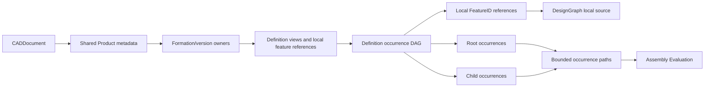

# Document Assembly

## Purpose and Scope

This component owns PARX.X2 source assembly definitions, shared occurrences,
nesting, and local coordinate systems. Parent: [CADIR](../DESIGN.md). No children.
An assembly references existing feature-owned local shapes; it does not own a
second B-rep source. Product attributes and general long-term topology reference
resolution remain outside this component.

## Responsibilities and Boundaries

`CADDocument.assembly` is the sole assembly source authority. The product/formation/definition graph owns three distinct persistent values.
A product owns its standard identifier, name and nullable description. A formation
owns its version identifier, nullable description and optional specified-source
subtype, and references one product. A definition owns its standard identifier
and nullable description, references one formation, and retains local body-producing
FeatureIDs and child occurrences. An occurrence has a persistent identity, a
definition reference, and an original proper-rigid or nonsingular affine placement into its containing frame.
Roots are occurrences in the document world frame. Reusing a definition retains
sharing; it never duplicates its feature source. A complete occurrence path,
rather than the final edge identity alone, identifies an expanded occurrence of
a shared nested assembly.

The feature graph owns local geometry and feature dependencies. Assembly source
validation owns structural references and finite original placement laws;
[Assembly Evaluation](../../CADKernel/AssemblyEvaluation/DESIGN.md) owns resolution
against live evaluated outputs and world topology. No synthetic feature node is
created to impersonate an occurrence. Local modeling remains in feature coordinates.

## Related Designs

| Design | Relationship | Contract Used | Summary | Cautions |
|---|---|---|---|---|
| [CADIR](../DESIGN.md) | parent | CADDocument, FeatureID, source validation | Retains assembly as source value data | Fast validated-document transitions must preserve assembly admission |
| [CADGeometry](../../CADGeometry/DESIGN.md) | depends on | RigidTransform3D and AffineTransform3D | Provides original coordinate laws | Exact nonsingular affine reflection/scale/shear remain explicit source |
| [Assembly Evaluation](../../CADKernel/AssemblyEvaluation/DESIGN.md) | used by | occurrence expansion and local output resolution | Generates world results from this source | Evaluation artifacts are derived, never persisted source |
| [STEP Assembly](../../CADExchange/STEPAssembly/DESIGN.md) | used by | product definitions and occurrence placements | Maps standard STEP structure to this source | Ambiguous alternative geometry is explicitly refused |
| [CADExchange](../../CADExchange/DESIGN.md) | used by | NativePackageStore strict envelope | Persists source references and frames | The current CADCore envelope requires nullable assembly; older envelopes fail |

## Architecture



## Contracts and Invariants

- The development source envelope uses
  [SchemaVersion.current](../../CADCore/SchemaVersion.swift), owned by CADCore.
  `assembly` is required in encoded
  documents and may explicitly be null. Unknown keys, missing fields, malformed
  identifiers, and older versions fail; no implicit migration is performed.
- Assembly definitions, direct occurrence records, and roots have unique valid
  identities. Every referenced definition and feature exists. A referenced
  feature is active and declares a body or sheet output. Definition references
  form an acyclic graph. Every retained definition is reachable from a root;
  an unreachable product is not silently discarded. An empty root list is invalid
  source, independently of resource ceilings.
- A definition may contain local feature shapes and explicit child occurrences.
  Distinct definitions may refer to the same existing FeatureID list. That feature
  is the sole local shape source; definition metadata and attribute selectors
  remain separate views, not copied geometry or additional feature nodes.
  Their source meaning is additive and unambiguous. STEP files whose assembly
  geometry could instead be an alternative flattened representation are refused
  by the exchange owner rather than assigned this additive meaning implicitly.
- `AssemblyPlacement` retains `.rigid(RigidTransform3D)`, `.affine(AffineTransform3D)`, `.step(OriginalSTEPPlacementSource)`, or an explicit `.word(AssemblyPlacementWord)`
  as the sole placement source. A persistent word contains only direct rigid/affine
  factors, never another word. Each factor explicitly retains a forward or inverse
  operation on the original direct source; inverse columns are never substituted. STEP mapping retains target and inverse-origin
  factors separately rather than flattening their coefficients. Rigid sources preserve their proper-frame
  contract; affine sources require finite coefficients and an exact nonzero original
  determinant sign. Translations use internal meters and linear columns are
  dimensionless. Reflection, nonuniform scale and shear are not normalized away.
- Expansion retains `AssemblyPlacementWord.factors` in root-to-leaf authored order.
  Persistent occurrence words are concatenated into that order;
  world application visits those factors leaf-to-root. No rounded composed matrix
  replaces that original word. Every word element and retained copy is charged to
  the existing cumulative work/depth/occurrence envelope before allocation.
- Occurrence paths retain all persistent edge identities from root to leaf.
  Sibling order or dictionary serialization order is not identity. Repeated
  nested definitions generate distinct paths while retaining one definition.
- Validation and expansion use explicit owner limits for source record count,
  depth, expanded occurrence count, work, and derived topology storage. Counters
  use checked arithmetic and charge before growing derived collections. Source
  record/work admission precedes duplicate-detection allocation. The protocol's
  expansion result reports consumedWork together with the complete occurrence list;
  downstream assembly evaluation carries that consumption into the same cumulative
  maximumWork ceiling, rather than granting each phase a fresh allowance.
  Callers may choose positive record/work limits and nonnegative text ceilings; limits do not relax source invariants.
- Products and formations are required source arrays. Each has a unique typed
  identity; formation-to-product and definition-to-formation references must exist.
  Every retained formation and product is used by a retained reachable definition.
  Formation `(productID, versionIdentifier)` is unique by exact UTF-8 identity,
  following standard UR1; canonically equivalent Unicode sequences remain distinct versions.
  Multiple definitions may share a formation and multiple formations a product.
- Each standard string has one owner. Product identifier/name/description are
  independent of definition identifier/description and formation version/description.
  Empty identifiers are valid standard strings; UUID-shaped business identifiers
  do not authorize native identity. All descriptions and specifiedSource are
  required nullable native keys; no missing-key default or migration is admitted.
  A nil specifiedSource means the base formation entity; made, bought and notKnown
  mean the actual standard subtype literal, with no lifecycle inference.
- Metadata lifetime is the immutable document lifetime. Canonical ordering includes
  products and formations without changing references. Their records, retained UTF-8
  text bytes and UTF-8 traversal are charged before index allocation and text
  traversal to maximumRecords, maximumTextBytes and the shared maximumWork ceiling.
  String admission has no normalization, trimming, repair or guessed default.
  Product, formation and definition equality compares every owned text field by
  exact UTF-8 sequence, with nil distinct from empty. UTF-8 views implement equality
  and version-key hashing without intermediate buffers. This keeps source equality,
  fingerprints and producer receipt freshness consistent for canonically equivalent
  but differently authored Unicode. Occurrence and attribute text owners are unchanged.
- Product names are resolved by the AssemblyProductLookingUp protocol through
  definition -> formation -> product under a caller work ceiling. Metadata lookup
  does not rebuild geometry or expand occurrence paths.
- Assembly values participate in member-wise document equality and stable source
  fingerprints. Graph-stable replacement and append fast paths recheck assembly
  source admission. Deleting or suppressing a referenced feature fails before a
  copied document is published.
- `translatingSources` on an assembly prepends the exact world translation factor
  `.forward(.translated(by: vector))` to each root's original factor word. Existing
  factors, including an inverse identity factor, retain their authored values and
  operations. It leaves
  local feature sources and nested relative placements intact, then validates
  the complete copy. Ordinary nonassembly translation retains its existing contract.

## Runtime Flows

```text
source DAG -> validate IDs/feature references/frames -> bounded cycle/reachability
 -> bounded occurrence expansion -> resolve local outputs -> world materialization

source edit -> copied document -> full or justified fast-path validation -> publish
native decode -> strict envelope/keys -> source validation -> owned CADDocument
```

## State, Ownership, and Lifecycle

Assembly source is owned value data with the CADDocument lifetime. Removing an
occurrence ends that path identity; removing a definition is admissible only when
no retained occurrence references it. Derived expansions and local/world indexes
belong to an evaluated snapshot. They never mutate the source or become a hidden
second authority. Validation has operation-local counters and no shared registry.

## Failure, Concurrency, and Constraints

New public operations are exposed through protocols with typed assembly errors.
Missing, suppressed, cyclic, duplicate, unreachable, nonfinite, singular, or
resource-exhausted source is refused. Cancellation propagates at traversal
boundaries. All validation is synchronous over immutable snapshots; a failure
does not publish partial source or an incomplete occurrence list.

## Verification and Change Impact

[DocumentAssemblyTests](../../../Tests/CADIRTests/DocumentAssemblyTests.swift)
owns source sharing/nesting, frame validation, cycle/dangling/suppression refusal,
bounded expansion, fingerprint changes, strict decoding, validated fast paths,
and root-only translation. Product graph tests verify sharing and formation UR1, strict required nullable
fields, dangling/unreferenced owners, pre-allocation resource admission, source
fingerprint changes for every owner, copied validated transitions,
and preservation through source translation. STEP and native package tests verify persistence
through their real public paths. Source contract changes require coordinated
revalidation of Assembly Evaluation, STEP Assembly, and strict NativePackageStore
admission; parent design indexes are maintained by the integration owner.

### Placement Public and Native Compatibility

The existing AssemblyOccurrence initializer with `placement: RigidTransform3D`
remains available and stores `.rigid`; `sourcePlacement: AssemblyPlacement` is the
explicit general-law initializer. `sourcePlacementWord:` stores an explicit
flat original source word. Word point/vector evaluation is fallible when its
original operation lacks an admitted lower evaluator; it never replaces an inverse
with rounded columns. Expanded and evaluation correspondence values
retain the original placement word. Their `applying(to:)` compatibility method
applies the original factors in mathematical composition order, never an identity
fallback or normalized affine approximation. Source native rigid placement JSON
keeps the existing basisX/basisY/basisZ/translation object. The new affine JSON
is `{kind: affine, transform: <original four-column object>}` with strict keys.
Explicit word JSON is `{kind: word, factors: [<direct placements>]}`; factor objects retain strict `operation` and `placement` keys. Nested
word factors fail before recursive decoding. No new occurrence source key or missing-field default is added to AssemblyOccurrence.
Unknown tags or mixed legacy/tagged keys fail. Portable source encoding preserves
the chosen source family and original coefficients; explicit occurrence words participate in source encoding, while expanded words
are derived artifacts. Exact model images, reflection orientation and world correspondence
are owned by AssemblyEvaluation and its Topology lower contract.

### Exact Identity Inverse Admission

An inverse factor with stored basis columns exactly equal to unit X/Y/Z and
translation exactly zero can apply the exact identity operation. This comparison
uses no tolerance, inferred orthogonality, normalization, or inverse coefficient
calculation. Source validation and the factor visit remain charged, and the factor
and original coefficients remain persisted and in expanded correspondence. True
nonidentity inverses remain an explicit lower original-law gap.

Rigid source normalization remains owned by the original authoring/import boundary.
Assembly placement retains those authored proper-frame columns unchanged and
validates their existing RigidTransform3D contract. It neither renormalizes the
columns while expanding a word nor infers an affine transform to be rigid from a
near-orthogonal matrix. Native rigid decoding preserves its existing constructor
admission; explicit affine decoding retains its distinct original column family.

### Original Normalized STEP Placement

`AssemblyPlacement.step` retains the complete OriginalSTEPPlacementSource witness
(including foreign record identity, original model units, nullable directions and
scale, and ordered adjustments). Geometry receives only its original normalized
geometry law; the numeric derivedAffineTransform is never source authority.
The bounded originalOperationWord(tolerance:maximumDepth:maximumSourceDepth:usage:) entry prepares
all factors in mathematical application order under one caller exact ledger and
one retained field context. Flat factor count consumes work/storage, not child
curve/surface source depth. Native retains a distinct step/source family while
legacy rigid objects and existing affine/word families stay compatible.
Convenience point/vector entries lacking a normalization admission context remain
explicitly incomplete for normalized families; production assembly uses the
explicit bounded entry rather than an inferred/default tolerance.

Original STEP source validation uses validateOriginal with the caller's explicit
maximumAlgebraicDepth cap and the same visit/storage adapter. Numeric frame binding
is excluded from source admission. Source expansion also counts every retained
foreign location/direction record, record name, and adjustment under the existing
maximumRecords/maximumTextBytes/maximumWork envelope; one occurrence is not treated
as a single record when it contains an authored placement word or STEP witness.

The placement validation callback is passed through a synchronous source-admission
value. Its Swift parameter permits temporary retention by that adapter, but neither
the immutable placement/result nor its derived field stores the callback. Adapter
lifetime ends before validation returns; callbacks execute outside any lock.

The explicit bounded originalOperationWord and applying entries are available on
placements, direct factors, and words. They require the caller tolerance, algebra
depth, and the same inout exact admission. A direct factor maps its original
operation tag before preparation; a word reverses root-to-leaf order once.
Rigid sources are checked against their proper RigidTransform3D contract before
conversion to the original affine coefficient law. The complete final exact
point/vector action is rounded once; inverse operations never manufacture rounded
replacement columns. These explicit entries do not use the context-free legacy
factor evaluation path or introduce a private allowance.

AssemblyResourceLimits.maximumAlgebraicDepth is an independent caller ceiling in
0...32, default 32, for exact ordered-field ancestry and root isolation/refinement.
It is distinct from structural maximumDepth (default 256) and curve subdivision.
The shared maximumWork ledger continues to admit every factor, exact cell, and
retained scalar/limb buffer; this separation adds no new allowance. Native limits
retain their old payload compatibility by assigning the existing intrinsic exact
ceiling when the newly introduced algebra-depth field is absent.

Raw foreign unit/source descriptor traversal receives an explicit positive
maximumSourceDepth separately from the algebra limit. Assembly callers forward
their structural maximumDepth; Native/STEP callers forward their source nesting
ceiling. These visits charge work at depth zero rather than substituting source
nesting for field ancestry. No descriptor codec or placement facade invents a
private source-depth ceiling.
