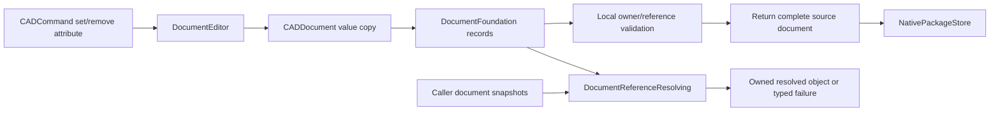

# Document Foundation

## Purpose and Scope

This component owns PARA.A1: typed document attributes, persistent object
references, explicit inter-document reference resolution, and consistency with
source edits and native persistence. Parent: [CADIR](../DESIGN.md). No children.
Undo/redo and transaction history belong to
[Document Transaction](../../SwiftCAD/DocumentTransaction/DESIGN.md); evaluated topology lineage and
split/merge correspondence belong to A3; cross-document feature evaluation and
dependency scheduling belong to A4.

## Responsibilities and Boundaries

`CADDocument.documentFoundation` owns attribute records as source value data.
Each record has a persistent UUID-backed `DocumentAttributeID`, a descriptive
name, a local owner, and one typed value. Records retain identity through edits
and serialization. Attribute removal ends that identity's lifetime; any local
owner or value reference that would dangle prevents the removal from publishing.
An ID never implicitly retargets a different object. Duplicate IDs or duplicate
attribute names on the same owner are invalid.

`DocumentReferenceResolving` owns one-hop lookup against caller-supplied
immutable `[DocumentID: CADDocument]` snapshots. No global registry, filesystem
path, I/O, or document loading is inferred. A missing snapshot is a typed failure
when resolution is requested. Ordinary document validation checks external
reference structure only; it does not claim those references were resolved.

## Related Designs

| Design | Relationship | Contract Used | Summary | Cautions |
|---|---|---|---|---|
| [CADIR](../DESIGN.md) | parent | CADDocument validation, Codable, source fingerprint | Owns source values and local feature/parameter identities | A symbolic external reference is not geometric input |
| [CADExchange](../../CADExchange/DESIGN.md) | used by | NativePackageStore strict source serialization | Persists complete attribute and reference records | Required 0.3.0 envelope; no 0.2.0 migration |
| [Swift-CAD](../../../DESIGN.md) | used by | DocumentEditing and CADCommand | Edits validate a complete value copy | Command boundary maps detailed errors to KernelError |

## Architecture



## Contracts and Invariants

- The development wire envelope is explicitly `SchemaVersion.current == 0.3.0`.
  `documentFoundation` is a required field, including for an empty foundation.
  Previous 0.2.0 documents and missing fields fail; no empty default is inferred
  during decoding. In-memory construction may explicitly use an empty value.
- `DocumentObjectReference` contains a persistent DocumentID and a typed target:
  document, FeatureID, ParameterID, or DocumentAttributeID. Attribute owners are
  local to their containing document. Local targets must exist. Attribute owner
  edges form a forest; ownership cycles fail. Attribute reference values are
  links, so they need not form an acyclic graph and are never recursively followed
  by one-hop lookup.
- Attribute values distinguish boolean, signed integer, finite real, text,
  unit-bearing Quantity, homogeneous integer/real/text arrays, bytes, a reference,
  and a reference array. Quantities use CADCore's explicit length/angle/scalar
  kind and canonical internal meters/radians. Every real and quantity is finite;
  empty arrays and empty text are valid values. Names are nonempty. Unknown kinds,
  unknown keys, multiple payloads and missing payloads are decoding failures.
- Attribute records participate in CADDocument equality and the source
  fingerprint. Fingerprint order is stable by attribute ID; no independent
  revision counter is introduced. External snapshot contents do not silently
  alter a symbolic source reference. Resolution uses the explicitly supplied
  snapshot rather than stale cached object state.
- `.setDocumentAttribute` and `.removeDocumentAttribute` run through
  `DocumentEditing`. The editor edits a copy, validates all local owners and
  reference values, then returns the document. Feature removal also validates
  these invariants. Failure leaves the caller's source value unchanged.

## Runtime Flows

```text
command -> validate source -> copy -> set/remove record -> validate full copy
 -> return source -> native encode -> strict shape/decode -> validate source

symbolic reference + supplied snapshot -> verify DocumentID -> validate document
 -> lookup exact target ID -> owned resolved object
```

## State, Ownership, and Lifecycle

Foundation records and resolver inputs are owned Codable/Sendable values.
There is no shared mutable state, callback, asynchronous stream, or retained
external document handle. A resolved value belongs to the supplied immutable
snapshot; later mutations require another resolution against a new snapshot.
The validated-document fingerprint memo remains valid because attribute edits
produce a new validated source value. Graph-stable edits preserve the foundation
unchanged and retain all named local object identities.

## Failure, Concurrency, and Constraints

`DocumentFoundationError` distinguishes duplicate attributes, invalid names or
values, ownership cycles, foreign owners, missing document snapshots, mismatched
snapshot IDs, and missing local targets. Direct foundation APIs retain this
detailed typed error. DocumentEditor translates reference failures to
`KernelErrorCode.missingReference` and structural/domain failures to
`invalidInput`; it does not let them become `unclassifiedFailure`.
Native shape/decoding errors remain SchemaError/DecodingError at their owning
boundaries. Cancellation is checked during record and ownership traversal.
Resolution performs one bounded pass over the selected snapshot validation and
one direct target lookup; it does not traverse an inter-document reference graph.

## Verification and Change Impact

[DocumentFoundationTests](../../../Tests/CADIRTests/DocumentFoundationTests.swift) own typed values, finite/unit
domains, stable IDs, strict Codable discriminators, local-owner/ref integrity,
and source fingerprint invariants. [DocumentFoundationCommandTests](../../../Tests/SwiftCADTests/DocumentFoundationCommandTests.swift) own the public command path,
copy preservation on failure, source-object deletion refusal and explicit
inter-document snapshot resolution. [DocumentFoundationPackageTests](../../../Tests/CADExchangeTests/DocumentFoundationPackageTests.swift) own native in-memory/URL
save/load of attributes and external links, strict 0.3.0 admission, malformed
foundation refusal, and existing-file preservation on failed saves.
The schema baseline fixture in StrictCurrentTopologySchemaTests is updated
together with SchemaVersion.current. Changes require rechecking CADIR full
document validation, DocumentEditor, NativePackageStore, and public inventory.
