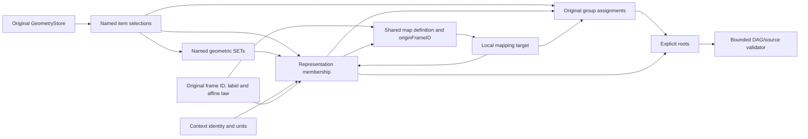

# Independent Shape Source

## Purpose and Scope

This CADIR component owns independent curve/surface selections, ordered/unordered groups with inverse membership, and local instance DAGs for X7. Parent: [CADIR](../DESIGN.md). Children include original placement, primitive metadata and [STEP group declarations](OriginalSTEPGroup/DESIGN.md); the direct child index follows below. The source is retained by the parent document's required nullable field; the current strict envelope version is owned by CADCore.

## Responsibilities and Boundaries

One `GeometryStore` owns the original curve and surface laws. An item owns selection identity, its original name and an optional directed curve trim, not a duplicate geometry law. Groups own original ordered/unordered assignment membership, inverse-membership obligations and actual inverse links, plus bound name/nullable description. Original STEP declarations independently own shared owner identity and metadata, including owners with zero assignments. Representations own actual item/instance membership and their context. Frames own original coordinate-system identity, label and finite nonsingular affine values. Definitions own a representation reference, required nullable originFrameID and required nullable originalIGES definition source. A nonnil ID refers to that sole real frame owner; explicit nil is the standard implicit-identity law (for example IGES308 without a defining matrix), not a missing field or synthesized frame. Instances own a definition reference, mapped-item name, distinct placementName and finite nonsingular target affine placement. Geometry sets own named SET membership of curve/surface selections; group assignments remain a separate owner. No edge, face, body, feature, material assignment or evaluation cache is fabricated. Existing generic topology shapes remain owned by CADTopology.

## Related Designs

| Design | Relationship | Contract Used | Summary | Cautions |
|---|---|---|---|---|
| [CADIR](../DESIGN.md) | parent | immutable document source, strict decoding and fingerprint | Composes this optional source into a CAD document. | Envelope version and parent composition are parent-owned. |
| [CADGeometry](../../CADGeometry/DESIGN.md) | depends on | original geometry validation and affine maps | Supplies the local laws and parameter domains. | Native validation does not imply standard format representability. |
| [Structural Geometry Work](../../CADGeometry/StructuralGeometryWork/DESIGN.md) | depends on | original payload work precharge | Bounds geometry scans before validation. | Work is cumulative; coefficient payload is not guessed from entity count. |
| [Independent Shape Exchange](../../CADExchange/IndependentShapeExchange/DESIGN.md) | used by | validated selections, original group families, instance DAG | Retains source semantics across format transport. | Standard IDs and native UUIDs have distinct lifetimes. |
| [Original IGES Placement](OriginalIGESPlacement/DESIGN.md) | child | original decimal Type124/408 operation words | Preserves exact coefficients and actual matrix sharing | Numeric placements are derived candidates |
| [Original STEP Placement](OriginalSTEPPlacement/DESIGN.md) | child | original proposed axes, scale and coordinate identity | Retains the source behind derived numeric frames | Exact downstream original image evaluation has its own producer contract |
| [Original STEP Line](OriginalSTEPLine/DESIGN.md) | child | original LINE/VECTOR records and exact directed derivative law | Retains primitive identity, magnitude and normative length source | Raw records remain the coordinate authority through translation and format publication |
| [Original STEP Spline](OriginalSTEPSpline/DESIGN.md) | child | original curve/surface metadata and shared named control points | Preserves source declarations alongside the sole geometry law | Raw coordinates, context units and original spatial words must remain bound |
| [Original STEP Group](OriginalSTEPGroup/DESIGN.md) | child | real declaration identity and exact nullable metadata | Retains owners independently of their assignments | Bare declarations have no invented geometry or membership |

## Architecture



## Contracts and Invariants

Frames and instances retain explicitly nullable `originalSTEPPlacement` source.
When present, this original standard law is the placement authority; the stored
numeric affine frame is its bound derived value. Validation interprets the same
original law under the caller's tolerance/work budget and rejects inconsistent
derived columns. Standard export re-emits original ratios/defaults/scale and
shared original element IDs. Native authored affine placements without a
witness instead require the format's exact original-coefficient proof.

* Required `curvePositionFrames` and `surfacePositionFrames` map original law identity to a real `IndependentShapePositionFrame` association. Its frameID is the actual standard position entity, retaining that entity's name, identity and sharing; parameterLengthUnit is required nullable provenance, nonnull only for a length-parameter generator (currently PARABOLA). Position frames contain internal-SI origins and unit axes. They do not become numerical geometry authorities: source validation checks the original law's stored pose against the frame, and inconsistent edits fail instead of updating either owner. Dimensionless conics and internally normalized plane charts require nil parameterLengthUnit. The length-parameter affine parabola retains its original local generator and proves each stored transform column equals the frame column times that declared unit's original SI gain, plus exact original translation. No inverse division, fitted axis or free scale is used to infer this unit.
* Position associations are genuine law-to-frame dependencies. All selected items of the same original law use one association; source reachability visits the real frame without creating a primitive or standalone root. Frame identity remains shared if it also has real representation/map/group membership. A standard writer reuses the actual frame entity and verifies owned context unit compatibility; source geometry is neither overwritten from frame metadata nor renamed from the frame label. The current exact association validator admits stored framed planes, explicit ellipse/hyperbola/parabola poses and the original affine circle/parabola families decoded by the standard producer. Other associated families fail explicitly until their original pose owner is proved; unassociated original laws remain governed by existing validation.

* Source item, geometric-set, group, context, representation, definition, frame and instance IDs have distinct tagged types. Item geometry IDs refer to the sole store. An optional trim binds the original curve parameterization and preserves traversal direction; it is not an edge endpoint contract. Its finite unequal endpoints must lie strictly in the original nonperiodic domain; periodic domains retain the requested original finite interval without modulo normalization.
* Roots and memberships are sets. Canonical source arrays are sorted by tagged ID/reference order and contain no duplicates. Canonicalization sorts only after count/work admission; it never removes a record or normalizes text.
* Names and descriptions compare by UTF8 bytes. Nil and empty descriptions differ. Item names belong to selections, so two trims of the same curve can have distinct identities and names. Original basis labels are independently owned by curveNames/surfaceNames keyed by law ID; an absent map entry and an explicitly empty label differ. Those maps use exact UTF8 equality.
* Every item, geometric set, group, representation, context, definition, frame, instance and original geometry law is reachable from a root. An item reaches its original position frame through the corresponding law association; the shared frame is not an invented independent root. Position comparisons reserve fixed bounded scalar work before arithmetic and retain exact equality of the original columns/translation. Missing references, duplicate IDs, cycles, empty groups, unused original laws and singular placements are typed failures. Shared descendants are allowed and never value-deduplicated.
* A geometric source has a real item, frame or graph-bound Body selector and actual roots. A Body selector may be a direct root, assignment member or representation member; its mere presence never replaces the later real imported-output check. A frame-only source requires no dummy geometry. A declaration-only source may instead retain real ambient STEP GROUP owners with empty geometry and roots. All present geometric graph owners remain subject to complete root reachability; declaration metadata retains the same identity/text/work admission.
* The fixed 3x3 outward determinant reserves 512 work units before its bounded arithmetic/scratch. The exact determinant-sign lower dependency remains pending; interval uncertainty does not close the full Native affine domain.
* A Native representation contains items, geometric sets, frames, instances and real groups. IGES308 may select a group; STEP representation_item restrictions are format-specific and do not narrow this common source law. A geometric set contains only real curve/surface item selections; it cannot own mapped instances or group assignments. A group may assign items, geometric sets, representations, frames, instances or other group assignments. A definition is not a groupable item. Definitions refer to real representations; instances refer to real definitions. Their DAG is acyclic, and every explicit mapping origin is a real retained frame referenced by at least one actual representation with the mapped representation's context identity. This is the bounded direct-membership proof of REPRESENTATION_MAP.WR1/item_in_context. A frame may be shared by several definitions; no frame or membership is synthesized or chosen from a first definition. Placement is an explicit target map relative to the retained definition origin: effective local placement is target composed with inverse(frames[originFrameID].placement), or with identity for an explicit nil originFrameID. Instance placementName retains the target operator label separately from its mapped-item name; both use exact UTF8 equality. Composition preserves these original matrices; source validation does not bake world geometry. Context units describe transport of internally normalized original laws, not a second implicit scale. Finite nonsingularity is checked after positive scaling of matrix columns to avoid determinant overflow. An outward determinant enclosure must exclude zero. Unresolved nonsingularity is a distinct `unprovedPlacement` failure, not a claimed singularity or a repaired matrix.
* Source limits bound records, UTF8 bytes, nesting and cumulative work. Geometry's structural visitor charges the stored payload before geometry validation. References and graph visits are charged before indexes/stack growth; source expansion is not materialized. Counts are checked before duplicate sets or canonical sorting. Caller ceilings are retained.

## Runtime Flows

Input count preflight → text/payload precharge → exact geometry/trim/placement validation → source indexes → directed DAG traversal → complete reachable ownership check → validation accounting. Cancellation and the caller-provided existing deadline callback are checked at every charge. No success receipt is published before complete validation. Contexts and definitions are retained once by identity; their membership is checked without value deduplication.

## State, Ownership, and Lifecycle

All source fields are immutable values/COW buffers. Validator state is invocation-local. It retains no global state, caller buffer view or mutable cache. Native Codable fields are strict and required, including nullable fields. Parent fingerprint and producer source receipts include the complete source via parent encoding/equality. This source encoder sorts original geometry-map and law-label keys before emitting the existing alternating key/value representation; UTF8 label bytes are unchanged. Its decoder refuses duplicate original-law or label keys, rather than accepting a overwritten owner. The maps remain unordered lookup owners at runtime.

## Failure, Concurrency, and Constraints

`IndependentShapeSourceError` distinguishes invalid source, missing reference, cycle and resource exhaustion. Original geometry validation errors and cancellation propagate without default values. The same source and isolation contract applies to every compiled target. Format-specific representability is an exchange concern.

## Verification and Change Impact

[IndependentShapeSourceTests](../../../Tests/CADIRTests/IndependentShapeSourceTests.swift) owns original literal curves/surfaces, shared selection/group/instance DAG, finite affine placement, exact text/null distinctions, strict decoding, cycles/missing targets, domain and budget/cancellation failures. Exchange owns Native/document/public memory/URL and standard two-generation evidence. Source/schema changes require rechecking parent persistence/fingerprint and exchange composition; validation structure alone is not success evidence.

Normative source relationships: [representation](https://www.steptools.com/docs/stp_aim/html/t_representation.html), [representation_context](https://www.steptools.com/docs/stp_aim/html/t_representation_context.html), [geometric_set](https://www.steptools.com/docs/stp_aim/html/t_geometric_set.html), [representation_map](https://www.steptools.com/docs/stp_aim/html/t_representation_map.html), and [groupable_item](https://www.steptools.com/docs/stp_aim/html/t_groupable_item.html). Exchange owns subtype-specific standard admission. Native does not silently normalize distinct mapping origins or empty labels.

### Ambient and representation units

The containing CADDocument owns ambient units for primitive/frame roots without representation membership. Each actual representation owns its retained context identity and units independently; equal numeric units do not merge contexts. Original geometry uses internal SI storage and its original parameter chart. Import must decode a primitive by its actual representation context before considering unassociated roots. A parent root classifier cannot reinterpret an already associated primitive under document units. An unassociated descriptor does not create a source ContextID or invented representation. The exchange owner resolves an unambiguous actual ambient descriptor; the document retains that UnitSystem through Native persistence and source fingerprinting. Changing document presentation units does not change represented context units or the geometry law. No second ambient-unit field duplicates document authority in this source.

### Whole-source translation
`translated(by:tolerance:)` changes the common coordinate chart of every original geometry law by one rigid translation, preserving IDs, source labels, trims, units and graph sharing. Physical source frames become `T * O`, preserving primitive position correspondence. For an explicit map origin the target becomes `T * I`; the resulting effective map is `T * I * inverse(O) * inverse(T)`. An implicit identity origin remains explicitly absent, and its target becomes `T * I * inverse(T)`. Thus every nested effective map is conjugated and a chain applies the world displacement once. Source array order and association ownership remain unchanged. The operation uses Geometry's actual parameter-preserving rigid image ports, propagates their failures and validates the final graph with the caller's source budget.

### Original trimming selectors
An item may retain an IndependentShapeTrimmingSource alongside its directed original-basis CurveTrim. It owns the first and second standard selector sets, the original numerical representatives, Cartesian source points and the master preference. The resolved interval is a derived native selection of the same original law; periodic representative adjustment never overwrites original selector numbers. Both representations must identify the same original curve point within the existing modeling tolerance. Selector coordinates use internal SI; parameter values remain in the original basis chart. Translation changes Cartesian points only and preserves numeric selectors, preference and traversal sense.

### Product-associated independent representations
`IndependentShapeSource.productAssociations` retains actual SHAPE_DEFINITION_REPRESENTATION membership as ordered pairs of IndependentShapeRepresentationID and AssemblyDefinitionID. Product, formation and definition values remain owned by DocumentAssembly; the association never infers an owner from a label, feature ordinal or equal geometry. Multiple actual definitions may select one original representation. Duplicate pairs, absent representations and absent document definitions fail. Canonical order is representation identity then definition identity. Native encoding requires this array even when empty. Translation preserves associations unchanged.

The source validator owns representation references and canonical association order. `validateProductAssociations(in:limits:after:check:)` owns the document cross-reference and debits the supplied completed source validation receipt against the same original limits before creating an owner index; it returns the combined receipt. The parent must call this operation with its actual assembly and the same source allowance. STEP graph producers consume explicit product-definition entity correspondence from their parent table, emit actual PRODUCT_DEFINITION_SHAPE/SDR entities, and fail before publication when correspondence is missing. Ingress consumes the actual inverse definition correspondence produced by the real product reader.

```text
DocumentAssembly definition -- actual entity correspondence --> PRODUCT_DEFINITION
Independent representation ---------------------------------> representation
productAssociations -----------------------------------------> PDS -> SDR
```

Exchange/public composition and Native parent decoding/fingerprinting are affected. Behavioral verification must cover shared representation selection, actual single-product retention, missing owners, duplicate pairs, cumulative allowance exhaustion and two-generation standard/Native retention; source-only editing does not establish these behaviors.

### Original foreign angular authority
IndependentShapeContext.originalAngularSource is required nullable source provenance. units.angle retains the canonical/native geometry and authored presentation convention. A nonnil descriptor is the sole authority for original foreign numeric angular coordinates: every SI radian prefix, conversion-unit name, original finite positive factor, zero dimensional exponents, original factor-unit reference and conversion chain is retained. Unit names never select a gain. Original unit identities preserve sharing across contexts and nested conversions; duplicate identities with conflicting source values fail.

The root-authorized canonical-degree profile is explicit: a conversion factor exactly equal to AngleUnit.degree.toInternal(1) has interpretation canonicalDegree, whose coordinate gain is OriginalParameterGain.ratio(pi,180). Every other factor has interpretation binary and retains that original binary factor. The original factor field is unchanged in either case; validation establishes the unique factor/interpretation correspondence. A chain composes these original laws and exact SI decimal prefix factors through Geometry's original gain owner, never a rounded cumulative product. Nil descriptor uses the existing native convention. Context consumers and primitive caches must compare the complete original angular descriptor when interpreting shared wire bases. Standard writers emit the retained descriptor, including original names and chain sharing; Native preserves all required fields.

Primitive/frame roots without real representation membership retain required-nullable ambientOriginalAngularSource on IndependentShapeSource. This is the sole original foreign angular law for those numeric coordinates; containing CADDocument.units remains the authored/native presentation convention. A standard descriptor does not manufacture a context, representation or frame root. Represented primitives use only their actual context.originalAngularSource. The same unit identity/content checks and cumulative source allowance cover ambient and represented descriptor chains.

### Original angular gain production
IndependentShapeAngularSource.originalParameterGain consumes the caller's RationalAlgebraAdmitting ledger. Each original conversion node becomes a binary factor, or the root-authorized canonical degree ratio pi/180, and an SI prefix becomes an exact decimal ratio. The resulting immutable Geometry original product retains the complete ordered factors. Descriptor IDs, names, dimensions and measure family remain separate source values. Neither numeric gain estimates nor unit labels select the original coordinate law. Validation and exchange share their original bounded ledger with this producer.

Position associations prove the original defining coordinate frame after unwrapping a scalar curve chart or a retained analytic surface image. The frame remains the original basis frame even when the parameter chart is shifted. Analytic surface frame checks consume the original analytic derivative authority and compare its defining origin/axes under the model tolerance; they do not replace the source frame or law.

### Original angular surface measure
The required surfaceAngularMeasures map retains CONICAL_SURFACE's original semi_angle numeric value as coneSemiAngle. It is associated with the original SurfaceID and interpreted only through that surface item's actual original angular context. Scalar conversion produces the native analytic angle without replacing this numeric source. Native equality, translation, persistence and the portable source writer retain the map. STEP egress emits the retained number only after exact coefficient conversion agrees with the native halfAngle. A changed coordinate gain must prove a new explicit numeric transport; inverse conversion of a rounded angle cannot establish original numeric identity.

### Actual ambient context metadata
The required ambientContexts array owns genuine original unassociated representation contexts, including identifier/type, presentation units and each original angular descriptor. It contains no synthetic context or representation. The existing ambientOriginalAngularSource selects the original numeric coordinate law for unassociated primitives. All actual ambient contexts must declare the same length unit and prove the same exact angular coefficient, while their identities, names, conversion chains and sharing remain distinct. Coefficient comparison consumes the caller ledger and does not require a finite binary64 gain estimate for nonangular metadata. STEP emits every retained ambient context; representation-associated context ownership is unchanged.

### Exact original affine placement admission
The source validator proves nonsingularity from all nine original binary64 matrix entries through exact rational coefficient arithmetic under its existing source ledger. It tests the original determinant for zero without column normalization, interval uncertainty, tolerance thresholds or rounded determinant values. Frame and instance values are preserved unchanged. Allocation/work/depth exhaustion remains a typed failure and is not a singularity conclusion. Lower Geometry forward/inverse operations still own their own original arithmetic and caller guarantees.

### Heterogeneous representation source and directed selections
IndependentShapeReference.body(SubshapeID) retains the actual imported feature selector already published by the parent STEP transfer. Both solid and sheet are TopologyReference.body source members. Their generated Subshape role remains body/ordinal0; the declared FeaturePort output is derived from the retained body's kind (body for solid, sheet for sheet). No evaluated/remappable BodyID is persisted. DefaultIndependentShapeSourceValidator receives an optional immutable bodySourceGraph context; absent, foreign, suppressed, non-imported, wrong-role or wrong-output references fail under the existing child ledger. CADDocument owns forwarding its actual graph. Reference validation does not copy the imported B-rep geometry.

IndependentShapeItem.traversalSource is an explicitly nullable directed selection chart, not another mutable geometry authority. The shared original basis remains geometry.curves[basisID]. A nonnil chart must be a retained normalized ParameterImageCurve3D whose source equals that entire original basis under paid structural comparison. resolvedCurve(in:) returns the actual selected chart and directed trim. Original trim parameter selectors remain parameters of the shared basis; Cartesian selectors remain original SI points. Endpoint validation evaluates the selected chart, while original selectors evaluate the original shared basis. Translation shifts the original basis and selection chart exactly once and preserves IDs/references. Native requires the nullable field; STEP reemits actual original selectors/basis/units and reconstructs the same directed chart on ingress.

Optimized graph edits call validateBodySourceAssociations(in:limits:check:) as a new invocation over already validated immutable independent source. It scans only retained root/representation/group Body selectors and validates them against the new original graph. It does not repeat independent curve/surface validation or mint a geometry proof from accounting. The shared selector checker owns imported source/output semantics and is used by both full source and graph-edit validation.

### Original representation family
IndependentShapeRepresentation.family retains the original standard family as a required source value: general representation, shape representation, geometrically bounded wireframe, or geometrically bounded surface. STEP ingress and egress select this actual value, rather than deriving another family from member count. Native requires it and equality includes it. Authored neutral representations default to shape. Body membership is admitted only in the general or shape family; the bounded families retain their original geometry profile checks. Parent schema and portable source writers consume this child value through the existing composition boundary.

IndependentShapeGeometricSet.family retains GEOMETRIC_SET versus GEOMETRIC_CURVE_SET. The curve-only family's actual members must select original curves. Bounded wireframe representations require this curve-only set family; bounded surface representations require actual surface selection and compatible mapped family. STEP emits both families from these retained source values, and Native requires them rather than silently deriving a value from current members.

### Source recursion and curve subdivision allowances
IndependentShapeSourceLimits.maximumDepth admits only original source recursion. maximumCurveSubdivisionDepth is a distinct caller-owned algorithm ceiling with default32, preserving the existing Cartesian-trim operation's supported 0...32 envelope. Translation/remaining allowance copies it unchanged. Original directed-chart admission and periodic factory receive this algorithm ceiling separately from source depth; neither derives one from the other.

The source byte allowance covers both retained UTF-8 source text and temporary exact UInt32 word storage admitted by RationalAlgebraAdmitting. retainExactStorage precharges checked word bytes before arithmetic allocation and also retains its existing scalar-record debit. consumedTextBytes therefore reports this complete source-byte admission for composition; a caller forwards the remaining byte ceiling rather than creating another exact-storage allowance. Native transfers decoder ownership only after decode finishes, snapshots the same immutable work/cell/storage counters, and validates original source with the remaining counts. A snapshot is accounting, not a reusable source proof.

Foreign length coordinate meaning is owned by [Original STEP Length Source](OriginalSTEPPlacement/LengthSource/DESIGN.md).
Context.originalLengthSource and ambientOriginalLengthSource are required nullable
persistent fields; nil preserves the Native binary LengthUnit convention. A
non-nil source controls raw foreign coordinate gain, independent of the numeric
presentation units. Source copies, validation and publication must retain it.

The local STEP surface chart recognizer binds plane/cylinder/sphere/torus original raw-model dimensions and their exact cardinal native-chart rotations. Its computed result owns no persistent identity. Positioned word images bind to the retained frame law; angular wrappers retain the original longitude/latitude gains and exact identity spatial image.

[Original STEP Line](OriginalSTEPLine/DESIGN.md) owns raw LINE/VECTOR law records. Required curveLinearSources maps their actual original basis IDs; complete source validation binds the retained raw derivative word to geometry and context. Translation preserves raw records and appends world operations.

IndependentShapeSourceLimits.maximumAlgebraicDepth independently bounds exact normalized-word algebra in 0...32 with default32. Source nesting and original curve subdivision remain independent. Child/remaining-budget copies retain all three original depth limits.

[Original STEP Spline](OriginalSTEPSpline/DESIGN.md) owns required curveSplineSources and surfaceSplineSources maps. These immutable records retain original shared control-point identity and descriptive assertions. Original BSpline geometry remains the sole coordinate/knot/weight law; validation binds each record to that raw spline under its complete spatial word. Translation retains raw records while appending world action to geometry.

Foreign SI-radian coordinate law and the canonical Native binary-pi chart are separate authorities. Producing a Native parameter gain requires actual retained canonical-phase cancellation; a rational/binary coefficient alone does not supply mathematical-pi transport. originalCoordinateLaw produces either a proven canonical gain (one canonical-degree factor) or an exact physical-radian coefficient (no canonical-degree factors). The latter is consumed by the symbolic physical-angle Geometry carrier, never by a rational Native-label image. Chains requiring higher symbolic-pi powers remain unprovedAngularCoordinateLaw, preserving original descriptors rather than classifying them as malformed.

Native canonical source maps require a known even count and the existing shared decoder allowance. Pair storage/work is admitted before reserving the index, source nesting uses the original wire path cap, and each new map entry consumes a depth-zero semantic cell. Duplicate keys fail before value insertion. Child record codecs consume that same allowance without resetting counters.

Translation of a retained original affine word appends the authored world displacement as an original forward factor under the same IndependentShapeSourceBudget. Raw STEP frame and LINE witnesses retain their original records and ordered adjustments; numeric frame views are regenerated from that adjusted original law. Parameter-only outer charts retain their gains and offsets while their admitted source changes. Exact algebra records, work and storage debit the operation's remaining allowance before final source validation; legacy cancellation-only word image constructors cannot establish this bounded translation contract.

Standalone source validation forwards the caller's explicit maximumAlgebraicDepth to every original curve, surface and directed-selection chart validation. Source nesting and curve subdivision remain separate authorities; a retained word prepared under a larger algebra limit cannot weaken a tighter current caller limit.

### Original group ordering and inverse associations
IndependentShapeGroup.family retains unordered/ordered and required/optional inverse-pointer semantics. Unordered member arrays are canonical sets. Ordered arrays retain original traversal order, including repeated references; they are not sorted during publication. backPointerMembers is a canonical unique subset of actual members and represents the original inverse links, even when optional. Required families require every distinct member in that subset. The group remains the sole owner of this inverse membership: no second mutable geometry or graph authority is added. Native requires family and backPointerMembers; source equality includes them. IGES transport uses legal forms 1/7/14/15 and actual member parameter association tails. STEP's set association cannot silently retain ordering or inverse-pointer obligations; its publication boundary requires explicit loss authority for those semantics.

### Foreign angular selected-curve chart
Shared untrimmed conic bases retain their intrinsic chart. IndependentShapeAngularCurveSelection.foreignCurve composes the current original descriptor’s coordinate law inside the retained spatial word (physical radians), or as an outer exact parameter gain (canonical degrees). The item alone retains this selected chart in traversalSource and the original foreign trim parameters; the shared basis is unchanged. Validation reconstructs that chart from the actual basis and bound descriptor on the same caller ledger. Retained periodic-difference traversals may wrap this chart only under their genuine original periodic authority. Cartesian inverse phase and mathematical-radian periodic translation remain separate Geometry producer contracts, never rounded station or period inference.

Physical-radian trims retain a normalized physicalRadianArc with exact descriptor-scaled original endpoint coefficients and an original signed integer turn count. The producer admits the smallest turn giving the requested direction by the Geometry transport’s original phase-sign proof; unresolved sign or count exhaustion fails explicitly. Validation reconstructs the arc from raw PARAMETER_VALUE selectors and the actual context descriptor. Native never derives a binary period. Pure Cartesian physical-angle inversion remains a required lower producer; approximate projected parameters cannot replace that authority.

### Original physical angular surface chart
IndependentShapeAngularSurfaceSelection composes physical-radian longitude/meridian transports directly on the retained ideal local primitive, before its original spatial frame word. The exact cardinal sphere/torus orientation image remains unchanged around this local transport. The shared recognizer checks that spatial image and raw dimensions; validation separately reconstructs both angular transports from the actual context descriptor. Cylinder height remains intrinsic raw model length. Sphere physical latitude remains dependent on the Geometry closed-pole endpoint producer and is not admitted by a rounded Native endpoint. Writers require the same reconstructed local law before emitting original raw dimensions and placement.

### Original IGES subfigure definition
IndependentShapeIGESDefinitionSource retains the original Type308 directoryLabel independently of representation.name (the parameter NAME), and a required nullable definingFrameID selecting the actual Type124 owner. This is a forward operation on definition geometry, followed by actual instance scale/matrix/translation; it is not the inverse STEP mapping-origin operation. Original IGES definitions require nil STEP origin and one actual definition per representation, so direct representation selection binds one unambiguous original template. Their forward frame is reachable through that definition and cannot also own a STEP origin or primitive pose. Native persists all source fields without synthesizing a frame for nil. Translating all original geometry retains the shared raw Type124 source and appends definition-scoped and instance-scoped original conjugation adjustments, preserving one world displacement; source pose frames continue their original translation rule. Standard publication retains this forward scope rather than flattening the transform into instances. Authority and transport live in the exchange child.

### Shared IGES matrix translation scope
Raw Type124 frames remain immutable while translated original geometry receives the world displacement. Definition and instance original IGES carriers each append their own conjugation adjustment. With original actions D and I and world translation T, the resulting actions are T D T^-1 and T I T^-1, giving (T I T^-1)(T D T^-1)(T C)=T I D C. No shared frame is translated twice. Native retains raw fields and scoped adjustments; numeric placements are checked derived views.

### Original IGES primitive pose scope
Position associations additionally retain originalIGESAdjustments as an ordered array. Empty arrays preserve existing STEP pose semantics. A nonempty array requires the actual frame's originalIGES source and a nil parameterLengthUnit. Validation reconstructs the frame word and each scoped adjustment under the same caller ledger, then compares the retained geometric image word exactly. World translation appends a nonconjugating pose adjustment while leaving shared Type124 immutable. The actual primitive curve/surface receives the translation once; the association records that same operation, never applies it a second time. A raw frame may serve multiple original legal forward scopes because every changed scope owns its separate adjustments.

### Original STEP group-owner sharing

IndependentShapeGroup.id identifies one original assignment. Required-nullable originalSTEPGroupID (IndependentShapeSTEPGroupID, a distinct tagged identity domain) identifies its actual shared GROUP owner independently of the assignment and its membership. Each assignment binds the real declaration in originalSTEPGroups and must have identical UTF8 name and nullable description, unordered membership and no IGES inverse obligations. Distinct assignment IDs and memberships remain distinct, including equal or overlapping sets. Nil means a Native/IGES group without retained STEP owner sharing. STEP ingress allocates one source owner identity per real GROUP; egress emits one GROUP per retained owner and a distinct APPLIED_GROUP_ASSIGNMENT for each source assignment. Cycles remain governed by the original assignment graph. Native requires the nullable source field; equality and parent fingerprint preserve it. IGES has no separate GROUP-versus-assignment owner and requires explicit source-sharing loss admission before projecting each assignment to an independent 402 group.

### Ambient original STEP GROUP declarations

Required originalSTEPGroups retains every actual GROUP owner independently of zero or more assignments; the [owner child](OriginalSTEPGroup/DESIGN.md) owns its raw contract. Declarations are explicit ambient metadata anchors, like ambientContexts, and are not inferred geometry roots. An owner-only source may have empty geometry/items/frames/roots. Geometric graph owners still require complete original root reachability. Assignment originalSTEPGroupID must resolve to this collection and its bound metadata must agree exactly. Translation copies declarations unchanged. Native Source23 requires the collection, including empty arrays; all parent copying and portable encoding must preserve it.
