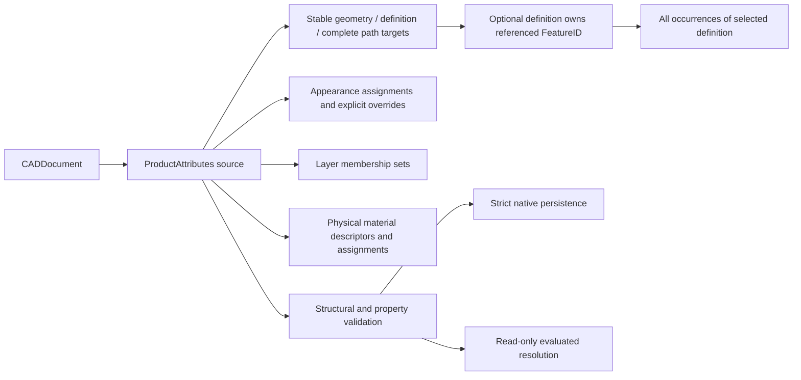

# Product Attributes

## Purpose and Scope

This component owns the PARX.X3 persistent source contract for body/face names,
appearance, layer membership, and physical material assignments on geometry,
parts, and occurrences. Parent: [CADIR](../DESIGN.md). No children. It does not add PMI, mass integration, inter-document
evaluation, or new long-term split/merge reference policies.

## Responsibilities and Boundaries

`CADDocument.productAttributes` is the source authority. Generic
DocumentFoundation records do not acquire product semantics by interpreting their
names or arbitrary values. Existing AssemblyDefinition and AssemblyOccurrence
owners retain part and occurrence names. This component owns body/face names and
the other typed attachments, not a second geometry or assembly definition.

Physical material descriptors contain a persistent identity, name, description,
and optional typed density in kilograms per cubic meter. Density is finite and
strictly positive when present. A descriptor owns its density value; effective
density requires an independent explicit density assignment. That assignment
may reference a descriptor's density value. Changing a material assignment alone
does not create, replace, or imply a density assignment. Appearance is separate: an explicitly specified
color does not assert metallic, roughness, IOR, or other PBR properties. Existing
`Material` and `Body.material` contracts are not reinterpreted or silently used
as this source registry. Conflicting legacy and new assignments require an
explicit admission decision by the consuming boundary.

## Related Designs

| Design | Relationship | Contract Used | Summary | Cautions |
|---|---|---|---|---|
| [CADIR](../DESIGN.md) | parent | CADDocument, StableSubshapeReference, source fingerprint | Composes persistent source values | Source values must participate in full and justified fast-path validation |
| [Document Foundation](../DocumentFoundation/DESIGN.md) | coordinates with | Typed general attributes and local references | Retains generic attributes independently | Attribute names never imply appearance semantics |
| [Document Assembly](../DocumentAssembly/DESIGN.md) | depends on | Definition identities and complete occurrence paths | Identifies shared parts and particular instances | A final occurrence edge alone is not a nested instance identity |
| [Product Attribute Resolution](../../CADKernel/ProductAttributeResolution/DESIGN.md) | used by | Source target resolution and effective property provenance | Connects source attachments to evaluated geometry | Derived topology IDs are not persisted targets |
| [STEP Attributes](../../CADExchange/STEPAttributes/DESIGN.md) | used by | Standard attribute correspondence | Maps admitted source semantics into STEP | Exchange never invents precedence or PBR values |
| [CADExchange](../../CADExchange/DESIGN.md) | used by | Strict native source admission | Persists this source container | Semantic admission changes require coordinated current-schema validation |

## Architecture



## Contracts and Invariants

- The current envelope is owned by [CADCore](../../CADCore/DESIGN.md). Encoded documents require a
  non-null `productAttributes` container, including an explicitly empty value.
  Older envelopes, missing fields, unknown keys/discriminators, and malformed
  payloads fail; no default or migration is inferred during decoding. The
  schema owner must update the current baseline and dependent contracts together.
- Body/face targets use existing StableSubshapeReference source identity and
  signature, with the required topology kind. A source-geometry assignment
  applies where that real feature-owned geometry is used, or may be restricted
  to one explicit definition or an explicit complete occurrence path. The two
  selectors are mutually exclusive, and a geometry target has no usage selector.
  A selected definition must exist and contain the geometry reference's FeatureID;
  its definition and feature membership scans consume the caller's cumulative
  work ceiling before traversal. A definition selector applies to every occurrence
  of that definition, including body-to-face inheritance, while excluding other
  definitions that reuse the same geometry feature. Absence of both selectors
  retains the existing global geometry semantics. This rule is identical for
  properties, names, and layer membership;
  restriction never rewrites its source reference to a world UUID. Part targets
  use AssemblyDefinitionID; instance targets use AssemblyOccurrencePath. Source
  validation checks feature/definition/path existence and geometry-reference
  structure; evaluated geometry resolution belongs to its separate owner.
- Assignment, layer, and physical material identities are persistent source
  identities. Duplicate identities, invalid references, missing descriptors,
  foreign path membership, and property override cycles fail. Empty descriptive
  text is retained as text; layer names must be nonempty. Same-name imported
  layers are normalized by the exchange owner before publishing one source layer.
- Color channels have explicit finite normalized domains. Transparency, when
  admitted by a consuming format, is an explicit appearance property rather
  than a density or PBR inference. Physical density has a typed unit contract
  distinct from CADCore's length/angle/scalar quantities; it cannot masquerade
  as an untyped real or length quantity.
- Each overridable property retains an explicit predecessor relation and source
  provenance. An override replaces only the properties it specifies. No fixed
  body/face/part/occurrence rank, record order, or entity order is a substitute
  for this relation. Competing applicable values without a unique explicit
  relationship fail as typed ambiguity. Material reference and density override
  chains remain separately identifiable. Only an explicit density assignment
  authorizes effective density, including when its value is obtained through a
  descriptor reference. A descriptor without density cannot satisfy such a
  reference. Absence of a density assignment remains absent even when the
  effective material descriptor contains a density value.
- Layer membership is a set of explicit associations, independently resolved
  from property override chains. Layers are flat; membership is not a material
  or color precedence rule. Body/face names identify their exact targets;
  occurrence names do not replace geometry names.
- Structural validation precedes graph traversal and derived allocation. Public
  protocols accept positive record, reference, override-depth, and cumulative
  work ceilings; checked counts are charged before constructing indexes or
  expanding path-specific associations. Limits do not weaken source invariants.
- Source values participate in document equality and stable fingerprints,
  including descriptors, values, target scopes, and override edges. No separate
  revision counter or hidden global registry is introduced. Edits validate a
  complete copied document before publication; deleting a referenced feature,
  definition, occurrence, layer, material, or assignment cannot publish dangling
  attachments. Existing fast paths must establish the same admission invariant.

## Runtime Flows

```text
owned source values -> preflight counts -> validate identities/targets/domains
 -> bounded override/reference traversal -> complete validated document

source edit -> copied document -> complete source validation -> publish copy
native decode -> strict current envelope -> typed source validation -> owned source
```

## State, Ownership, and Lifecycle

The container and descriptors are Codable/Sendable source values owned by their
CADDocument snapshot. Removing an identity ends its lifetime; reuse does not
retarget prior attachments. Validation counters and indexes are operation-local.
No shared mutable registry, callback, I/O, or platform-specific state is added.
Derived effective values belong to a separate evaluated snapshot and are never
written back into this source as hidden defaults.

## Failure, Concurrency, and Constraints

Public source validation/editing operations are protocol-based and expose typed
failures for malformed values, duplicate identities, dangling targets, invalid
scopes, cyclic overrides, ambiguous competing properties, and exhausted limits.
Cancellation propagates during record/path/override traversal. Failure publishes
no partial container or copied document. Native schema/decoding failures remain
owned by their existing boundaries; callers never receive an empty success in
place of an invalid source.

## Verification and Change Impact

[ProductAttributesTests](../../../Tests/CADIRTests/ProductAttributesTests.swift)
own typed value/unit domains, target/path structure, property-specific overrides,
ambiguity/cycle/deletion refusal, cumulative bounds, cancellation, strict coding,
and equality/fingerprint changes. Definition-qualified tests use one real feature
referenced by two definitions and retain that common owner through coding. The
[native scope tests](../../../Tests/CADExchangeTests/ProductAttributesNativeScopeTests.swift)
exercise public in-memory and URL persistence, prior-version refusal, foreign
definition membership, mutually exclusive selectors, and atomic failure. Source
admission does not certify STEP transport of the new selector: its consumer must
refuse until standard ingress/egress retains the same definition scope.
Native tests also cover missing/unknown payloads and atomic
failure. Changes require rechecking CADDocument full/fast validation, schema
admission, DocumentAssembly, ProductAttributeResolution, and STEPAttributes.
Parent indices and the baseline update belong to the integration owner.
