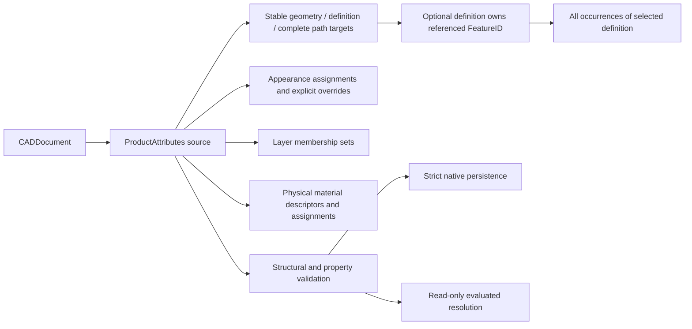

# Product Attributes

## Purpose and Scope

This component owns the PARX.X3 persistent source contract for body/face names,
appearance, layer membership, and physical material assignments on geometry,
parts, and occurrences. Parent: [CADIR](../DESIGN.md). No children. It composes [PMI](../ProductManufacturingInformation/DESIGN.md) and [View Metadata](../ProductViewMetadata/DESIGN.md) source containers. It does not own mass integration, inter-document
evaluation, or new long-term split/merge reference policies.

## Responsibilities and Boundaries

`CADDocument.productAttributes` is the source authority. Generic
DocumentFoundation records do not acquire product semantics by interpreting their
names or arbitrary values. Existing AssemblyDefinition and AssemblyOccurrence
owners retain part and occurrence names. This component owns body/face names and
the other typed attachments, not a second geometry or assembly definition.

Physical material descriptors contain a persistent identity, name, description,
and optional typed density in kilograms per cubic meter. Density is finite and
strictly positive when present. A descriptor owns its density value; effective
density requires an independent explicit density assignment. That assignment
may reference a descriptor's density value. Changing a material assignment alone
does not create, replace, or imply a density assignment. Appearance is separate: an explicitly specified
color does not assert metallic, roughness, IOR, or other PBR properties. Existing
`Material` and `Body.material` contracts are not reinterpreted or silently used
as this source registry. Conflicting legacy and new assignments require an
explicit admission decision by the consuming boundary.

## Related Designs

| Design | Relationship | Contract Used | Summary | Cautions |
|---|---|---|---|---|
| [CADIR](../DESIGN.md) | parent | CADDocument, StableSubshapeReference, source fingerprint | Composes persistent source values | Source values must participate in full and justified fast-path validation |
| [Document Foundation](../DocumentFoundation/DESIGN.md) | coordinates with | Typed general attributes and local references | Retains generic attributes independently | Attribute names never imply appearance semantics |
| [Document Assembly](../DocumentAssembly/DESIGN.md) | depends on | Definition identities and complete occurrence paths | Identifies shared parts and particular instances | A final occurrence edge alone is not a nested instance identity |
| [Product Attribute Resolution](../../CADKernel/ProductAttributeResolution/DESIGN.md) | used by | Source target resolution and effective property provenance | Connects source attachments to evaluated geometry | Derived topology IDs are not persisted targets |
| [STEP Attributes](../../CADExchange/STEPAttributes/DESIGN.md) | used by | Standard attribute correspondence | Maps admitted source semantics into STEP | Exchange never invents precedence or PBR values |
| [CADExchange](../../CADExchange/DESIGN.md) | used by | Strict native source admission | Persists this source container | Semantic admission changes require coordinated current-schema validation |

## Architecture



## Contracts and Invariants

### Caller-Owned Attribute Budget Composition

`ProductAttributeBudget.init(limits:using:)`, `charge(...using:)`, and
`withExecution(using:_:)` consume the same `OriginalQueryExecution` as the
Kernel resolver. The budget retains the immutable original budget identity,
execution limits/context, and contribution handles; it does not copy numeric
accounting into another ledger. Its ordinary initializer creates one independent
execution. Later ordinary charges reconstruct an execution on that retained
owner, preserving cumulative admission rather than creating a new root.

| Existing local allowance | Canonical contribution | Meaning retained |
|---|---|---|
| consumedWork / maximumWork | Attribute work scope | Actual work, including direct geometry work inside the attribute invocation |
| consumedTargets / maximumTargets | Target record scope | Number of resolved target publications |
| consumedTextBytes / maximumTextBytes | Independent source-text scope | Exact authored UTF-8 bytes, separate from numeric storage |

Each charge preserves the existing nonnegative/local-limit checks and
`ProductAttributeError.resourceLimitExceeded` rejection. Caller limits,
contribution preparation, and cancellation additionally retain their original
typed canonical failures. Publication uses the common atomic charge operation;
failed admission does not update a separate local counter. A copied budget value
retains the same owner and contribution authority. A foreign execution is
rejected explicitly. Kernel resolution and mass-property callers must forward
their existing execution through each direct charge and geometry scope.

The `ProductAttributesValidating` direct requirement executes the existing
validator body under that attribute scope. The concrete validator retains record
preflight, metadata/target validation, override traversal, ambiguity checks,
layers, and original failure order. An injected validator without a direct body
refuses the composing call explicitly. Target validation forwards the same
execution through the stable reference and complete geometry signature validation
owned by [CADIR](../DESIGN.md), including its original minimal validation tolerance.
Derived maps, sets, and annotation concatenation are charged before allocation.

| Shared accounting state | Native | WASM | Embedded |
|---|---|---|---|
| Storage and isolation | OriginalQueryBudget and contribution handles, common Mutex owner | Same | Same |
| Reads and mutations | Canonical snapshots and caller execution charge operations | Same | Same |
| Lifetime | Immutable retained owner/handles; no raw state or target-specific synchronization branch | Same | Same |

- The current envelope is owned by [CADCore](../../CADCore/DESIGN.md). Encoded documents require a
  non-null `productAttributes` container, including an explicitly empty value.
  Older envelopes, missing fields, unknown keys/discriminators, and malformed
  payloads fail; no default or migration is inferred during decoding. The
  schema owner must update the current baseline and dependent contracts together.
- Body/face targets use existing StableSubshapeReference source identity and
  signature, with the required topology kind. A source-geometry assignment
  applies where that real feature-owned geometry is used, or may be restricted
  to one explicit definition or an explicit complete occurrence path. The two
  selectors are mutually exclusive, and a geometry target has no usage selector.
  A selected definition must exist and contain the geometry reference's FeatureID;
  its definition and feature membership scans consume the caller's cumulative
  work ceiling before traversal. A definition selector applies to every occurrence
  of that definition, including body-to-face inheritance, while excluding other
  definitions that reuse the same geometry feature. Absence of both selectors
  retains the existing global geometry semantics. This rule is identical for
  properties, names, and layer membership;
  restriction never rewrites its source reference to a world UUID. Part targets
  use AssemblyDefinitionID; instance targets use AssemblyOccurrencePath. Source
  validation checks feature/definition/path existence and geometry-reference
  structure; evaluated geometry resolution belongs to its separate owner.
- Assignment, layer, and physical material identities are persistent source
  identities. Duplicate identities, invalid references, missing descriptors,
  foreign path membership, and property override cycles fail. Empty descriptive
  text is retained as text; layer names must be nonempty. Same-name imported
  layers are normalized by the exchange owner before publishing one source layer.
- Color channels have explicit finite normalized domains. Transparency, when
  admitted by a consuming format, is an explicit appearance property rather
  than a density or PBR inference. Physical density has a typed unit contract
  distinct from CADCore's length/angle/scalar quantities; it cannot masquerade
  as an untyped real or length quantity.
- Each overridable property retains an explicit predecessor relation and source
  provenance. An override replaces only the properties it specifies. No fixed
  body/face/part/occurrence rank, record order, or entity order is a substitute
  for this relation. Competing applicable values without a unique explicit
  relationship fail as typed ambiguity. Material reference and density override
  chains remain separately identifiable. Only an explicit density assignment
  authorizes effective density, including when its value is obtained through a
  descriptor reference. A descriptor without density cannot satisfy such a
  reference. Absence of a density assignment remains absent even when the
  effective material descriptor contains a density value.
- Layer membership is a set of explicit associations, independently resolved
  from property override chains. Layers are flat; membership is not a material
  or color precedence rule. Body/face names identify their exact targets;
  occurrence names do not replace geometry names.
- Structural validation precedes graph traversal and derived allocation. Public
  protocols accept positive record, reference, override-depth, and cumulative
  work ceilings; checked counts are charged before constructing indexes or
  expanding path-specific associations. Limits do not weaken source invariants.
- Source values participate in document equality and stable fingerprints,
  including descriptors, values, target scopes, and override edges. No separate
  revision counter or hidden global registry is introduced. Edits validate a
  complete copied document before publication; deleting a referenced feature,
  definition, occurrence, layer, material, or assignment cannot publish dangling
  attachments. Existing fast paths must establish the same admission invariant.

### Global Item Characterization Metadata (PAR.CIWR2)

The current source contract requires the `itemCharacterizations`
array to ProductAttributes, empty when absent in meaning. An immutable
`ProductItemCharacterization` owns one global body/face stable source target,
a required name and an explicitly present nullable description. It is the
characterization wrapper's metadata, independent of geometry name, material
name/description, appearance, PD or usage metadata. At most one record belongs
to a global kind/StableSubshapeID source owner. Competing signatures for that
same owner fail; geometry resolution still requires the complete target and signature to match,
so a stale signature is never retargeted. Item metadata has an independent
lifetime and requires no material or density assignment. Definition/path/usage/
part targets remain outside this global geometry profile.
No additional native UUID or transport-only identity is introduced.

The sole canonical default is an empty name with null description. It carries
no authored wrapper text and is represented
by absence of a metadata record. An explicit source default record is invalid;
validation and Native admission reject it instead of filtering it during
canonicalization. Empty name with empty description is a meaningful record,
as are nonempty name with null or text description. Import omits only the
canonical default after full CIWR structure/unit/target/uniqueness validation;
export emits empty/null for absent metadata. Whitespace and Unicode text are
never treated as empty by normalization.

Name/description equality preserves exact UTF-8 scalar bytes, including
non-normalized strings; null and empty descriptions differ. Canonical ordering
uses stable target source fields and participates in the existing canonical
document fingerprint. Full copies, validation and producer receipt freshness
include these source values through the existing document path. Editing wrapper
text invalidates a stale receipt while preserving the separate geometry owner.
Validator record/work/target/text budgets are cumulative and charged before
index/traversal/growth; cancellation and failed copied edits publish no state.

| Owner | Contract |
|---|---|
| ProductAttributes | Required source array, global stable target uniqueness, independent item metadata, exact text and lifetime |
| CADCore | Coordinated current envelope owned by [CADCore](../../CADCore/DESIGN.md); prior envelopes are refused |
| CADExchange Native | Required array/fields, nullable presence and unknown-key rejection |
| STEPAttributes | Standard singleton global CIWR text mapped to this owner without renaming geometry/material/PD |
| Source fingerprint/receipt | Existing complete canonical source encoding and immutable document freshness |

Independent source coding/canonicalization/copy/budget/cancel tests, public
Native plus two STEP generations and edited-text old/new receipt behavior must
verify this bounded contract. Contextual characterization chains, saved views and scoped wrappers remain
separate full-X3 gaps. Material/density provenance and definition-qualified
shape-element descriptions retain their separate contracts.

## Runtime Flows

```text
owned source values -> preflight counts -> validate identities/targets/domains
 -> bounded override/reference traversal -> complete validated document

source edit -> copied document -> complete source validation -> publish copy
native decode -> strict current envelope -> typed source validation -> owned source
```

### Definition-Qualified Shape Element Description (PAR.SDESC1)

The strict source contract adds required `shapeElementDescriptions` to
ProductAttributes and an immutable `ProductShapeElementDescription` value.
Each record owns a body/face target with a real definitionID and complete local
StableSubshapeReference; path and usage selectors are absent. Its required
String preserves exact UTF-8, including empty and non-normalized text. Record
absence is standard null description; a present empty String is meaningful.
No default record, generated UUID, geometry rename or second name field is
introduced. ShapeAspect.name remains the existing name assignment's authority.

Uniqueness is definitionID/kind/StableSubshapeID, including rejection of competing
signatures. Attachment requires a standalone nonempty name or material/explicit
density assignment on the identical complete target. Existing real definition
membership and local geometry admission remain mandatory. Metadata-only
ShapeAspect lifetime, other selectors, chained predecessors and contextual
characterization remain separate typed unsupported profiles.

The required array participates in canonical source equality, coding, copies,
fingerprints and exact producer receipt freshness. Changing description text
must reject a stale genuine receipt while preserving geometry and appearance.
Native's coordinated current source envelope is owned by [CADCore](../../CADCore/DESIGN.md),
rejecting prior versions without migration. PAR.SDESC1 has Native source, resolution and public exchange behavioral evidence. Missing array/fields, unknown keys,
foreign definition membership, duplicate or unattached targets, text/work/record
exhaustion and cancellation fail before publishing a source edit.

| Owner | Assumption | Guarantee / evidence |
|---|---|---|
| Source record/validator | Exact real definition-qualified body/face and attachment | Null versus empty UTF-8, canonical uniqueness and current-source freshness |
| STEPAttributes | Strict PD/GISU/view/item/unit membership and uniqueness | Same ShapeAspect description and shared geometry through two generations |
| Native | Coordinated current envelope and complete fields | Exact complete source roundtrip or strict prior/malformed refusal |
| Evaluation | Genuine current producer receipt | Metadata edit invalidates old receipt; fresh resolution leaves shape/appearance unchanged |

Independent literal STEP body/face/selected-PD descriptions, empty/null/Unicode,
new-PD nonattachment, Native source equality and genuine stale/fresh receipt
fixtures must establish this pending contract. The existing source and STEP
owners retain cumulative limits, cancellation and atomic URL publication.

## State, Ownership, and Lifecycle

The container and descriptors are Codable/Sendable source values owned by their
CADDocument snapshot. Removing an identity ends its lifetime; reuse does not
retarget prior attachments. Validation counters and indexes are operation-local.
No shared mutable registry, callback, I/O, or platform-specific state is added.
Derived effective values belong to a separate evaluated snapshot and are never
written back into this source as hidden defaults.

## Failure, Concurrency, and Constraints

Public source validation/editing operations are protocol-based and expose typed
failures for malformed values, duplicate identities, dangling targets, invalid
scopes, cyclic overrides, ambiguous competing properties, and exhausted limits.
Cancellation propagates during record/path/override traversal. Failure publishes
no partial container or copied document. Native schema/decoding failures remain
owned by their existing boundaries; callers never receive an empty success in
place of an invalid source.

## Verification and Change Impact

[ProductAttributesTests](../../../Tests/CADIRTests/ProductAttributesTests.swift)
own typed value/unit domains, target/path structure, property-specific overrides,
ambiguity/cycle/deletion refusal, cumulative bounds, cancellation, strict coding,
and equality/fingerprint changes. Definition-qualified tests use one real feature
referenced by two definitions and retain that common owner through coding. The
[native scope tests](../../../Tests/CADExchangeTests/ProductAttributesNativeScopeTests.swift)
exercise public in-memory and URL persistence, prior-version refusal, foreign
definition membership, mutually exclusive selectors, and atomic failure. Source
admission does not certify STEP transport of the new selector: its consumer must
refuse until standard ingress/egress retains the same definition scope.
Native tests also cover missing/unknown payloads and atomic
failure. Changes require rechecking CADDocument full/fast validation, schema
admission, DocumentAssembly, ProductAttributeResolution, and STEPAttributes.
Parent indices and the baseline update belong to the integration owner.


### Independent Global Item Metadata Publication (PAR.CIWR2)

ProductItemCharacterization and ProductAttributes.itemCharacterizations own the
existing global item wrapper target/name/explicit nullable description semantics,
including records with no physical assignment. This is a replacement of the
misleading physical-only source name, not a second alias or owner. Global
kind/StableSubshapeID uniqueness, exact UTF8/defaultabsence, full source target,
canonical source fingerprint, copied-edit atomicity and cumulative budgets stay
mandatory. Strict current schema0.11 owns the new required itemCharacterizations
array; old keys and earlier envelopes are refused, without compatibility fallback.

Source validation admits standalone global body/face metadata while still proving
its source feature/target. Resolution must run the existing actual local geometry,
index/lineage and complete signature proof for every characterization target,
even when no assignment/layer references it. Metadata generates no effective
material, density, name, style or layer and never creates an assembly by itself.
Complete source equality/fingerprint invalidate genuine stale producer receipts.
The existing immutable record/array is sufficient; no metadata-only identity,
new revision counter or effective-value owner is introduced.
