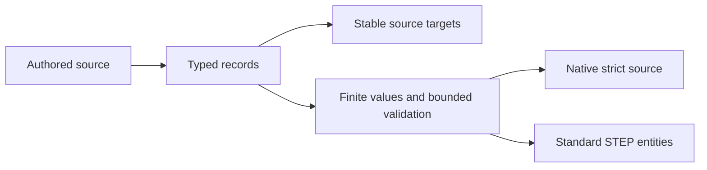

# ProductManufacturingInformation

## Purpose and Scope
Owns persistent dimension, tolerance, datum, semantic annotation and presentation source. Parent: [CADIR](../DESIGN.md). No children. ProductAttributes composes the container without interpreting its records.

## Responsibilities and Boundaries
This component owns authored values and source references. Geometry remains owned by its source feature; values are never inferred from renderer labels. STEP exchange owns standard carriers and unit conversion. UUID identities survive Native persistence and become entity identities within an exchange invocation.

## Related Designs
| Design | Relationship | Contract Used | Summary | Cautions |
|---|---|---|---|---|
| [Product Attributes](../ProductAttributes/DESIGN.md) | used by | structural target and record validation | source composition | Targets must resolve in the same document |
| [STEP Attributes](../../CADExchange/STEPAttributes/DESIGN.md) | used by | semantic entity transport | public STEP persistence | No silent partial loss |

## Architecture

## Contracts and Invariants
Every array is required, including empty arrays. Every reference resolves to a real target. Duplicate IDs, dangling datum references, nonfinite values and contradictory intervals fail. Validation consumes the caller's record, text, target, work and depth budgets. Length values use internal SI; angles use radians. Measured validation values retain their authored units and are not recomputed during exchange.

## State, Ownership, and Lifecycle
All source values are Sendable value types with no shared mutable storage. ProductAttributes owns their document lifetime.

## Failure, Concurrency, and Constraints
Structural and reference failures use ProductAttributeError. Cancellation and budget failure propagate from the enclosing source validator. Exchange refusal occurs before publication.

## Verification and Change Impact
Behavioral verification must cover actual Native and public STEP round trips of semantic targets, numerical values, datum relationships, camera/clipping and annotation placements, plus malformed, missing reference and resource failures. Parent fingerprint and Native schema must change together. Source implementation is not verification evidence.

### Annotation text source
Each ProductAnnotation owns its original ordered text literal selections. A ProductAnnotationTextLiteral retains occurrence identity/name, literal name/content, 2D versus 3D placement, orthonormal placement axes, alignment, text path and predefined font name. The annotation's plain text is the concatenation of its original literal content; differing values fail rather than choosing one authority. Public authoring without explicit literal selections creates one authored default literal, while Native decoding requires the actual stored array. STEP emits and decodes every literal using its actual standard fields. Unsupported presentation-style families fail explicitly before metadata publication.
