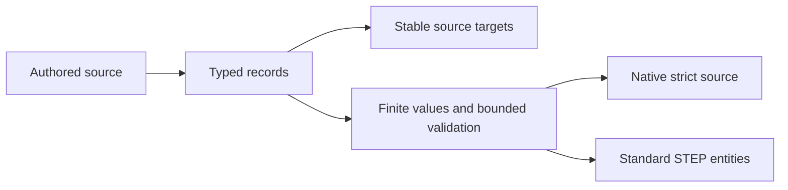

# ProductViewMetadata

## Purpose and Scope
Owns persistent saved camera, clipping plane, annotation placement and physical validation source. Parent: [CADIR](../DESIGN.md). No children. ProductAttributes composes the container without interpreting its records.

## Responsibilities and Boundaries
This component owns authored values and source references. Geometry remains owned by its source feature; values are never inferred from renderer labels. STEP exchange owns standard carriers and unit conversion. UUID identities survive Native persistence and become entity identities within an exchange invocation.

## Related Designs
| Design | Relationship | Contract Used | Summary | Cautions |
|---|---|---|---|---|
| [Product Attributes](../ProductAttributes/DESIGN.md) | used by | structural target and record validation | source composition | Targets must resolve in the same document |
| [STEP Attributes](../../CADExchange/STEPAttributes/DESIGN.md) | used by | semantic entity transport | public STEP persistence | No silent partial loss |

## Architecture

## Contracts and Invariants
Every array is required, including empty arrays. Every reference resolves to a real target. Duplicate IDs, dangling datum references, nonfinite values and contradictory intervals fail. Validation consumes the caller's record, text, target, work and depth budgets. Length values use internal SI; angles use radians. Measured validation values retain their authored units and are not recomputed during exchange.

## State, Ownership, and Lifecycle
All source values are Sendable value types with no shared mutable storage. ProductAttributes owns their document lifetime.

## Failure, Concurrency, and Constraints
Structural and reference failures use ProductAttributeError. Cancellation and budget failure propagate from the enclosing source validator. Exchange refusal occurs before publication.

## Verification and Change Impact
Behavioral verification must cover actual Native and public STEP round trips of semantic targets, numerical values, datum relationships, camera/clipping and annotation placements, plus malformed, missing reference and resource failures. Parent fingerprint and Native schema must change together. Source implementation is not verification evidence.

### Saved-view volume and clipping authority
A saved view retains the original projection point, window origin and in-plane up direction, and all front/back/side clipping booleans. The window's local Z equals its view-plane distance; camera world pose and camera-local window are separate frames. Plane acceptance preserves the original normal and positive/negative source halfspace. Recursive union and intersection values retain the Boolean clipping law without flattening it to intersecting planes. Validation charges each tree node and rejects excess caller depth. Native coding is strict and Native-only; common values are unchanged across compilation targets. Standard carriers follow [view_volume](https://www.steptools.com/stds/stp_aim/html/t_view_volume.html) and [visual presentation clipping](https://www.steptools.com/stds/smrl/data/resource_docs/visual_presentation/sys/4_schema.htm).

The saved window retains its original two-dimensional or three-dimensional placement kind. Two-dimensional window coordinates remain camera-local XY at z=0; three-dimensional window origins retain their original view-plane z. Standard planar-box placement selects both forms ([schema](https://www.steptools.com/stds/stp_aim/html/t_planar_box.html)). Native required decoding and the portable writer retain this distinction.

Three-dimensional window direction is original source data independent of the view-plane distance. Annotation mapping retains its original mapping-origin frame and the target transform's independent X basis (including reflection); the original mapping is target composed with inverse origin, rather than a regenerated identity origin.

View-volume signed distances are independently finite original LENGTH_MEASURE values, including inactive clipping planes; no invented positive focal-distance or front/back ordering changes their source meaning. Multiple placements of the same annotation in one saved view remain distinct ordered occurrences.
