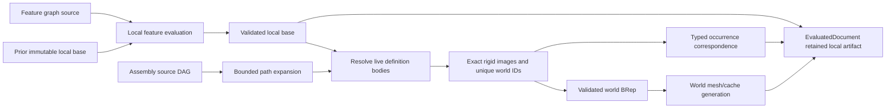

# Assembly Evaluation

## Purpose and Scope

This component owns PARX.X2 evaluation of the
[Document Assembly](../../CADIR/DocumentAssembly/DESIGN.md) source DAG into placed
world shapes and a typed occurrence correspondence index. Parent:
[CADKernel](../DESIGN.md). No children. Feature modeling and STEP syntax remain
with their existing owners.

## Responsibilities and Boundaries

The document evaluator first evaluates the feature graph in local coordinates.
This component resolves definition FeatureIDs against live body outputs, expands
source occurrence paths, composes placements, and creates independently owned
world topology. Existing generic-shape transformation and ownership-closed
extraction are consumed through their contracts. Shared definitions retain one
local geometry authority; each world instance has distinct topology identities.

An immutable local evaluation base retains the validated local B-rep, local
subshape index, and local lineage required by existing incremental feature
deltas. The final world B-rep is never used as that rollback base. Source changes
reuse admissible local feature evaluation and rebuild the world placement stage.
The public typed occurrence index owns path-to-definition/source/world
correspondence; it is not an invented feature graph or a substitute for lineage.

## Related Designs

| Design | Relationship | Contract Used | Summary | Cautions |
|---|---|---|---|---|
| [CADKernel](../DESIGN.md) | parent | EvaluatedDocument, incremental engine, cache validation | Composes local evaluation and world artifacts | Incremental deltas remain in the local topology domain |
| [Document Assembly](../../CADIR/DocumentAssembly/DESIGN.md) | depends on | validated DAG, paths, frames, limits | Provides the only assembly source | No geometry source is copied into the assembly DAG |
| [CADTopology](../../CADTopology/DESIGN.md) | depends on | exact ownership-closed B-rep | Validates independently placed topology | Entity identity collisions are failures |
| [Generic Shape](../../CADTopology/GenericShape/DESIGN.md) | depends on | ShapeOperating transformed/extracted shapes | Preserves exact geometry and chart correspondence | No alternate sampled transform is introduced |
| [STEP Assembly](../../CADExchange/STEPAssembly/DESIGN.md) | used by | retained local definition artifacts and correspondence | Exports definitions once with relative placements | Export checks source/artifact consistency |

## Architecture



## Contracts and Invariants

- Every definition body is resolved from real live subshape outputs of its
  declared FeatureIDs. Missing, consumed, ambiguous, or non-body outputs fail.
  Local body geometry remains ownership-closed and exact. Solid images use solid
  roots; sheet images use their existing shell roots and reattach their retained
  source body ownership records after the exact rigid operation. Shell transformation
  does not invent a solid or a new local source body. Every live local body
  must be accounted for by the assembly source; none is silently omitted.
- The correspondence index identifies each complete occurrence path, its source
  definition, composed proper rigid frame, local body identities, and world
  body/face/edge/vertex identities. It is validated against source and both local
  and world models. Index coverage of world topology is complete and unique.
- World topology identities are deterministic functions of persistent path and
  local source identity. Adding or reordering a sibling does not retarget an
  existing occurrence. Collisions fail before model publication.
- Existing local lineage is retained under its current real-feature ownership
  and earlier-feature-parent rules. Occurrence outputs use real definition
  FeatureIDs and path-qualified output roles. Their generated output lineage
  does not assert an invalid same-feature preserved relation; the typed
  occurrence index explicitly retains geometric source correspondence.
- The final SubshapeIndex exactly covers world bodies/faces/edges/vertices.
  The retained local index exactly covers local topology. These domains never
  share one mutable index or masquerade as each other during incremental rollback.
- Local feature entries and their deltas are reused only from a matching
  immutable local base. All world occurrences are rebuilt after local evaluation;
  world meshes/caches are generated against the new world model and source
  fingerprint. Local changed-body identities cannot authorize world mesh reuse.
- The artifact retains its admitted operation limits. `DocumentEvaluator` accepts
  caller assembly limits; STEP maps its exchange ceilings into those limits before
  world materialization. Raw-document evaluation admits caller expansion limits before
  the standard source validation can expand a DAG; certified-document entry checks
  them again before local evaluation. Consistency validation accepts a caller ceiling
  and otherwise uses the artifact's retained admitted limits. Geometry counting traverses persistent-map values directly
  through their existing Codable payloads into an operation-local counting encoder,
  without map materialization, a serialized buffer, or control-net copies.
  Primitive/array values, including loop-owned trim/control arrays, bound retained
  geometry storage;
  repeated copy passes, occurrence-role text, and full local-index scans are charged
  before copying.
  Independent world models are combined once, avoiding cumulative repeated copies.
- The complete assembly operation has one cumulative maximumWork ceiling. Source
  expansion returns its consumed work; local extraction and world copying consume
  the remaining allowance. Successful evaluation reports consumedWork so a caller
  can verify the admission boundary without guessing implementation cost constants.
- Expansion and topology-copy allocation charge checked counts before reserve or
  append. Maximum depth, occurrences, work, and topology entities are explicit
  operation limits. Cancellation is checked during traversal and copying.
  Failure returns no partially evaluated document.
- Nonassembly document behavior remains unchanged. Exact evaluation defers world
  mesh generation but still resolves, places, validates, and indexes assembly
  geometry. Persisted evaluated values cannot bypass source/artifact validation.

## Runtime Flows

```text
validate source -> evaluate/reuse local features -> retain immutable local base
 -> expand occurrence paths -> extract local definition bodies -> charge copies
 -> compose parent/local frame -> rigid transform -> reidentify -> combine
 -> validate world model/index -> create world meshes/caches -> publish snapshot
```

## State, Ownership, and Lifecycle

Local and world artifacts are immutable snapshot-owned values. Local geometry
may share immutable storage through existing value semantics, but every world
topology record belongs to one occurrence path. Operation counters and temporary
maps are confined to one synchronous evaluation. No registry, shared mutable
state, I/O, callback, or platform-specific synchronization is introduced.

## Failure, Concurrency, and Constraints

Public assembly evaluation is protocol-based and throws typed failures for
unresolvable local definitions, unsupported geometry transforms, inconsistent
correspondence, identity collisions, invalid frames, or resource exhaustion.
Existing exact validation and cancellation errors propagate. Neither a failed
placement nor an invalid retained base is replaced with an unplaced success.

## Verification and Change Impact

[AssemblyEvaluationTests](../../../Tests/CADKernelTests/AssemblyEvaluationTests.swift)
owns rotated/translated shared parts, nested shared subassemblies, world
coordinates and exact topology, deterministic sibling-stable identity, complete
correspondence, local-source editing with incremental reuse, exact and materialized
evaluation, consumed-output/resource/cancellation refusal, and source/derived
consistency. STEP/native tests verify the same artifacts through public document
flows. Changes require rechecking DocumentAssembly, existing evaluator
incremental/cache invariants, GenericShape exact transforms, and STEP export.
