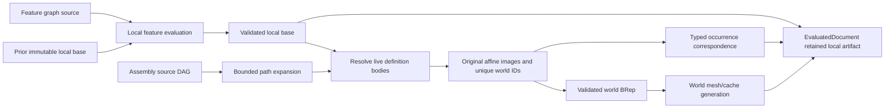

# Assembly Evaluation

## Purpose and Scope

This component owns PARX.X2 evaluation of the
[Document Assembly](../../CADIR/DocumentAssembly/DESIGN.md) source DAG into placed
world shapes and a typed occurrence correspondence index. Parent:
[CADKernel](../DESIGN.md). No children. Feature modeling and STEP syntax remain
with their existing owners.

## Responsibilities and Boundaries

The document evaluator first evaluates the feature graph in local coordinates.
This component resolves definition FeatureIDs against live body outputs, expands
source occurrence paths, composes placements, and creates independently owned
world topology. Existing generic-shape transformation and ownership-closed
extraction are consumed through their contracts. Shared definitions retain one
local geometry authority; each world instance has distinct topology identities.
Distinct definitions referencing the same FeatureID also reuse that authority.
World identity continues to include the actual definition and complete occurrence
path, so sharing local geometry does not merge PD-specific attributes or placements.

An immutable local evaluation base retains the validated local B-rep, local
subshape index, and local lineage required by existing incremental feature
deltas. The final world B-rep is never used as that rollback base. Source changes
reuse admissible local feature evaluation and rebuild the world placement stage.
The public typed occurrence index owns path-to-definition/source/world
correspondence; it is not an invented feature graph or a substitute for lineage.

## Related Designs

| Design | Relationship | Contract Used | Summary | Cautions |
|---|---|---|---|---|
| [CADKernel](../DESIGN.md) | parent | EvaluatedDocument, incremental engine, cache validation | Composes local evaluation and world artifacts | Incremental deltas remain in the local topology domain |
| [Document Assembly](../../CADIR/DocumentAssembly/DESIGN.md) | depends on | validated DAG, paths, frames, limits | Provides the only assembly source | No geometry source is copied into the assembly DAG |
| [CADTopology](../../CADTopology/DESIGN.md) | depends on | exact ownership-closed B-rep | Validates independently placed topology | Entity identity collisions are failures |
| [Generic Shape](../../CADTopology/GenericShape/DESIGN.md) | depends on | ShapeOperating transformed/extracted shapes | Preserves exact geometry and chart correspondence | No alternate sampled transform is introduced |
| [STEP Assembly](../../CADExchange/STEPAssembly/DESIGN.md) | used by | retained local definition artifacts and correspondence | Exports definitions once with relative placements | Export checks source/artifact consistency |

## Architecture



## Contracts and Invariants

- Every definition body is resolved from real live subshape outputs of its
  declared FeatureIDs. Missing, consumed, ambiguous, or non-body outputs fail.
  Local body geometry remains ownership-closed and exact. Solid images use solid
  roots; sheet images use their existing shell and source body records under the original affine image operation. Shell transformation
  does not invent a solid or a new local source body. Every live local body
  must be accounted for by the assembly source; none is silently omitted.
- The correspondence index identifies each complete occurrence path, its source
  definition, original placement word, local body identities, and world
  body/face/edge/vertex identities. It is validated against source and both local
  and world models. Index coverage of world topology is complete and unique.
- World topology identities are deterministic functions of persistent path and
  local source identity. Adding or reordering a sibling does not retarget an
  existing occurrence. Collisions fail before model publication.
- Existing local lineage is retained under its current real-feature ownership
  and earlier-feature-parent rules. Occurrence outputs use real definition
  FeatureIDs and path-qualified output roles. Their generated output lineage
  does not assert an invalid same-feature preserved relation; the typed
  occurrence index explicitly retains geometric source correspondence.
- The final SubshapeIndex exactly covers world bodies/faces/edges/vertices.
  The retained local index exactly covers local topology. These domains never
  share one mutable index or masquerade as each other during incremental rollback.
- Local feature entries and their deltas are reused only from a matching
  immutable local base. All world occurrences are rebuilt after local evaluation;
  world meshes/caches are generated against the new world model and source
  fingerprint. Local changed-body identities cannot authorize world mesh reuse.
- The artifact retains its admitted operation limits. `DocumentEvaluator` accepts
  caller assembly limits; STEP maps its exchange ceilings into those limits before
  world materialization. Raw-document evaluation admits caller expansion limits before
  the standard source validation can expand a DAG; certified-document entry checks
  them again before local evaluation. Consistency validation accepts a caller ceiling
  and otherwise uses the artifact's retained admitted limits. Geometry counting traverses persistent-map values directly
  through their common PortableSourceEncodable payloads into an operation-local
  PortableSourceEncoder measurement,
  without map materialization, a serialized buffer, or control-net copies.
  Primitive/array values, including loop-owned trim/control arrays, bound retained
  geometry storage;
  repeated copy passes, occurrence-role text, and full local-index scans are charged
  before copying.
  Independent world models are combined once, avoiding cumulative repeated copies.
- The complete assembly operation has one cumulative maximumWork ceiling. Source
  expansion returns its consumed work; local extraction and world copying consume
  the remaining allowance. Successful evaluation reports consumedWork so a caller
  can verify the admission boundary without guessing implementation cost constants.
- Expansion and topology-copy allocation charge checked counts before reserve or
  append. Maximum depth, occurrences, work, and topology entities are explicit
  operation limits. Cancellation is checked during traversal and copying.
  Failure returns no partially evaluated document.
- Nonassembly document behavior remains unchanged. Exact evaluation defers world
  mesh generation but still resolves, places, validates, and indexes assembly
  geometry. Persisted evaluated values cannot bypass source/artifact validation.

## Runtime Flows

```text
validate source -> evaluate/reuse local features -> retain immutable local base
 -> expand occurrence paths -> extract local definition bodies -> charge copies
 -> concatenate original factors -> bounded original affine image -> reidentify -> combine
 -> validate world model/index -> create world meshes/caches -> publish snapshot
```

## State, Ownership, and Lifecycle

Local and world artifacts are immutable snapshot-owned values. Local geometry
may share immutable storage through existing value semantics, but every world
topology record belongs to one occurrence path. Operation counters and temporary
maps are confined to one synchronous evaluation. An invocation-owned Mutex usage receipt is shared by synchronous lower callbacks.
All targets use the same storage and isolation; no callback or I/O executes under
the lock. No global registry is introduced.

## Failure, Concurrency, and Constraints

Public assembly evaluation is protocol-based and throws typed failures for
unresolvable local definitions, unsupported geometry transforms, inconsistent
correspondence, identity collisions, invalid frames, or resource exhaustion.
Existing exact validation and cancellation errors propagate. Neither a failed
placement nor an invalid retained base is replaced with an unplaced success.

## Verification and Change Impact

[AssemblyEvaluationTests](../../../Tests/CADKernelTests/AssemblyEvaluationTests.swift)
owns rotated/translated shared parts, nested shared subassemblies, world
coordinates and exact topology, deterministic sibling-stable identity, complete
correspondence, local-source editing with incremental reuse, exact and materialized
evaluation, consumed-output/resource/cancellation refusal, and source/derived
consistency. STEP/native tests verify the same artifacts through public document
flows. Changes require rechecking DocumentAssembly, existing evaluator
incremental/cache invariants, GenericShape exact transforms, and STEP export.

## Original Affine Placement Words

Assembly expansion supplies ordered immutable original rigid/affine factors.
An invocation-owned Mutex-backed usage receipt starts at structural expansion's
consumedWork and is shared by source feature extraction, bounded exact validation,
original-image placement, world namespace retention and correspondence publication.
Each feature model receives one exact source certificate. ShapeOperating's
validated-model original-word port retains flat original curve/surface images,
native UV/pcurve/coedge laws and exact determinant reflection orientation. No
rounded flattened matrix, unplaced fallback or fabricated validation receipt is
used. Bounded output validation precedes topology reidentification; the original
word remains in each published occurrence correspondence. All common source fields,
Sendable and synchronization contracts are identical on Native/WASM/Embedded;
Codable adapters remain Native-only. Deferred execution must cover nested mixed
rigid/affine words, reflection, shear/nonuniform scale, repeated/shared definitions,
source and decoded artifacts, cancellation and same-ledger refusal.

### Original Operation and Shared Admission

Persistent factors retain forward/inverse direction on their original direct
source. Original factors are applied leaf-to-root through the validated-model
ShapeOperating word port. Its prepared rational/algebraic action retains exact
inverse and direction normalization laws; a rounded inverse matrix cannot
substitute for them. Legacy context-free normalized point/vector conveniences
remain marked separately from this explicit caller path.

Bounded ValidatedBRepModel input and output receipts share the invocation usage
callback and caller depth caps. Source-local certificates are retained once per
feature. Structural extraction and reidentification copies keep their original
prepaid pass allowance, while original numeric validation/image visits charge the
same remaining work before execution. PortableSourceEncoder.measure counts the
actual common source payload without retaining its output byte buffer; required
canonical sorting scratch remains charged. Native codecs are adapters and never
participate in common geometry admission.

| State | Native | WASM | Embedded |
|---|---|---|---|
| Invocation usage | Mutex<State> | Mutex<State> | Mutex<State> |
| Read | remainingWork/consumedWork withLock | same | same |
| Mutation | consume before lower work, withLock | same | same |
| Release | invocation ARC owner after synchronous evaluation | same | same |

Lower bounded correspondence, seam/chart lift and exact inverse authority are
tracked by their owning components. Until those original lower ports close,
this source composition is incomplete even when a restricted forward image works.

### Flat Original Placement Action

AssemblyPlacementWord.originalOperationWord receives the explicit evaluation
tolerance and min(32, caller maximumDepth), and borrows the invocation's
OriginalQueryExecution under its retained contribution. Rational/algebraic work
and exact root visits share that owner; retained UInt32 limbs are charged as
checked bytes to its original work/storage envelope before allocation. One
immutable operation word is prepared per occurrence and reused across its source
features. Original inverse operations and normalized STEP directions remain
source; no rounded inverse/composition or reset allowance is introduced.
Topology owns original curve/surface image publication and orientation transport,
with word length independent of the child-source min(16, caller depth) cap.

Original word preparation and exact-cell visits consume the explicit
AssemblyResourceLimits.maximumAlgebraicDepth, independent from structural
maximumDepth and bounded curve subdivision. The same OriginalQueryExecution
and contribution admit exact work/storage and geometry visits; separating the
depth authorities neither resets counters nor enlarges any numeric ceiling.

## Canonical placement caller admission

The existing ordinary AssemblyEvaluator entry creates one OriginalQueryExecution
with the selected assembly work/source/scalar limits. Expansion, exact placement
words, validated BRep preparation and shape transformation borrow that execution.
The removed RationalAlgebraAdmitting adapter and its duplicate cumulative usage
owner are not reconstructed. Existing extraction/count/namespace algorithms and
independent topology/depth guards remain unchanged. This caller rebinding does
not change document evaluation or establish independent assembly runtime acceptance.

Assembly namespace rebinding borrows the invocation execution for every existing
source-table and internal-reference visit. Deterministic ID allocation, ordering
and retained geometry are unchanged; the ordinary reidentifier roots once and
delegates to that same body. This is the concrete caller dependency of assembly
composition, not a new imported-feature algorithm.

The direct assembly entry intersects the same declared AssemblyResourceLimits
with its incoming execution using one immutable contribution. Nested product
consistency evaluation consumes the same owner and keeps the original assembly
expansion, namespace, placement and validation algorithms.
