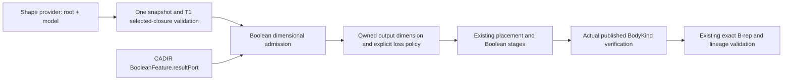

# BooleanDimension

## Purpose and Scope

This component is a child of [CADModeling](../DESIGN.md). It owns B3's semantic
Boolean admission, declared result dimension, explicit loss policy and result
dimension verification. It has no children. General Boolean intersection,
contact classification and exact region construction remain kernel concerns.

## Responsibilities and Boundaries

`BooleanDimensionResolving` declares the public preflight requirement.
`DefaultBooleanDimensionResolver` acquires each Shape input once, validates its
selected closure through T1 and derives an owned immutable contract.
`BooleanDimensionContract` verifies the dimension of the actual feature result.
The existing `BooleanFeatureEvaluator` invokes both boundaries around its real
placement, tool-union, Boolean, Slice and Keep Tools stages.

Shape validity does not imply Boolean capability. Standalone edges, wires and
vertices are valid T1 inputs but have no body Boolean implementation here.
Heterogeneous compounds and solid complexes likewise require a separate
operation route; preflight refuses them rather than dropping their roots.
Face and shell roots, including homogeneous aggregates of these roots, are
sheet inputs. A solid root is a material body input. Descendant boundary edges
and vertices never change the dimension of their owning input root.

## Related Designs

| Design | Relationship | Contract Used | Summary | Cautions |
|---|---|---|---|---|
| [CADModeling](../DESIGN.md) | parent | feature evaluation and staged publication | Owns the actual Boolean caller | No temporary stage identity reaches publication |
| [GenericShape](../../CADTopology/GenericShape/DESIGN.md) | depends on | one snapshot, selected closure and validation | Supplies valid dimensional selections | Validity is independent of Boolean geometry coverage |
| [CADIR](../../CADIR/DESIGN.md) | depends on | BooleanFeature.validate and resultPort | Sole source/material/output-port authority | This component does not duplicate the port decision |
| [CADKernel](../../CADKernel/DESIGN.md) | used by | Boolean operation applicator | Builds classified exact B-rep regions | Admission is not a geometry certificate |

## Architecture

## Contracts and Invariants

- Each provider is acquired once through `ShapeOperating.extract`. All later
  dimension decisions use that immutable validated snapshot.
- Root dimension is semantic: solid is 3D; face/shell is 2D; edge/wire is 1D;
  vertex is 0D. An aggregate does not promote its children to its highest
  dimension or acquire material ownership.
- Targets must all be supported solids or all supported sheets. Each tool is
  a supported solid or sheet. Multiple tools outside Region must be solids
  taken as Default or Inside, because the existing evaluator unites them as
  their volumes. Region preserves its existing all-faces interpretation.
- CADIR's `BooleanFeature.resultPort` supplies the result: Region is 3D;
  otherwise target material and target port determine 2D or 3D. Tool geometry
  may still make the requested result empty, unsupported or non-manifold.
- Output is a regularized body or sheet. Standalone contact vertices, edges
  and wires are not result roots. A lower-dimensional-only intersection
  therefore remains the existing typed empty-result failure; boundary entities
  owned by a surviving body are retained as that body's topology.
- The policy declares operand identity replacement and original tool retention
  under Keep Tools. Actual removed identities and reconstruction history come
  from `EvaluationResult.removedSubshapeIDs` and lineage, not inferred geometry.
- Default-solid Slice retains target and tool pieces. Sheet or nondefault
  material Slice retains the existing target-pieces-only envelope; its
  incomplete source marker remains authoritative. The policy exposes this
  restriction and does not claim complete Slice geometry.
- Before returning, the current feature must publish exactly one result body
  of the planned kind and no separate generated curves. Kept input tools and
  unrelated bodies do not masquerade as the feature's output. Exact body and
  lineage validation remain mandatory after dimension verification.

## Runtime Flows

The public resolver validates the source feature and operand counts, extracts
the selected topology once per input, classifies roots and consumes CADIR's
output-port contract. The production evaluator adapts its actual Body inputs
to solid or sheet Shape selections, resolves the contract before any stages,
then performs the existing staged evaluation. It verifies the final published
result before exact validation. No new Boolean geometry or fallback is selected.

## State, Ownership, and Lifecycle

Contracts and loss policies are immutable Sendable values. Snapshots are local
owned Shape values; no live provider survives preflight. Iterative root stacks
and local sets exist only within a synchronous invocation. Native, WASM and
Embedded use the same declarations and ownership boundaries.

## Failure, Concurrency, and Constraints

Malformed geometry and missing references propagate the existing typed
validation errors. Unsupported dimensional roots fail as unsupportedCapability;
mixed targets and incompatible multiple tools fail as invalidInput. A result
that violates its declared output dimension fails as topologyFailure. Existing
empty-result, numerical, non-manifold, resource and cancellation failures remain
failures. No partial result is returned on a failed preflight or postcondition.

Work is linear in finite input roots and the selected topology validated by T1;
root classification uses an explicit stack. Cancellation is checked per operand
and root. The component adds no subdivision, sampling, mesh allocation or new
geometry workspace, and does not change the existing kernel's resource limits.

## Verification and Change Impact

`Tests/CADModelingTests/BooleanDimensionTests.swift` owns the operation/material
dimension matrix, valid edge/wire rejection, heterogeneous-root rejection,
single-acquisition provider behavior, malformed selected-closure failure,
multiple-tool admission and actual evaluator output-kind refusal. Fixtures
contain real valid B-rep topology, not type-only placeholders. Root verification
additionally executes the existing SheetBoolean, RegionBoolean and
PlacedBooleanTool public tests and the portable contracts.

CADIR port/material changes require this preflight and kernel solidity to be
rechecked. T1 root changes require classification and single-acquisition tests.
Kernel output or staged publication changes require the result postcondition
and actual public Boolean behavior to be rechecked. B1/B2 geometry coverage and
the incomplete Slice envelope are not completed by this component.
