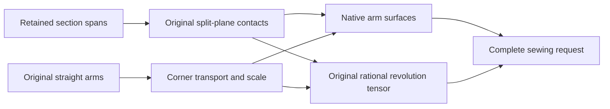

# Corner Sweep

## Purpose and Scope

This child of [CADModeling](../DESIGN.md) owns Sweep construction with mitred and round joins between straight arms,
including smooth curved legs carried by the certified curved sweep. It has no children.

## Responsibilities and Boundaries

The component owns arm transport, section splitting, join rows, retained scale,
native revolution patches and requests for the injected sewer. It consumes
section-span and tensor-boundary contracts. Geometry owns complete original
contact events and exact control-plane signs. Topology owns singularity and
sewing admission. Public feature selection and guide law authority remain in
the parent and its other children.

## Related Designs

| Design | Relationship | Contract Used | Summary | Cautions |
|---|---|---|---|---|
| [CADModeling](../DESIGN.md) | parent | native section spans and sewing boundaries | Supplies retained sections and public output publication. | The request must preserve actual guide presence. |
| [CADGeometry](../../CADGeometry/DESIGN.md) | depends on | original curve/plane events and coefficient predicates | Supplies source-side and contact authority. | Numeric root parameters cannot authorize exact poles. |
| [CADTopology](../../CADTopology/DESIGN.md) | depends on | original tensor singular boundaries | Retains collapsed face-local UV uses. | A near-axis point is not a singularity witness. |
| [CertifiedTwist](../CertifiedTwist/DESIGN.md) | coordinates with | original twist law | Owns straight-path rotation certification. | Corner twist and guide deformation require a distinct original producer. |

## Architecture

## Contracts and Invariants

All incident rows consume the same corner scale. A terminal authored zero
scale has a single native collapsed row and no fabricated end cap. Negative
scale or a nonperiodic closed-path scale fails explicitly. Exact axis controls
remain fixed in every angular row, including rational middle rows. Every
tensor patch retains four oriented UV uses; the original coefficient
classifier alone authorizes their singularity.

Split planes are part of the original construction law. Complete native
curve/plane events replace sampled sign-change searches. Whole source control
signs authorize the side of a span. A contact parameter is a proposal until
the original side and axis-contact witnesses justify the resulting split.
Mixed control hulls use prepared original native value/derivative intervals.
Whole positive or negative intervals prove a side; an exact clamped endpoint
on the plane and a strict original derivative sign proves its adjacent cell.
Unresolved cells subdivide within 32 levels and 65,536 charged source visits.
General algebraic contact charts and corner twist/guide producers remain
source gaps and cannot be inferred from fitted or sampled candidates.

## Failure, Concurrency, and Constraints

Construction is request-local and retains immutable source values. Exact
axis and plane coefficient phases consume at most 65,536 component visits;
native intersection options retain their existing bounds. Exhaustion,
ambiguous side and absent original deformation proofs are typed failures.
No source failure falls back to a successful sampled surface.
The request may borrow the Sweep invocation's CurvedSweepSourceBudget. Original
plane/axis visits and fresh split-span certificates consume that same work and
physical storage allowance while retaining the component's original 65,536
visits and 32 subdivision levels. A request-local default preserves legacy
entry points. Smooth curved legs retain their existing rigid, unit-scale contract; retained end
scale applies to the straight-arm domain. Corners adjoining a curved leg and
nonplanar closed-frame holonomy retain their explicit incomplete refusals.
This forwarding does not certify unmetered intersection,
patch-admission or constructor temporaries; those lower paths remain explicit
source gaps before aggregate admission can be claimed.

## Verification and Change Impact

`MitredSweepTests` and `RoundSweepCornerTests` in CADModelingTests own the
deferred behavioral evidence: native measured sections, arm/join pairing,
closed frame, ellipse and small-circle pole boundaries, zero terminal scale,
ambiguous contacts and invalid guide/twist requests. Source-only changes do
not establish those behaviors. Geometry contact/chart and Topology pole
changes require the same public Sweep path checks.

Straight-arm admission consumes SectionResolution's original whole line
incidence proof under the same invocation admission. Candidate control-point
proximity may propose a corner but cannot establish that its arms are straight.
