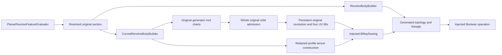

# Revolve

## Purpose and Scope

This component owns retained section revolution and its public feature
evaluation. Its parent is [CADModeling](../DESIGN.md); it has no children.

## Responsibilities and Boundaries

The component owns angular splitting, original rational tensor construction,
solid caps, sheet boundaries, stable publication and orbit admission. Geometry
owns exact axis-incidence predicates and original jet bounds. Topology owns
singular coefficient classification; the injected sewer owns canonical
vertices, edge pairing and face-local UV retention. Boolean application remains
an injected contract.

## Related Designs

| Design | Relationship | Contract Used | Summary | Cautions |
|---|---|---|---|---|
| [CADModeling](../DESIGN.md) | parent | section and evaluation contracts | Publishes retained construction through feature evaluation. | Source construction alone is not behavioral completion. |
| [Core CurrentTaskCancellation](../../CADCore/CurrentTaskCancellation/DESIGN.md) | depends on | common stateless cancellation checker | Checks every borrowed allowance operation. | Cancellation preserves its typed failure on every target. |
| [CADGeometry](../../CADGeometry/DESIGN.md) | depends on | rational tensors and original interval jets | Supplies native surface laws and whole orbit bounds. | Candidate roots do not prove original axis incidence. |
| [Geometry Conversion](../../CADGeometry/GeometryConversion/DESIGN.md) | depends on | retained source work and scalar-storage envelope | Bounds original request preparation without changing model tolerance. | The same caller ledger owns all composing native operations. |
| [Geometry OriginalRootSpan](../../CADGeometry/OriginalRootSpan/DESIGN.md) | depends on | source-bound algebraic roots and closed owning-span charts | Retains exact axis roots in original rational section coordinates. | Root exclusions, causal depth and one-sided native ownership survive construction. |
| [Geometry RationalBivariateAlgebra](../../CADGeometry/RationalBivariateAlgebra/DESIGN.md) | depends on | original homogeneous polynomials and square-free Sturm chains | Supplies exact arithmetic for original orbit monotonicity. | Endpoint signs consume retained root authority and the same caller allowance. |
| [Geometry OriginalRevolution](../../CADGeometry/OriginalRevolution/DESIGN.md) | depends on | retained original angular/generator law and closed endpoint incidence | Supplies the persistent source support and all four boundary lifts. | U remains original radians and V retains root traversal; converted tensors do not replace this law. |
| [CADTopology](../../CADTopology/DESIGN.md) | depends on | singular iso-boundary classification | Retains collapsed original rows as singular UV uses. | No endpoint-proximity bypass. |
| [SingularSheetBoundary](../../CADKernel/SingularSheetBoundary/DESIGN.md) | used by | sewing edge admission | Pairs physical boundaries and retains singular face uses. | Singular uses have one host face, not fabricated paired edges. |

## Architecture

## Contracts and Invariants

An original axis endpoint remains fixed under rotation. Its tensor row is
identical at all angular coefficients, and the corresponding constant-V UV
use remains in the rectangular face loop. The component may skip an axis
generator only after an exact original incidence witness. A small nonzero orbit
must not become an axis pole through distance tolerance.
Original linear endpoints without a whole outward clearance proof also choose
the tensor path. This routing cannot admit singularity: the exact incidence
witness and unchanged original tensor coefficients retain that authority.
The analytic fast path therefore never drops a near-axis orbit as a pole.

Spatial admission uses original axial/radial interval boxes, monotonicity and
whole pair separation. One or both original endpoint poles require strictly
positive homogeneous radial projection throughout the open span. The separator
uses the original unnormalized axis coefficients, independently of the rounded
rotation frame. Zero axis controls contribute no radial numerator, and at least
one strictly positive control with positive weight proves positivity on the
open single-Bezier span; the same
monotonicity proof continues to own orbit injectivity. Interior algebraic axis
contacts require an original root chart. Numeric root midpoints are proposals
and cannot authorize a collapsed row.

`OriginalRevolveGeneratorResolver` constructs rational generator charts directly
from every original positive knot span in the authored finite trim. Geometry's
original root classifier owns the common axis-cross polynomial isolation and
binds each exact root to its original source, span, raw axis and Sturm interval.
Modeling consumes complete isolated and coincident strata without duplicating
the polynomial or filtering numerical root bounds. Roots
at a retained trim endpoint replace the authored endpoint authority; roots at
a knot retain both adjacent owning sides. Root ordering uses exact rational
isolation stations and exclusion flags, never numerical midpoints. A span
whose three numerators vanish identically retains a whole-axis receipt distinct
from an isolated pole. Each chart carries the original knot-span index and
source curve; no trimmed or converted coefficient net becomes its source.
Consumers use the lower prepared owning-span local chart, including its
original endpoint and slope receipt. The public construction and orbit paths
do not turn outward native parameter bounds back into a local chart. This
preserves roots between adjacent representable native parameters even in a
small internal knot span; the lower design owns its exact normalization.
Exact zero-offset binary gain-minus-one parameter images unwrap by negating
the two authored trim stations and reversing the retained chart traversal.
The operation preserves the original underlying native polynomial and its
algebraic roots; no fitted reverse curve or rounded affine offset supplies the
endpoint authority. General ratio, offset and analytic angular maps require
their lower original endpoint chart and cannot use this exact-negation branch.
The native curve-section public path consumes this resolver, persistent
original revolution supports and all four UV boundary uses. Analytic-conic,
transformed and cyclic endpoint charts and higher-order pole admission remain
required before general source or publication completion is declared.

`OriginalRevolutionSheetBuilder` constructs one persistent original support for
each retained generator chart and angular interval, with U in original radians
and V in [0,1]. Each rectangle retains four `SurfaceLiftCurve3D` boundaries,
including both singular endpoint iso-curves. Endpoint coordinates only realize
the lower original source point within the distance contract. Axis incidence
comes from the retained root witness. Canonical positive UV rectangle winding
and the original generator direction determine sheet orientation independently
of the sign of the requested turn. Angular intervals retain authored ordering
for stable face publication. Sewing and model combination remain the existing
injected publication boundary; neither exact geometry failure nor exhausted
admission selects a tensor or analytic successful fallback.

`OriginalRevolutionOrbitAdmitter` consumes those retained generator charts.
Its orbit coordinates are the original axial dot product and squared norm of
the original raw-axis cross product. Whole closed native jets bound both
coordinates and their derivatives, including algebraic endpoint uncertainty.
Pair separation, a strict common monotone functional, or certified partial-turn
angular separation must discharge every pair of generator cells. Partial-turn
angular exclusion consumes the same canonical continuous angular phase as the
persistent original revolution support, preserving authored radian labels and
its outward phase scale. Raw binary sine/cosine cannot substitute for that
source law in an orbit-separation witness. Midpoints
choose functionals and subdivisions only. Root completeness proves open-span
axis exclusion; an interval radius lower bound or an approximate point cannot
replace that receipt. Whole-axis charts do not generate faces. The caller's
same exact ledger owns preparation, retained cells and pair visits, with the
unchanged depth and visit envelope. Closed endpoint derivative zeros consume
the exact open-chart monotonicity proof below; they do not select a regularity
bypass. Higher-order whole pole normal laws remain a separate lower obligation.

`OriginalRevolutionMonotonicityProof` owns exact orbit monotonicity when closed
derivative bounds include an endpoint zero. It constructs original rational
axial and squared-radial derivative numerators, retaining their square-free
Sturm chains under the request allowance. Variations at authored exact stations
or retained algebraic roots count zeros on the open original chart; endpoint
zeros do not become interior zeros. The first nonzero original polynomial
derivative at the traversal start determines the directed open sign. A receipt
is usable for every subcell of that same chart, and adjacent charts must have
the same strict directed sign in the same orbit coordinate. Whole-axis charts
and unresolved signs remain separate strata. This proof does not replace
pair separation, original root completeness, or whole pole normal bounds.
Proofs are prepared only when closed interval monotonicity is inconclusive and
cached once per retained chart in an invocation-local array. Reversed charts
retain their authored native traversal direction, so endpoint Taylor signs
are transported by the exact direction parity rather than a numeric midpoint.

Angular intervals and profile edges share one retained rotation. Singular
topology never creates a terminal cap. Stable references identify only actual
published faces, edges and vertices. Original thin, sheet, solid and Boolean
requests retain their body-kind and lineage authority.
Distinct original interior spline knots remain separate native boundaries,
including parameter intervals shorter than the model-space distance tolerance.
Only identical repeated knots are deduplicated; parameter spacing cannot erase
a source continuity break or an owning Bezier pole chart.
Planar generator half-space admission does not spend the model-space distance
allowance across the rotation axis. Exact whole-axis controls and isolated
original endpoint pole proofs retain their separate admission; other spans
require a zero-margin half-space proof. A slightly negative radius cannot be
accepted as a regular span and later published with an interior collapse.

## Runtime Flows

Resolve the source section, admit the original axis and generator, construct
retained surfaces and UV uses, sew, combine the prior model and publish lineage.
Boolean requests consume the completed tool through the injected applicator.
No failed geometric admission selects a different successful fallback.
Native B-spline curve sections, including the exact negation image used by
reversed section references, dispatch from `CurvedRevolveBodyBuilder.buildSheet`
to original root classification, orbit admission and persistent sheet publication.
The orbit admission receipt retains the exact charts, angle and tolerance and
has no externally callable initializer; publication consumes that same receipt.

## Failure, Concurrency, and Constraints

Inputs and prepared geometry are immutable request values. Original orbit
proofs retain 65,536 pair visits and 32 subdivision levels per cell. Exhaustion,
unresolved overlap and invalid original input remain typed failures. This
source-only phase does not claim the deferred behavioral or runtime evidence.
The original native request retains the existing Geometry Conversion default
work and scalar-storage ceilings together with the historical 65,536 cell and
32-depth revolution ceilings. `OriginalRevolutionSourceBudget` owns one local
value ledger, borrowed synchronously by each lower operation. Preparation,
root isolation, coefficient evaluation, orbit cells and publication charge that
same ledger without resets. Its mutation is invocation-local `inout` on Native,
WASM and Embedded; no escaping callback, reference-shared storage or conditional
isolation is introduced. Cancellation uses Core's common current-task checker.

## Verification and Change Impact

The deferred owners are `CurvedRevolveFeatureTests` and
`RevolveSheetConstructionTests` in CADKernelTests, and `RevolveOptionsTests`
in SwiftCADTests.
Required behavior includes positive and negative turns, exact poles, small
nonzero orbits, singular UV retention, native side/cap pairing, stable lineage
and invalid or unresolved generators. Changes to the lower pole classifier,
one-sided normal law or sewer require these original-public-path checks.

The original revolution source allowance preserves conversion storage as
Double-sized physical slots. Exact algebra word counts are UInt32 words: checked
word-byte multiplication followed by ceiling division into Double slots retains
the same physical cap. Algebra cell depth remains the intrinsic 32-level limit;
source traversal and curve subdivision must check their own explicit guard.
