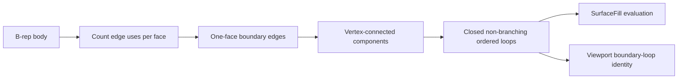
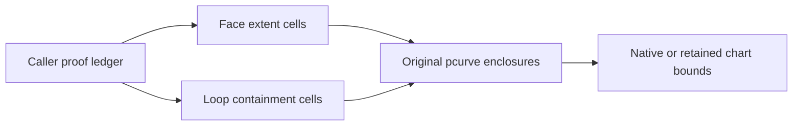

# CADTopology

## Purpose and Scope

`CADTopology` owns validated B-rep topology and topology-level queries. It is a
child of the [Swift-CAD package design](../../DESIGN.md) and owns
[OpenBoundaryLoop](OpenBoundaryLoop/DESIGN.md) and
[SurfaceAreaIntegration](SurfaceAreaIntegration/DESIGN.md),
[BoundedRepair](BoundedRepair/DESIGN.md), [GeometricExtrema](GeometricExtrema/DESIGN.md),
[VolumeMoments](VolumeMoments/DESIGN.md), [OriginalSourceValidation](OriginalSourceValidation/DESIGN.md), and [OrthographicEdgeProjection](OrthographicEdgeProjection/DESIGN.md).

## Responsibilities and Boundaries

The module owns exact topological incidence, adjacency, ownership, and
validation. It does not construct NURBS surfaces, resolve Rupa selection, or
choose display behavior. Open-boundary loop discovery is shared topology
knowledge so feature evaluation and viewport presentation identify the same
eligible boundary components.

The [GenericShape](GenericShape/DESIGN.md) component publishes common operations
for independently selected dimensional roots and heterogeneous compounds. Its
selected snapshot is distinct from a complete body-owned BRepModel.

## Related Designs

| Design | Relationship | Contract Used | Summary | Cautions |
|---|---|---|---|---|
| [Swift-CAD package](../../DESIGN.md) | parent | exact B-rep topology | Defines topology's place in the package. | Mesh is not topology authority. |
| [Solid Complex](SolidComplex/DESIGN.md) | child | face-connected cell topology and full-boundary interface validation | Preserves individually owned solids and shared interface identity. | A connected cell graph does not assert Boolean union or global interior disjointness. |
| [GenericShape](GenericShape/DESIGN.md) | child | ShapeRepresenting and ShapeOperating | Owns common dimensional selection and exact rigid-image operations. | Selected closure validation retains the complete-body BRepModel contract. |
| [Non-Manifold Topology](NonManifoldTopology/DESIGN.md) | child | raw snapshot retention, structural diagnosis and explicit admission | Preserves non-manifold topology for inspection without granting modeling permission. | Clean structure must still pass existing exact geometry/body validation. |
| [OpenBoundaryLoop](OpenBoundaryLoop/DESIGN.md) | child | ordered boundary cycles and hole eligibility | Provides shared exact topology and rejects a lone face's outer perimeter as a fill target. | Geometry quality remains a modeling contract. |
| [CADModeling](../CADModeling/DESIGN.md) | used by | loop containing a stable seed edge | Builds a separate surface from an eligible boundary. | Curve conversion and surface quality remain CADModeling responsibilities. |
| [RupaCore](../../../RupaKit/Sources/RupaCore/DESIGN.md) | used by | loop edge membership | Marks the same open loop for viewport affordances. | Display identity comes from generated topology IDs. |

## Architecture



## Contracts and Invariants

`SurfaceParameterAreaBounds.zero`, `minimumAbsoluteValue` and `adding` are package-readable
for the thickened-sheet consumer. The existing signed area enclosure remains
authoritative: an interval containing zero has no strictly positive absolute
area bound. Visibility does not change its numerical law or admit a face.


### Original Vertex Position Authority

`Vertex.originalPoint` optionally retains the original authored binary point
and its ordered original affine operation word through Geometry's
`OriginalAffineWordPoint3D`. When absent, `Vertex.point` retains its historical
binary source meaning. When present, `point` is only a numeric localization;
validation, position queries and canonical mesh junctions consume the original
whole D0 enclosure under their unchanged physical tolerance and caller budgets.
Transformations append original operations to the retained word rather than
transforming an earlier rounded localization. Source equality and native
transport retain the optional law. Missing exact enclosure or unachievable
localization accuracy fails explicitly; a numeric point cannot erase the law.
Original source nesting, spatial subdivision, exact algebra and optional bytes
retain their independent composing caller policies.

- An eligible edge has exactly one coedge use in exactly one face owned by the
  requested body.
- A returned loop is connected, closed, has no repeated edge, and every vertex
  has degree two in that boundary component.
- Edge traversal records whether it follows the stored edge direction. A loop
  requested from a seed starts at that edge and follows its stored direction.
- Branches, open chains, non-boundary edges, and malformed components are not
  returned as closed loops. A lone face's outer perimeter is a valid boundary
  cycle but not a fillable hole; both modeling and presentation use the same
  predicate to refuse it.
- Loop discovery reads exact B-rep topology only. It never consults mesh edges
  or geometric endpoint proximity.
- `BRepModel.faceAreaMeasurement` (`TOPO-FACEAREA-001`) measures a face's area
  and area centroid from its coedge pcurves alone, never from a tessellation.
  Analytic supports retain their specialized exact integration paths. Free-surface
  area and centered first moments use the certified error and resource contract
  owned by [SurfaceAreaIntegration](SurfaceAreaIntegration/DESIGN.md).
- Volume integrates each face loop as one chain on the periodic chart the
  `SurfaceParameterLoopUnwrapper` lifts it to. A great-circle pcurve on a
  sphere keeps the branch of longitude its chart lift starts on — a meridian
  along the seam reads as either end of the period — and a great circle split
  at the seam carries that branch on across it, so the integrated longitudes
  meet the unwrapper's translations. A projected analytic pcurve (a conic on
  a plane or a cone) reads a `Plane3D`'s parameters along the plane's own
  basis (`Plane3D.parameterBasis`, the one `Surface3D` places points by), so a
  hyperbolic edge on a floor or a side wall integrates on the chart its
  neighbouring pcurves share; `DraftFaceTests` own it by a cone-drafted wall's
  volume. A certified pcurve on a cylinder that runs round it (a crossed
  cylinder's intersection) starts its cells halved until each encloses less
  than a turn; a cell's enclosure may narrow to a point of the curve's own
  parameter (an endpoint's v enclosure). A cell's term sees U only through the
  primitive's periodic derivative, but the global `v * F(u)` boundary term
  needs both ends on one sheet: each cell centres its U enclosure on its own
  principal midpoint, so the end is carried onto the start's sheet through the
  shared boundaries of a left-to-right cell chain (a curve crossing the seam
  otherwise gains a whole turn of flux). `CrossedCylindersTests` own it by a
  radial hole, a drilled hole and a tee with the smaller cylinder's seam turned
  0, 45 and 90 degrees.
- `AnalyticPrismaticVolumeEvaluator`'s closed-form frustum takes shells of cones and
  planes only; a shell with a torus among its cones (a cone's rim rounded) is left to
  `TrimmedAnalyticSurfaceVolumeEvaluator`'s flux (`ConicalRimBlendTests`).

### Geometry Store Bounded Admission

`GeometryStore.validate` forwards one caller work callback and optional byte
callback to every bounded original curve and support validator. Entity visits
occur before traversal; descendant source and algebra admission remain owned by
Geometry. The store introduces no allowance or allocation estimate. Original
source depth and geometric subdivision caps remain separate from retained
ordered-field/root depth. `OriginalBRepValidationInvocation` composes this port
with the same source invocation used for topology and correspondence checks.

### Original UV Rectangle Images

`ExactRectangularPcurveDomainResolver` recognizes full directed native UV
traversals hosted by `OriginalAffineWordSurfaceParameterCurve`. Recognition
requires the face support to equal the retained target and the original lift
support to equal the target source. Only source fractions 0→1 or 1→0 are
transparent; reverse traversal reverses the original endpoint order. Spatial
word factors do not change UV bounds. Partial fractions require an original
exact endpoint carrier and are not inferred from rounded interpolation.
Nested word images retain these bindings at every layer. Natural sheet resizing
and rectangular contact refinement consume the same original rectangle.

Full directed `originalImage` carriers use the same source/target bindings.
`axisAlignedEndpoints` publishes an immutable receipt retaining the original
pcurve, support and tolerance together with its ordered exact endpoints. Natural
sheet consumers reuse this producer to select the physical original axis;
they do not duplicate inverse-gain calculations or interpolate source fractions.
Each foreign UV endpoint is issued only after exact original rational subtraction,
gain division and optional axis swap reproduce a finite represented Double.
Nonrepresentable endpoint images remain on the general certified enclosure route;
a rounded inverse does not authorize a rectangle. Affine and periodic translated
endpoints use the same exact scalar authority. Native spline sides require
clamped authored endpoint roles, positive weights and monotone axis controls;
control equality alone and evaluated rounded endpoints are insufficient.

The additive bounded resolver accepts the original work/depth and optional byte
callbacks. Every source/knot/control/weight visit and requested endpoint buffer
uses that invocation. Child-source recursion retains the caller source-depth
limit; exact algebra visits are depth zero source charges. An injected legacy
resolver cannot silently satisfy the bounded requirement. Requested typed bytes
remain distinct from allocator capacity and overhead. Recognition refusal selects
the existing complete original enclosure/integration path and does not change
its fidelity, cancellation or failure contract.


### Original Face Extent Witness Bounds

Face extent refinement uses original singleton UV value boxes as reached-point
witnesses. The upper endpoint of each box bounds the true minimum from above;
the lower endpoint bounds the true maximum from below. Rounded representative
parameters cannot enlarge this inner witness extent. Complete original curve
boxes remain the outer extent authority. The historical 1e-7 relative overhang,
65536 visited-cell cap and depth48 ceiling remain unchanged, with caller depth
and independent algebra32 applied more strictly. Every retained curve/cell buffer
is admitted through the same optional requested-byte callback before growth.

### Retained Angular Transport Sources

Original angular transport curves/supports consume their own retained prepared
jets and domains. Foreign physical-radian transports have no intrinsic binary
period receipt; classifiers and trim paths cannot descend to an underlying ideal
circle/sphere to invent seam or full-turn authority. Primitive/construction
shortcuts decline these families and retain generic original source producers.

### Original Boundary-Corrected Supports

`originalBoundaryCorrected` retains both its native construction and the original
Coons boundaries. Generic original position/jet, flux and tessellation producers
consume the corrected law; analytic, translation and native-tensor shortcuts
cannot substitute the construction alone. Area admission checks both retained
source children under its existing dimensional and nesting limits. Lower source
validation/higher-order completion remains an explicit dependency of these routes.

## Verification and Change Impact

`CADTopologyTests` verifies deterministic ordered traversal, seed orientation,
multiple disjoint loops, and refusal to report branched or open boundary
components, and the single-face inner/outer fillability rule.
`FaceAreaMeasurementTests` (SwiftCADTests) prove box, L-shaped, full and half
cylinder areas and centroids against closed forms and the typed refusal.
`FilletShapeTests.everyEdgeOfABoxRoundsIntoARoundedBox` proves the sphere chain
at all eight octants of a box, including those whose meridians lie on the
seam, against the rounded box's closed-form volume. Changes affect
CADModeling Surface Fill and RupaCore body display topology; both consumers
must continue to agree on the exact cycle and whether it is actionable.


### Original Local Active Curve Extraction (PAR.CL9L1)

CertifiedBSplineCurveBezierExtractor may reduce each original active span to its
exact degree+one original control/weight slice and two-degree+two stored knot
slice. No coefficient reconstruction or rounded Cartesian extraction is used.
The lower endpoint's correct original owning span, all derivative orders,
positive weights and existing outward homogeneous derivative/Bernstein operations
must remain authoritative. Repeated knots and closed endpoints retain their
original side; invalid/unsupported source and exhausted work refuse explicitly.
A monotonic original knot cursor avoids restarting a full scan for every span. Each new cursor advance and the checked original local knot/control/weight slice cost is charged to the existing maximumControlOperations before reading or materializing that work. No new private budget is introduced.
Direct independent original homogeneous value/derivative containment at span
endpoints/interiors and repeated-knot rational fixtures must verify the change,
followed by existing profile-moment and rational area/volume integration owners.
The candidate flux endpoint shortcut is not part of this adoption; it has a
separate near-endpoint root and seam-enclosure contract needing direct proof.


### Original Local Active Surface Extraction (PAR.SURFEX1)

The certified surface extractor owns complete native span decomposition for volumetric validation. Each original tensor span may use only the degree-plus-one original control and weight slice in each axis and each axis's two-degree-plus-two stored knot slice, preserving the original chart and outward homogeneous derivative/Bernstein authority. Monotonic original span cursors charge every knot probe before reading it; a U cursor starts once per V row. Checked local knot/control/weight materialization is charged before allocation to the existing cumulative maximumControlOperations. Basis work depends on local degree rather than repeatedly materializing every original global control. No budget increase, rounded Cartesian reconstruction, replacement support, sample authority or volume fallback is introduced. Repeated knots and closed endpoints retain their original owning side, and all span contributions retain positive finite homogeneous weights. Failure and cancellation remain explicit. Independent original tensor homogeneous position/derivative containment on rational repeated-knot span endpoints and interiors, multi-span polynomial extraction under the unchanged allowance, resource refusal and existing volume regressions precede Draft's actual final volumetric validation. Native lower4tests pass.135s, including strict dyadic homogeneous value/first/second derivative containment on every original repeated-knot patch side,178-span admission under unchanged4M allowance and typed resource/cancel refusal. Existing22 parametric/rational volume owner tests pass20.265s on the exact frozen source. Draft public integration remains separately owned.

### Original Rational Pcurve Seam Bands (PAR.SEAMBAND1)

Rational pcurve seam subdivision supplies a complete curve partition for certified volumetric flux; its breaks do not replace original coefficients or certify root equality. At the existing maximumDepth, an unresolved closed cell whose original homogeneous difference hull still contains zero contributes both cell boundaries to the partition. Every positive interval, including the entire uncertain band, remains in rationalSurfaceExplicitBounds. No endpoint identity, root-free classification, dropped measure, coordinate snapping or new tolerance is inferred. Original rational pcurve jets and PreparedField.bounds over every intersecting original surface span retain both closed seam sides. piecewiseRationalSurfaceGaussEnclosure and rationalSurfaceSeamEnclosure integrate the complete band measure; only the unchanged requestedWidth final acceptance authorizes flux. Unprovable width, original cell/work exhaustion, nonfinite arithmetic, invalid support and cancellation remain explicit failures. The original maximumDepth and maximumWorkItems are maintained, and no private fallback budget or replacement curve is created. Task cancellation is checked at the rational entrance, seam/adaptive work boundaries and before flux publication; the original cancellation cause propagates.

Normalized rational pcurve jets retain every original homogeneous derivative-control net and factorial/native scaling. For a finite ordered parameter interval contained in [0,1], each derivative range intersects its existing outward de Casteljau evaluation with the complete original derivative-control convex hull. Both bounds contain the same original polynomial over the whole closed interval; their intersection does not replace coefficients, sample, infer zero or alter derivative orders. Outside this normalized domain the existing evaluation remains authoritative. Empty/nonfinite intersections refuse with explicit topology resource failure rather than manufacturing a successful range. This closes the observed dependency expansion that gave a valid constant positive weight a nonpositive lower bound on [0,1]; it also retains the complete original first derivative needed to integrate an unresolved band. The same work/depth/requested-width contracts remain in force.

Prepared original surface flux has the same scalar Bernstein authority. Patch.flux already restricts its normalized U/V query to each original patch's unit square and preserves every owning span. Only this scalar prepared flux numerator evaluates its complete original determinant polynomial with outward tensor de Casteljau and intersects that evaluation with the complete same-original coefficient tensor hull. All original determinant coefficients, homogeneous denominator bounds, chart/scaling and span ownership remain unchanged; finite empty intersections fail explicitly. This operation does not alter directional jets or claim derivatives from a scalar hull. It closes the observed constant-density whole-band dependency expansion while preserving the existing width, work and depth acceptance.

Independent lower tests must exercise near-endpoint and interior crossings, contact or on-seam intervals, unequal rational weights and no-crossing controls against literal integral bounds; exact interval width must contain the oracle and satisfy the request. An insufficient width/work allowance must refuse. Actual Draft pcurve/adjacent surface validation and the unchanged original volume oracle remain upper-owned verification.

Native lower verification: all5 dedicated declarations/10cases pass.080s on the original depth-zero whole-band fixture and unchanged width/work/cancellation oracles. Existing22 parametric/rational volume declarations pass5.989s. The scalar and derivative original hull intersections are composed on the same frozen source; actual Draft/public volume integration is separately owned and pending.

### Original Piecewise Polynomial Green Prefix (PAR.CL9PREFIX1)

This module owns a bounded replacement for the repeated U-span fan integration
observed in the original cubic Draft's final volumetric validation. It prepares
a Green primitive from the same original certified homogeneous Bezier patches
already consumed by `PreparedField`; it does not replace the stored surface,
pcurve, extraction authority, complete closed curve cover, or requested volume enclosure.
The [CADModeling original cubic Draft contract](../CADModeling/DESIGN.md)
depends on this volume owner only after its whole support/pcurve proofs succeed.
This section defines pending implementation and verification, not completed
public Draft capability.

```text
Shell's shared coefficient budget + original surface/reference/uBase
    -> certified original patches -> polynomial primitive and V-band U prefixes
Original directed pcurve -> certified jets and complete seam/band partition
    -> owning-span primitive jet OR all-incident closed-band range
    -> one-dimensional boundary integral -> unchanged requested-width admission
```

| Owner file | Internal contract and responsibility |
|---|---|
| New `CertifiedPiecewisePolynomialSurfaceFluxPrimitive.swift` | Owns the immutable `CertifiedPiecewisePolynomialSurfaceFluxPrimitive`, with no private work allowance. The existing single-patch primitive file needs no change. |
| `CertifiedRationalBezierSurfaceFluxIntegrator.swift` | Adds `PreparedField.preparedPolynomialGreenPrimitive(uBase:consumeCoefficientOperations:) throws -> CertifiedPiecewisePolynomialSurfaceFluxPrimitive?`. The synchronous nonescaping charge callback is `(Int) throws -> Void`. Reuses that field's retained source/reference/tolerance, already prepared original patches and determinant coefficients, without another extraction or determinant reconstruction. |
| `CertifiedAnalyticPcurveFluxIntegrator.swift` | Adds `piecewisePolynomialBounds(for:primitive:requestedWidth:tolerance:) throws -> Interval`. Consumes original pcurve jets, owning-span primitive jets and all-incident seam ranges; it does not revisit every preceding U span at each Gauss node. |
| `TrimmedParametricSurfaceVolumeEvaluator.swift` | Keeps its private shell-scoped `CoefficientBudget`, passes it by `inout` into `arbitraryRationalContribution`, and supplies the factory's callback as `try budget.consume(count, tolerance: tolerance)`. Prepares once per admitted surface/reference/uBase and consumes the primitive for its loops; only the factory's nonconstant-weight `nil` selects the existing rational path. Existing analytic/rectangular dispatch and loop orientation/area admission retain their proofs. |

The existing nested `CoefficientBudget` keeps its private owner, unchanged limit,
consumed count, checked `consume` behavior and typed resource error. The shell
creates it once from `maximumCoefficientOperations` (default 2,000,000); no face,
patch, prefix or retry resets it. The synchronous callback borrows this counter
only during preparation and is never stored in the immutable receipt. Existing
polynomial consumers retain their existing charges. Already executed extraction
and determinant preparation is not retroactively charged by this callback.
For new receipt preparation, the charge counts transferred coefficient and
metadata slots and original-source/panel scan work separately from executed
outward divisions, U-integration accumulations and prefix additions;
it charges both to the shared total before their allocation or execution.
Checked degree, tensor, capacity, loop and total arithmetic precedes all charges
and work, including prefix accumulation. Slot counts alone cannot stand for
executed arithmetic; this does not assert that unchanged consumers charge every
existing scalar operation. Original homogeneous extraction retains its separate
cumulative extraction-operation budget, and adaptive jobs retain their existing
work-item/depth owners. No budget type is exported or moved for this handoff.
Failed preparation cannot select the rational route.

Admission first validates the original source and tolerance. Every stored
weight must equal the same finite positive original weight `w` exactly, and the
certified patch weights must retain that exact constant. Approximate equality,
an `isRational` classification, sampled agreement and rounded Cartesian patches
cannot admit this authority. Only an otherwise valid source with nonconstant
stored weights returns `nil`. Invalid source/domain/uBase, missing or duplicate
native panels, unproved exact-weight retention, nonfinite arithmetic and budget
exhaustion throw the existing appropriate typed failure. `uBase` must lie in
the original closed U domain. Periodic and unsupported charts retain an explicit
incomplete-implementation marker and typed refusal in the factory; they do not
return the nonconstant-family `nil`.

For each native patch, let `xi=(u-a)/DeltaU`, `eta=(v-c)/DeltaV` and let
`Q=N/(3*w^3)` be its original outward determinant polynomial in normalized
coordinates. Native density is `f=Q/(DeltaU*DeltaV)`. Bernstein U integration
uses the existing primitive law `B[0]=0` and
`B[k+1]=B[k]+Q[k]/(degreeU+1)` with outward arithmetic. For each original V
band, the prefix at U panel `i` is the coefficient-wise sum of the full U
integrals of all panels preceding `i`. The native Green value is
`G_i(u,v)=(prefix_i(eta)+B_i(xi,eta))/DeltaV`.
The anchored primitive is `A(u,v)=G(u,v)-G(uBase,v)`, and its boundary
integrand is `A(u(t),v(t))*v'(t)`. This native convention preserves every
stored chart width; it neither multiplies DeltaU twice nor drops DeltaV.
Prefix construction retains matching original V degrees/charts and the
original reference point. No coefficient is snapped or fitted.

The receipt retains the original surface, reference, preparation tolerance,
uBase, complete ordered native U/V spans, exact endpoint ownership/scales and
outward prefix/local coefficient nets. Only the factory constructs it.
Its same-owner queries are `range(overClosedUV:) throws -> Interval` and
`directionalJet(u:v:uSpan:vSpan:) throws -> CertifiedUnivariateTaylorJet`.
The range query covers every incident original panel intersecting the closed
box, including both sides of C0 knots; missing coverage and domain violations
fail. The jet query binds to one retained native panel and never advertises a
single derivative across a C0 seam. Anchoring subtracts the separately retained
uBase primitive in the same native V chart.

U-prefix construction makes the mathematical primitive agree at each shared U
endpoint without claiming equal derivatives there. V seams retain both original
V-band primitives and their own DeltaV. Every positive uncertain seam band from
the existing original pcurve partition remains part of the integral. A cell
proved to lie in one native panel uses the original pcurve jets and the existing
sixth-derivative one-dimensional Gauss remainder. A closed cell touching or
crossing a seam uses the union of all incident original primitive ranges,
multiplied by the full original `v'` range and the entire cell measure; refinement
may tighten this enclosure but cannot remove measure or assign one seam side.
No seam-spanning jet, endpoint root identity or coordinate tolerance is invented.

The caller's existing `requestedWidth`, depth and work limits govern the
boundary integral and final accumulated enclosure. Preparation and prefix
formation check Task cancellation at entry and each native-panel work boundary;
receipt publication performs a final Task cancellation check after all charged
work, including cancellation triggered by the final charge callback. Exact-weight
admission charges its prepared-control and row-metadata scans before that scan;
prior extraction charges do not pay for these new repeated operations.
Boundary partition/adaptive evaluation/publication retain the existing
cancellation checks and propagate the original cancellation cause. Unsupported
pcurve families throw explicitly; the already supported `certifiedImplicit`
family retains its original native implicit flux owner by type dispatch, with
no prefix-error retry. Mixed loops use prefixes for explicit original pcurves
and the existing proof for implicit ones under the same requested widths and
loop orientation/total. Implicit-only faces may skip unused prefix preparation.
The existing original surface extractor requires positive closed U/V domains.
A valid periodic BSplineSurface3D exposes a periodic domain and is rejected by
that extractor before a PreparedField is created. This prefix uses the retained
bounded closed-domain authority and does not expand that existing support range.
The factory's periodic refusal is local defensive admission, not evidence of a
newly rejected successful volume route. No periodic prefix, cycle cover or
unwrapped-chart capability is introduced. Failures on admitted polynomial inputs
never select a sampled proof, new allowance or rational retry. General
nonconstant weight inputs continue through the original rational owner.

Verification uses literal continuous C0 support
`S(u,v)=(u,v,h(u))`, U knots at `[1,2,4]`, V domain `[0,3]`, with `h=u` on
`[1,2]` and `h=3*u-4` on `[2,4]`. Its original native density is `0` and
`-4/3`: the triangle `[(1,0),(4,0),(4,3)]` has flux `-16/3`, its reversed
boundary `+16/3`, and the full rectangle `-8`. The triangle's sloping side
also uses literal collinear degree-two rational controls
`[(4,3),(2.5,1.5),(1,0)]` with weights `[1,2,1]` to retain nonlinear original
parameter jets. Uniform source weights `7` must preserve those oracles; changing
one stored weight to `7.nextUp` must select the nonconstant family, without
acquiring polynomial authority. Tests cover original seam endpoints, complete
uncertain bands and V-side ownership, invalid/missing coverage, shared cumulative
budget exhaustion and cancellation. The accumulated interval must contain its
independent oracle and meet the original requested width.
The whole-loop handoff fixture uses the same literal triangle with affine
original pcurves, preserving its flux and enclosure width. Rational nonlinear
pcurve jets are checked directly by the lower flux owner. The unchanged pcurve
area owner refused the rational whole-loop fixture at its existing cell limit;
that observation is local to area orientation convergence and does not authorize
changing its limits or broadening this prefix responsibility. The original
178-span public Draft retains its original pcurves and area proof and remains a
required integration check.

Change impact includes existing polynomial and rational volume owners and the
unchanged original 178-U-span public Draft adjacency/volume tests. The same
public trace must show that each ordinary primitive evaluation consumes a
prepared prefix and current native span instead of repeating the fan's entire
preceding U-span integration. Runtime and operation counts are measured on that
actual path; passing lower preparation tests alone does not complete Draft.


### Polynomial Prefix U Seam Ownership (PAR.CL9SEAM2)

The admitted original polynomial Green prefix owns U seam coverage for its
B-spline pcurve dispatch. Every original native pcurve Bezier patch remains a
separate integration domain with its existing requested-width share. This
branch keeps the existing V seam root partition but does not first isolate
roots of every U surface seam. Generic rational, implicit and other explicit
pcurve routes retain their original U/V partition owner.

```text
Original B-spline pcurve native patches -> existing closed V seam partition
    -> whole original pcurve jets
    -> one owning U/V panel jet OR all-incident closed primitive range
    -> full cell measure -> existing width/work/depth/cancellation admission
```

The prefix construction carries each original U-panel integral into the next
panel in the same native V chart. Its mathematical Green value is therefore
continuous across every closed U knot, including C0 source knots; both incident
outward coefficient nets contain that same value. This is coefficient authority,
not equality inferred from pcurve endpoints, affine coordinate samples or a
root identity. V-side primitives may differ at a C0 V knot, so their existing
root partition remains owned by the rational seam producer.

A prefix cell may use derivative/Gauss proof only after its complete original
U/V value ranges lie in one retained panel. Every other cell uses the primitive
range over all intersecting original closed panels, the complete original
rational pcurve V derivative and the entire cell measure. No contact, endpoint,
on-seam interval or uncertain U band loses measure or receives a root-free
classification. Adaptive subdivision uses the unchanged 65,536-cell allowance,
48-depth default, requested-width accounting, finite arithmetic and cancellation
checks. Exhaustion and an unproved final width remain typed failures. This
handoff introduces no new budget, replacement curve, coefficient reconstruction
or failed-proof retry.

The owner is `CertifiedAnalyticPcurveFluxIntegrator.swift`; receipt construction
and range/jet authority remain in the preceding prefix contract. Independent
literal crossing, contact, on-seam and endpoint flux tests, original native
pcurve patch coverage, insufficient work/width and cancellation accompany the
change. Existing V-C0 prefix and generic rational seam tests remain regression
evidence. The original 178-U-span Draft pcurves, support proofs, 15-minute public
limits and volume oracle remain unchanged and are verified by the upper owner.

### Portable value and serialization boundary

The common Native/WASM/Embedded topology types preserve the same stored source,
Sendable, Hashable and ownership contracts. Foundation-free common geometry
algorithms import the platform C math implementation explicitly. Codable,
Encoder/Decoder and CodingKeys belong to native transport adapters guarded by
`!hasFeature(Embedded)`; this split never changes state, synchronization or
source authority. The portable source writer consumes the same public stored
values rather than selecting another topology implementation.

### Caller-Owned Face Extent Proof Work

`FaceParameterExtentResolver(maximumSubdivisionDepth:consumeWork:)` retains its
original relative extent resolution of `1e-7` and `65_536` visited-cell ceiling.
The optional callback debits the calling query before each curve, endpoint,
extent cell, and lower enclosure cell is evaluated. Caller subdivision depth
is a stricter admission bound, including enclosure subdivision below an extent
cell; it never replaces the historical component ceiling with a larger value.
`DefaultFaceParameterBoundsResolver` and the certified loop predicate forward
the same callback and remaining depth to original pcurve enclosures. Specialized
analytic enclosure producers share that callback rather than granting each
curve a new query allowance. A typed depth/work failure is preserved through
face bounds, classification, and original B-rep bounding-box callers.



The existing `FaceParameterExtentResolverTests` own the extent-resolution
contract; source-only wiring is not behavioral evidence for shared budgets.

Retained original Coons surfaces compose the generic original chart contracts for validation, area and volume flux. Each boundary root span is admitted recursively under the existing source nesting and coefficient limits; no analytic-family shortcut or fitted tensor replaces the source.

Certified parameter loop queries expose signed integer winding as well as nonzero containment. The same original curve boxes establish a homotopy excluding the query before exact directed half-open ray crossings are summed. Boundary remains a distinct result; summing contours never replaces boundary by a winding value. Original curve order, orientation, callback and subdivision limits are retained.

Original plane-derivative curves and surfaces retain both their generated
construction and original support constraints. Generic original jet producers
own their corrected geometry; native or analytic volume shortcuts cannot
substitute the construction net. Dimension admission visits original rails,
constraints and corrected support fields under the same source ceiling.

Original drafted curves and walls retain the directed generator, raw normal,
axis, pull, physical angle and authored heights. Generic original closed jets
are their geometry authority; analytic and native construction shortcuts
decline this family. Source dimension admission visits the generator under the
existing nesting ceiling. Area smoothness uses the original drafted first-order
continuity issuer over the complete query and never infers higher continuity
from a derivative hull or a fitted native candidate.

Original guide traversal chains remain normalized source curves in trim,
measurement, mesh and volume dispatch. Their raw traversals and exact station
partition are retained; primitive volume shortcuts do not substitute any fitted
control net or infer spatial linearity from the traversal list.

Exact rectangular polyline admission permits repeated identical stations within
a nonzero directed axis run. Every source segment remains on the fixed axis and
never reverses direction; Geometry owns the exact Euclidean telescoping proof
used by native iso consumers. No distinct endpoint or source point is removed.

Original guide endpoint connectors retain the authored guide and section
endpoint expressions through generic trim, area, volume and mesh routes.
Primitive recognition cannot infer an uncorrected source locus from that
connector; its corrected original law supplies every position and derivative.


### Original Parameter Enclosure Host Propagation

Face extent witness and enclosure queries pass the actual face support to the
original UV value facade. The certified parameter encloser accepts an optional
host for compatibility with independent standalone 2D queries and forwards a
known host through every original numeric-chart query. Spatial image recursion
uses the retained source support; literal periodic translation keeps the same
host. Missing hosting authority cannot certify an original source relation.
Work, byte admission and independent depth limits remain the same invocation.

## M6 Portable Validation Wiring

The actual exact validator and the full Topology module compile on the same
Native, ordinary WASM and Embedded graph. Topology directly depends on
HashTreeCollections where its retained PersistentMap members and conformances
are consumed; each diagnosed source imports that module explicitly. This changes
import visibility only, retaining the existing immutable COW map authority.

Existing cancellation sites consume the public
[Current Task Cancellation](../CADCore/CurrentTaskCancellation/DESIGN.md) port
through its stateless default checker on all targets. The checker observes the
current task at the existing site and preserves typed CancellationError. No
check is removed, no callback is weakened and no budget or algorithm changes.

```text
exact validator / existing topology operation
    -> CurrentTaskCancellationChecker
    -> current Task.isCancelled -> same CancellationError
```

The retained storage, isolation, callback and release contracts are identical on
Native, ordinary WASM and Embedded: existing PersistentMap owners remain COW,
existing proof-budget Mutex owners retain their withLock access, and invocation
contexts remain immutable Sendable values. This wiring adds no mutable state or
target-specific synchronization.

The M6 boundary verification graph owns actual exact-model validation, current
task cancellation and canonical source-ID audit formatting. Full Geometry and
Topology compilation plus the real Kernel boundary component precede public
consumer execution. This is not full CADKernel/Modeling acceptance. See
[M6 boundary fixtures](../../Tests/OriginalDomainConsumerVerification/Sources/M6BoundaryFixtures/M6ExactBoundaryFixtures.swift)
and the [verification graph](../../Tests/NativeExactRelationVerification/DESIGN.md).

Only existing optional numeric diagnostic strings use private typed formatters:
Optional(value) and nil retain their original spelling. Source-derived, hash-bound
Native differential and Embedded probes verify the exact helper bodies.
The nonthrowing diagnose path preserves isValid:false and invalidInput while
consuming KernelError.wrapping(...).message from Core's existing
[Failure Contract](../CADCore/FailureContract/DESIGN.md). Existing KernelError
messages are retained; GeometryError diagnostic presentation is owned by Core.
No new error classification or reflection implementation is introduced here.

### M6 Metadata-Free Member Access

The diagnosed Embedded key-path reads use closures selecting the same concrete
member. Existing map, flatMap, compactMap, allSatisfy and grouping operations
retain their input traversal, ordering, result counts and container ownership.
Private homogeneous-coordinate and chord-deviation helpers receive a noncapturing
member accessor rather than runtime key-path metadata; their arithmetic and
control buffers remain unchanged. Edge length dispatch explicitly supplies the
existing default `CurveArcLengthOptions()` to the injected protocol requirement,
as the former convenience extension did. No Geometry protocol is changed.

The eight diagnosed existential error interpolations consume only the existing
Core `KernelError.wrapping(...).message` presentation authority. Their prefixes,
outer diagnostic codes, residuals, KernelError-specific branches and cancellation
rethrows remain owned by the unchanged caller. Native keeps its prior reflective
text; Embedded uses Core's typed static presentation. Presentation does not
authorize a success result or alter error classification.

| Logical owner | Native | Ordinary WASM | Embedded WASM | Read / mutation entry | Release |
|---|---|---|---|---|---|
| BRep entity tables | PersistentMap COW | Same | Same | Existing model member reads / value mutation | Retained model release |
| Original source invocation | Immutable Sendable callbacks and limits | Same | Same | Existing admission callback; no retained mutable ledger | Invocation release |
| Distance proof work/bytes | `Mutex<State>` | Same | Same | Existing `withLock` charge/read; callback outside lock | Invocation release |
| Volume moment proof work/bytes | `Mutex<State>` | Same | Same | Existing `withLock` charge/read | Invocation release |
| Current-task cancellation adapter | Stateless checker | Same | Same | Existing check site → `Task.isCancelled` | No stored owner |

The M6 exact boundary result retains immutable Sendable raw/refined owners and
COW arrays; its compiler's mutable assembly buffers are local to one call. The
self-contact result uses the same immutable retained-owner contract. Neither
consumer introduces shared mutable state, unchecked Sendable or conditional
storage/isolation. Target-specific numeric/error presentation contains no state.

The complete interpolation boundary is: DefaultBRepTopologyValidator's invalid
coordinate, geometry store, face-local pcurve, geometric correspondence and
volume diagnostic catches; OriginalCollapsedWireRestorer's collapsed-position
catch; OriginalBRepValidationInvocation's non-Kernel contextualized coedge
catch; and BoundedBRepRepairEngine's signed-shell orientation catch. Each retains
its prior diagnostic and cancellation control flow. The earlier five-site
summary omitted the two validator catches and the final compiler-exposed repair
catch; this list is the complete verified scope.

### Canonical admission delivery binding

This integration selects the existing Geometry direct APIs documented by
[Original Query Execution](../CADGeometry/OriginalQueryExecution/DESIGN.md).
Topology replaces removed admission declarations and callback-shaped calls with
one original inout execution through the existing validation, trim, area and
image algorithms. Ordinary entry points create one execution and enter the same
body. Scalar/coefficient, source and subdivision limits remain independent;
existing formulas, supported branches, orientation and refusal guards remain
authoritative. This binding does not include independent feature or repair fixes.
Selected child contracts own their direct invocation details. Actual target
compilation and focused behavior remain required evidence.

```text
ordinary root / composing caller -> OriginalQueryExecution -> original Geometry API
```

The selected body shell-ID helper visits the original component/void ownership
order under the same execution before producing its array. Validation requests
expose a direct witness preserving their unique, nonempty scope predicate. These
are required callee bindings for receipt/validator consumers, not topology edits.
