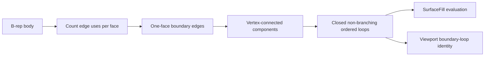

# CADTopology

## Purpose and Scope

`CADTopology` owns validated B-rep topology and topology-level queries. It is a
child of the [Swift-CAD package design](../../DESIGN.md) and owns
[OpenBoundaryLoop](OpenBoundaryLoop/DESIGN.md) and
[SurfaceAreaIntegration](SurfaceAreaIntegration/DESIGN.md).

## Responsibilities and Boundaries

The module owns exact topological incidence, adjacency, ownership, and
validation. It does not construct NURBS surfaces, resolve Rupa selection, or
choose display behavior. Open-boundary loop discovery is shared topology
knowledge so feature evaluation and viewport presentation identify the same
eligible boundary components.

The [GenericShape](GenericShape/DESIGN.md) component publishes common operations
for independently selected dimensional roots and heterogeneous compounds. Its
selected snapshot is distinct from a complete body-owned BRepModel.

## Related Designs

| Design | Relationship | Contract Used | Summary | Cautions |
|---|---|---|---|---|
| [Swift-CAD package](../../DESIGN.md) | parent | exact B-rep topology | Defines topology's place in the package. | Mesh is not topology authority. |
| [Solid Complex](SolidComplex/DESIGN.md) | child | face-connected cell topology and full-boundary interface validation | Preserves individually owned solids and shared interface identity. | A connected cell graph does not assert Boolean union or global interior disjointness. |
| [GenericShape](GenericShape/DESIGN.md) | child | ShapeRepresenting and ShapeOperating | Owns common dimensional selection and exact rigid-image operations. | Selected closure validation retains the complete-body BRepModel contract. |
| [Non-Manifold Topology](NonManifoldTopology/DESIGN.md) | child | raw snapshot retention, structural diagnosis and explicit admission | Preserves non-manifold topology for inspection without granting modeling permission. | Clean structure must still pass existing exact geometry/body validation. |
| [OpenBoundaryLoop](OpenBoundaryLoop/DESIGN.md) | child | ordered boundary cycles and hole eligibility | Provides shared exact topology and rejects a lone face's outer perimeter as a fill target. | Geometry quality remains a modeling contract. |
| [CADModeling](../CADModeling/DESIGN.md) | used by | loop containing a stable seed edge | Builds a separate surface from an eligible boundary. | Curve conversion and surface quality remain CADModeling responsibilities. |
| [RupaCore](../../../RupaKit/Sources/RupaCore/DESIGN.md) | used by | loop edge membership | Marks the same open loop for viewport affordances. | Display identity comes from generated topology IDs. |

## Architecture

## Contracts and Invariants

- An eligible edge has exactly one coedge use in exactly one face owned by the
  requested body.
- A returned loop is connected, closed, has no repeated edge, and every vertex
  has degree two in that boundary component.
- Edge traversal records whether it follows the stored edge direction. A loop
  requested from a seed starts at that edge and follows its stored direction.
- Branches, open chains, non-boundary edges, and malformed components are not
  returned as closed loops. A lone face's outer perimeter is a valid boundary
  cycle but not a fillable hole; both modeling and presentation use the same
  predicate to refuse it.
- Loop discovery reads exact B-rep topology only. It never consults mesh edges
  or geometric endpoint proximity.
- `BRepModel.faceAreaMeasurement` (`TOPO-FACEAREA-001`) measures a face's area
  and area centroid from its coedge pcurves alone, never from a tessellation.
  Analytic supports retain their specialized exact integration paths. Free-surface
  area and centered first moments use the certified error and resource contract
  owned by [SurfaceAreaIntegration](SurfaceAreaIntegration/DESIGN.md).
- Volume integrates each face loop as one chain on the periodic chart the
  `SurfaceParameterLoopUnwrapper` lifts it to. A great-circle pcurve on a
  sphere keeps the branch of longitude its chart lift starts on — a meridian
  along the seam reads as either end of the period — and a great circle split
  at the seam carries that branch on across it, so the integrated longitudes
  meet the unwrapper's translations. A projected analytic pcurve (a conic on
  a plane or a cone) reads a `Plane3D`'s parameters along the plane's own
  basis (`Plane3D.parameterBasis`, the one `Surface3D` places points by), so a
  hyperbolic edge on a floor or a side wall integrates on the chart its
  neighbouring pcurves share; `DraftFaceTests` own it by a cone-drafted wall's
  volume.

## Verification and Change Impact

`CADTopologyTests` verifies deterministic ordered traversal, seed orientation,
multiple disjoint loops, and refusal to report branched or open boundary
components, and the single-face inner/outer fillability rule.
`FaceAreaMeasurementTests` (SwiftCADTests) prove box, L-shaped, full and half
cylinder areas and centroids against closed forms and the typed refusal.
`FilletShapeTests.everyEdgeOfABoxRoundsIntoARoundedBox` proves the sphere chain
at all eight octants of a box, including those whose meridians lie on the
seam, against the rounded box's closed-form volume. Changes affect
CADModeling Surface Fill and RupaCore body display topology; both consumers
must continue to agree on the exact cycle and whether it is actionable.

### Original Local Active Curve Extraction (PAR.CL9L1)

CertifiedBSplineCurveBezierExtractor may reduce each original active span to its
exact degree+one original control/weight slice and two-degree+two stored knot
slice. No coefficient reconstruction or rounded Cartesian extraction is used.
The lower endpoint's correct original owning span, all derivative orders,
positive weights and existing outward homogeneous derivative/Bernstein operations
must remain authoritative. Repeated knots and closed endpoints retain their
original side; invalid/unsupported source and exhausted work refuse explicitly.
A monotonic original knot cursor avoids restarting a full scan for every span. Each new cursor advance and the checked original local knot/control/weight slice cost is charged to the existing maximumControlOperations before reading or materializing that work. No new private budget is introduced.
Direct independent original homogeneous value/derivative containment at span
endpoints/interiors and repeated-knot rational fixtures must verify the change,
followed by existing profile-moment and rational area/volume integration owners.
The candidate flux endpoint shortcut is not part of this adoption; it has a
separate near-endpoint root and seam-enclosure contract needing direct proof.

### Original Local Active Surface Extraction (PAR.SURFEX1)

The certified surface extractor owns complete native span decomposition for volumetric validation. Each original tensor span may use only the degree-plus-one original control and weight slice in each axis and each axis's two-degree-plus-two stored knot slice, preserving the original chart and outward homogeneous derivative/Bernstein authority. Monotonic original span cursors charge every knot probe before reading it; a U cursor starts once per V row. Checked local knot/control/weight materialization is charged before allocation to the existing cumulative maximumControlOperations. Basis work depends on local degree rather than repeatedly materializing every original global control. No budget increase, rounded Cartesian reconstruction, replacement support, sample authority or volume fallback is introduced. Repeated knots and closed endpoints retain their original owning side, and all span contributions retain positive finite homogeneous weights. Failure and cancellation remain explicit. Independent original tensor homogeneous position/derivative containment on rational repeated-knot span endpoints and interiors, multi-span polynomial extraction under the unchanged allowance, resource refusal and existing volume regressions precede Draft's actual final volumetric validation. Native lower4tests pass.135s, including strict dyadic homogeneous value/first/second derivative containment on every original repeated-knot patch side,178-span admission under unchanged4M allowance and typed resource/cancel refusal. Existing22 parametric/rational volume owner tests pass20.265s on the exact frozen source. Draft public integration remains separately owned.

### Original Rational Pcurve Seam Bands (PAR.SEAMBAND1)

Rational pcurve seam subdivision supplies a complete curve partition for certified volumetric flux; its breaks do not replace original coefficients or certify root equality. At the existing maximumDepth, an unresolved closed cell whose original homogeneous difference hull still contains zero contributes both cell boundaries to the partition. Every positive interval, including the entire uncertain band, remains in rationalSurfaceExplicitBounds. No endpoint identity, root-free classification, dropped measure, coordinate snapping or new tolerance is inferred. Original rational pcurve jets and PreparedField.bounds over every intersecting original surface span retain both closed seam sides. piecewiseRationalSurfaceGaussEnclosure and rationalSurfaceSeamEnclosure integrate the complete band measure; only the unchanged requestedWidth final acceptance authorizes flux. Unprovable width, original cell/work exhaustion, nonfinite arithmetic, invalid support and cancellation remain explicit failures. The original maximumDepth and maximumWorkItems are maintained, and no private fallback budget or replacement curve is created. Task cancellation is checked at the rational entrance, seam/adaptive work boundaries and before flux publication; the original cancellation cause propagates.

Normalized rational pcurve jets retain every original homogeneous derivative-control net and factorial/native scaling. For a finite ordered parameter interval contained in [0,1], each derivative range intersects its existing outward de Casteljau evaluation with the complete original derivative-control convex hull. Both bounds contain the same original polynomial over the whole closed interval; their intersection does not replace coefficients, sample, infer zero or alter derivative orders. Outside this normalized domain the existing evaluation remains authoritative. Empty/nonfinite intersections refuse with explicit topology resource failure rather than manufacturing a successful range. This closes the observed dependency expansion that gave a valid constant positive weight a nonpositive lower bound on [0,1]; it also retains the complete original first derivative needed to integrate an unresolved band. The same work/depth/requested-width contracts remain in force.

Prepared original surface flux has the same scalar Bernstein authority. Patch.flux already restricts its normalized U/V query to each original patch's unit square and preserves every owning span. Only this scalar prepared flux numerator evaluates its complete original determinant polynomial with outward tensor de Casteljau and intersects that evaluation with the complete same-original coefficient tensor hull. All original determinant coefficients, homogeneous denominator bounds, chart/scaling and span ownership remain unchanged; finite empty intersections fail explicitly. This operation does not alter directional jets or claim derivatives from a scalar hull. It closes the observed constant-density whole-band dependency expansion while preserving the existing width, work and depth acceptance.

Independent lower tests must exercise near-endpoint and interior crossings, contact or on-seam intervals, unequal rational weights and no-crossing controls against literal integral bounds; exact interval width must contain the oracle and satisfy the request. An insufficient width/work allowance must refuse. Actual Draft pcurve/adjacent surface validation and the unchanged original volume oracle remain upper-owned verification.

Native lower verification: all5 dedicated declarations/10cases pass.080s on the original depth-zero whole-band fixture and unchanged width/work/cancellation oracles. Existing22 parametric/rational volume declarations pass5.989s. The scalar and derivative original hull intersections are composed on the same frozen source; actual Draft/public volume integration is separately owned and pending.
