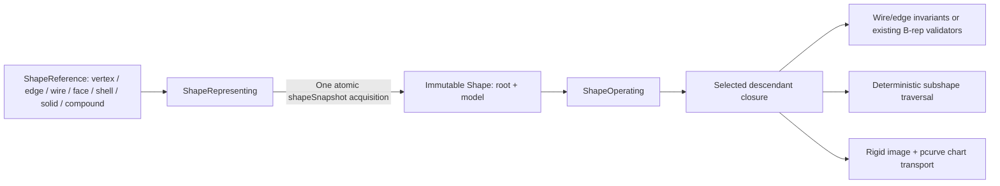

# GenericShape

## Purpose and Scope

This component is a child of [CADTopology](../DESIGN.md). It owns the T1 common
input abstraction for standalone vertices, edges, open or closed wires, faces,
shells, solids and heterogeneous compounds. Its public operations extract the
selected ownership closure, validate it, traverse its subshapes and apply exact
rigid transformations. Boolean and feature-specific dimension combinations
belong to B3/B4 and consume this abstraction through its public contract.

## Responsibilities and Boundaries

`ShapeRepresenting.shapeSnapshot()` acquires one immutable `Shape` containing
its root selection and `BRepModel` together. `Shape` is the concrete value and
returns itself. `ShapeOperating` defines common
operations and `DefaultShapeOperator` supplies their implementation.
`ShapeReference` preserves dimensional root identity; a wire owns an ordered
list of `ShapeEdgeUse` values, independently of face-local `Loop.role` and
pcurve ownership.

The component does not weaken `BRepModel.validate`: that existing contract
requires body-owned shells and all referenced descendants. Standalone topology
uses its own selected closure. Face and shell validation temporarily adapts that
closure to the existing sheet-body validation path; synthesized adapter owners
are never returned or persisted. Solid validation uses the original body's
material-component and cavity contract. Compound means aggregate selection;
CompSolid and shared-material ownership are T2 responsibilities.

## Related Designs

| Design | Relationship | Contract Used | Summary | Cautions |
|---|---|---|---|---|
| [CADTopology](../DESIGN.md) | parent | B-rep incidence and validation | Stores topology referenced by the shape. | Body ownership remains strict. |
| [CADGeometry](../../CADGeometry/DESIGN.md) | depends on | Curve/surface validation, parameter-preserving rigid images | Supplies exact geometric representations. | Chart transport must preserve pcurve lifts. |
| [CADModeling](../../CADModeling/DESIGN.md) | used by | Common Shape input and selected topology closure | Subsequent dimension-specific operations use the same input abstraction. | T1 does not establish Boolean domain coverage. |

## Architecture

## Contracts and Invariants

- Every common operation acquires exactly one immutable snapshot of a valid
  provider. Extraction, validation, transformation and returned root use only
  that captured value. A provider may change its selection between operations;
  its snapshot method must atomically capture the root and model together.
- Extraction copies exactly the selected descendants and their geometry. It
  preserves IDs, edge direction, trims, face/shell orientation, body material,
  component ownership and void-shell relationships. It never mutates input.
- Root references and every selected descendant must exist with a matching
  table ID; unrelated malformed or unselected topology is outside the closure.
- Vertices have finite coordinates. Edges carry valid geometry with endpoints
  matching their curve and trim under the existing modeling tolerance contract.
- Wires contain a nonempty ordered edge-use chain. Consecutive oriented endpoint
  IDs agree; an open final endpoint is valid. A closed wire returns to its first
  endpoint. Closure never implies a face or a solid.
- Edge geometry admission retains the existing B-rep edge/trim domain: one
  vertex closing a full-period edge and degenerate zero-length edges are
  explicitly refused. Their seam/pole representations require T5's topology
  changes; the generic abstraction does not claim those domains are complete.
- Standalone faces and shells use the existing exact B-rep validation path,
  including pcurve correspondence and sheet manifold/orientation checks.
- Solids retain the existing exact body validation, outer-shell/void ownership,
  closure and positive-material component constraints.
- Compounds preserve their ordered heterogeneous roots and may be empty.
  Shared selected descendants are copied once by identity; compound membership
  does not create or transfer material ownership.
- Common operations use protocol requirements, including through existentials;
  no extension-only dispatch is required by Embedded Swift.
- Rigid transforms preserve IDs and parameterized curves. Each face-local
  pcurve is transported through its source and target surface charts, and the
  output passes the same validation contract before it is returned.
- Invalid selections and malformed topology fail explicitly with typed topology
  or kernel errors. Numerical and geometry limitations propagate unchanged.

## Runtime Flows

Closure extraction uses an explicit work stack, checking cancellation at each
selected entity. Descendant table membership prevents duplicate graph visits;
extraction work is linear in selected root occurrences plus selected topology
and geometry. Traversal orders entity IDs with sorting and preserves explicit
wire selection order. Validation is scoped to each distinct dimensional root, so overlapping
aggregate selections do not invent a second topology owner.

Transformation first validates and extracts the selected shape, transports each
selected geometry and vertex once, then transports each face's pcurves and
orientation. It validates the result before publication.

## State, Ownership, and Lifecycle

Shapes own value snapshots backed by existing copy-on-write persistent maps.
The captured value retains its root and model for the whole operation even if
the provider subsequently changes. A live provider owns synchronization of its
source state and returns an independent value snapshot through the protocol
requirement. Operators are stateless `Sendable` values. There is no shared
mutable operator state, cached validation certificate or asynchronous resource
lifetime.

## Failure, Concurrency, and Constraints

Missing references, mismatched IDs, disconnected wire ordering, invalid trim
endpoints, sheet roots passed as solids and inconsistent face pcurves fail
before an operation produces a result. Cancellation propagates as
`CancellationError`. There is no global allocation or geometry fallback.
Runtime is proportional to selected input size and inherited geometric proof
cost; no tessellation is used as geometry or topology authority.

## Verification and Change Impact

[GenericShapeTests](../../../Tests/CADTopologyTests/GenericShapeTests.swift)
owns behavior: every dimensional root succeeds through the same public
operator, open and closed wires preserve orientation, heterogeneous nested
compounds preserve membership while deduplicating descendants, extraction
excludes unrelated topology, rigid images preserve exact edge and surface lifts,
and malformed selections, wire gaps and wrong-dimensional solid inputs fail.
An acquisition-counting, mutex-protected live provider changes roots between
snapshots and proves each operation acquires once and returns a root present in
its selected closure.
Existing `BRepModel` validation tests retain the strict body ownership contract.
The root task owns native and WASM/Embedded compile/link/runtime verification;
source inspection alone is not completion evidence.
