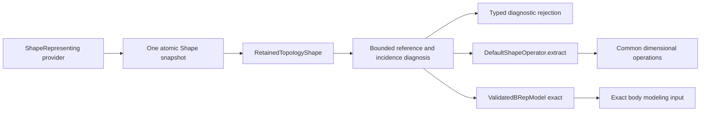

# Non-Manifold Topology

## Purpose and Scope

Child of [CADTopology](../DESIGN.md), with no children. Owns PART.T8: retaining
raw shape snapshots, bounded structural diagnostics and explicit admission to
common shape operations or exact body modeling. Diagnosis covers the stored
combinatorial topology, including disconnected vertex fans. Geometry coincidence
without shared topology IDs, repair and Boolean operand combinations belong to
their existing owners.

## Responsibilities and Boundaries

`NonManifoldTopologyHandling` declares retention, diagnosis and both admission
operations as protocol requirements. `DefaultNonManifoldTopologyHandler` captures
one immutable Shape snapshot, diagnoses it and delegates successful admission to
the existing public validation boundaries. `RetainedTopologyShape` deliberately
does not conform to ShapeRepresenting: retention is not permission to model.
No existing BRepModel or GenericShape validation rule is relaxed.

## Related Designs

| Design | Relationship | Contract Used | Summary | Cautions |
|---|---|---|---|---|
| [CADTopology](../DESIGN.md) | parent | BRepModel and ValidatedBRepModel exact validation | Owns valid body topology | Raw retention is separate from valid model ownership |
| [GenericShape](../GenericShape/DESIGN.md) | depends on | Atomic Shape snapshot and selected-closure exact operations | Supplies dimensional roots and shape admission | Background raw topology is diagnosed before extracting the selected closure |
| [SolidComplex](../SolidComplex/DESIGN.md) | coordinates with | Shared-boundary complex represented by distinct owned bodies | Defines body assembly semantics | Geometric contact across distinct IDs is not structural non-manifold incidence |

## Architecture



## Contracts and Invariants

- Retention preserves the complete root, geometry tables and topology tables,
  including malformed references and non-manifold incidence. It does not repair,
  prune, merge identities, evaluate geometry or produce a validity certificate.
- Diagnosis inspects the whole retained model and the selected root references.
  Table identity mismatches, missing children/geometry, duplicate ownership,
  excessive face edge use, disconnected or branching vertex links, branching
  loose-edge graphs and broken explicit wires produce typed issues. Loose edges
  have no face use; degree greater than two is a branch even when the root is a
  compound instead of an ordered wire. This scope has no geometry-validity claim.
- Shell vertex links use incident edges as link vertices and each face-loop
  corner as a link edge. A manifold fan is one connected path or cycle, with
  degrees at most two. Distinct faces meeting only at one vertex yield multiple
  link components and must be rejected, even when every edge has at most two uses.
- Link analysis requires existing references and an ordered closed loop in
  topology IDs. Broken ordering is a structural issue, not a fabricated fan.
  Repeated seam coedges and parallel link edges retain multiplicity; a periodic
  corner is not classified by the number of distinct neighboring face IDs.
- Successful shape admission requires a clean structural report and successful
  DefaultShapeOperator extraction. It admits the existing standalone vertex,
  edge, ordered wire, face, shell, solid, compound and solid-complex contracts.
  It is not a promise that a Boolean or feature accepts every dimensional input.
- Successful B-rep admission requires a clean structural report and a complete
  ValidatedBRepModel at exact level. Its owned body graph restrictions apply;
  standalone lower-dimensional topology does not become a body through retention.
- Detected non-manifold or malformed topology is never silently admitted. Typed
  admission rejection retains the complete diagnostic report. Geometry and
  existing validator failures propagate unchanged after structural admission.
- Snapshot values and geometry use existing Sendable value/COW ownership.
  No mutable state escapes a call, and no platform-specific ownership branch exists.

## Runtime Flows

```text
retain -> capture once -> bounded structural inventory -> immutable raw value
diagnose -> inventory -> references/owners -> shell edge uses and vertex links -> report
admit -> diagnose -> reject issues -> existing exact validation -> return valid input
failure/cancellation -> throw -> original retained snapshot remains unchanged
```

## State, Ownership, and Lifecycle

The retained value owns its Shape snapshot for its entire lifetime. Returned
model/root properties are values; mutation of a caller's copy cannot change the
retained snapshot. Work counters, ownership maps, vertex links and diagnostic
buffers are local to one synchronous operation. There are no streams, tasks,
unsafe pointers or shared mutable stores.

| State | Native / WASM / Embedded storage | Isolation | Mutation | Release |
|---|---|---|---|---|
| retained snapshot | Same immutable Sendable value | Value ownership | Caller creates a separate copy | Value lifetime |
| diagnostic work | Same local values | Single call | Local engine only | Return/throw |

## Failure, Concurrency, and Constraints

Callers explicitly provide positive maximumTopologyRecords, maximumWork and
maximumDiagnostics. Record admission counts topology and geometry table entries;
work is charged before each visited stored reference, root, link insertion and
link traversal. Diagnostic capacity is checked before append. Exhaustion returns
a typed resource failure, never a truncated success report. The graph budget
bounds this component's temporary topology data; existing geometry owners retain
curve/surface storage and exact-validation computation contracts.

Cancellation is checked before capture, throughout charged work and before
returning or entering an existing validator, and after validator success.
Failed retention, diagnosis or admission never changes the provider's captured
value. Injected source acquisition follows ShapeRepresenting's atomic contract.

## Verification and Change Impact

[NonManifoldTopologyTests](../../../Tests/CADTopologyTests/NonManifoldTopologyTests.swift)
owns raw malformed/non-manifold retention, copy isolation, shell edge incidence,
pinched vertex fans, branching wire references, explicit admission refusal,
successful exact sheet/body and dimensional shape admission, limits and cancellation.
Root owns native/WASM/Embedded and cumulative integration verification. Changes
to GenericShape or ValidatedBRepModel require rechecking the two admission paths;
the retained raw representation never substitutes for either valid-input contract.

### Portable module wiring

This component consumes the unchanged current-task cancellation and direct
collection import contracts owned by [CADTopology](../DESIGN.md#m6-portable-validation-wiring).
Its algorithms, budgets, immutable source owners and existing isolation remain
unchanged on Native, ordinary WASM and Embedded.
