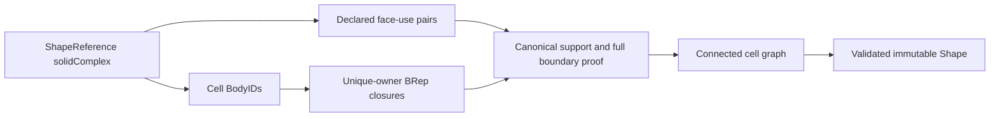

# Solid Complex

## Purpose and Scope

This component owns PART.T2: the semantic difference between aggregate selection
and a face-connected set of individually owned solid cells. Parent:
[CADTopology](../DESIGN.md). No children. Boolean region classification, automatic
coincidence discovery, and resolving overlapping material interiors belong to
the Boolean requirements; this value does not assert a Boolean union result.

## Responsibilities and Boundaries

`SolidComplexTopology` owns selected BodyIDs and declared pairs of shared boundary
face uses. Each cell retains its complete Body, material, outer shell and void
shell ownership. Each face/edge/vertex still has exactly one owner in BRepModel.
The complex shares one interface identity through two opposite cell-local uses;
it does not give one mutable face record to two shells. Compound selection makes
no assertion about interfaces, connectivity, or material membership.

`SolidComplexValidating` proves cell validity, interface membership, opposite
orientation, whole-boundary canonical identity and graph connectivity. It does
not infer an interface from endpoint proximity, sampled points or bounding boxes.
The caller supplies canonical support/curve charts. Equivalent independently
parameterized patches need a separate coincidence construction, not a tolerance
increase in this validator.

## Related Designs

| Design | Relationship | Contract Used | Summary | Cautions |
|---|---|---|---|---|
| [CADTopology](../DESIGN.md) | parent | exact BRepModel and explicit BodyTopology | Preserves all cell ownership and voids | A complex is not one manifold body |
| [GenericShape](../GenericShape/DESIGN.md) | coordinates with | immutable Shape snapshot, extraction and rigid transform | Common operations retain complex metadata | Validation must not flatten a complex into an unqualified compound |
| [CADGeometry](../../CADGeometry/DESIGN.md) | depends on | exact curve/surface values and pcurve reversal | Whole-boundary chart identity | No sampled equivalence proof |

## Architecture



## Contracts and Invariants

- A complex contains at least one distinct solid BodyID. Every cell has exactly
  one explicit connected material component, including its existing void shells.
- Every declared interface names distinct cells and one face owned by each cell.
  Each local face participates in at most one interface. Internal interface uses
  have opposite effective face/shell orientation.
- Complete support values agree in one canonical parameter chart. Outer/inner
  loops have matching roles and complete oppositely traversed coedge boundaries;
  every paired curve, trim, endpoint and reversed pcurve agrees structurally.
  Matching is cyclic and independent of the arbitrary loop start. Failure to
  prove identity returns a typed unproven-interface result; it never relabels
  nonmatching geometry as shared.
- The interface graph connects every selected cell. A single cell is connected
  without interfaces. Disconnected solids remain valid Compound inputs.
- Common extraction and rigid transforms retain BodyIDs and interface face IDs,
  material and cavity ownership. Input snapshots remain unchanged.
- No global interior-disjointness or external union-boundary guarantee follows
  from this local topology certificate. Modeling operations own those admission
  conditions explicitly.

## Runtime Flows

```text
one Shape snapshot -> select cell closures -> validate each cell -> prove face
uses -> bounded cyclic boundary matching -> connected graph -> return shape
```

## State, Ownership, and Lifecycle

All values are owned immutable Sendable data. Each invocation owns its temporary
cell incidence tables and work counter. No retained resource or shared mutation.

## Failure, Concurrency, and Constraints

Typed errors distinguish malformed selection, invalid cells, missing/foreign
face uses, repeated interface ownership, unproven geometric identity, equal
orientation, disconnected cells and exhausted comparison work. Cancellation
propagates through cell and boundary traversal. A caller-owned positive work
budget bounds cyclic candidate comparisons across the whole invocation; the
default is an operational policy, not a geometric tolerance.

## Verification and Change Impact

`Tests/CADTopologyTests/SolidComplexTests.swift` owns independently constructed
adjacent solid cells, complete interface evidence, compound/complex distinction,
ownership preservation, disconnected/same-side/mutated-interior rejection,
comparison-budget exhaustion, cancellation and rigid-image preservation.
Changes to the descriptor affect GenericShape's exhaustive root handling and
must rerun both suites. General coincidence and Boolean admission remain
separately tracked requirements.

### Portable module wiring

This component consumes the unchanged current-task cancellation and direct
collection import contracts owned by [CADTopology](../DESIGN.md#m6-portable-validation-wiring).
Its algorithms, budgets, immutable source owners and existing isolation remain
unchanged on Native, ordinary WASM and Embedded.
