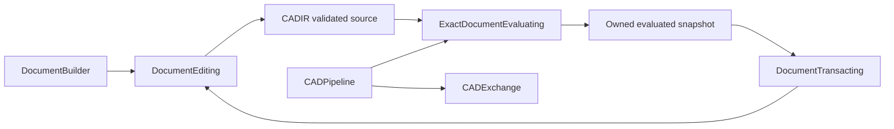

# SwiftCAD

## Purpose and Scope

SwiftPM facade module in [swift-CAD](../../DESIGN.md). It composes source authoring,
validated document edits, kernel evaluation, queries and exchange for callers.
The [Document Transaction](DocumentTransaction/DESIGN.md) component owns mutable
transaction sessions. Existing facade entry points retain their source owners;
this task does not relocate them.

## Responsibilities and Boundaries

`DocumentBuilder` constructs source through `DocumentEditing`. `DocumentEditor`
validates and returns owned edited source values. `CADPipeline` composes the
kernel's evaluation/query and exchange contracts. Transactions own publication
and history, while exact geometry remains owned by the kernel and topology.
Application project publication and UI history are application responsibilities.

## Related Designs

| Design | Relationship | Contract Used | Summary | Cautions |
|---|---|---|---|---|
| [swift-CAD](../../DESIGN.md) | parent | Kernel/application boundary | Public facade composition | No application project publication |
| [Document Transaction](DocumentTransaction/DESIGN.md) | child | DocumentTransacting | Atomic document publication and history | Exact evaluation must succeed before commit |
| [CADIR](../CADIR/DESIGN.md) | depends on | CADDocument and CADCommand | Source ownership and validation | Complete source values remain authoritative |
| [CADKernel](../CADKernel/DESIGN.md) | depends on | ExactDocumentEvaluating and kernel queries | Exact evaluated snapshots | Deferred evaluation is distinct from materialized artifacts |
| [CADCapabilities](../CADCapabilities/DESIGN.md) | depends on | Executable command admission | Shared public capability catalog | Admission does not prove geometry |
| [CADExchange](../CADExchange/DESIGN.md) | depends on | NativePackageStore and OfficialFormatExchange | Source and exchange publication | Exchange owns format and resource refusal |

## Architecture

## Contracts and Invariants

- Editing returns a complete validated source copy; failure leaves caller-owned
  input unchanged. Command legality belongs to the existing editor contract.
- Exact evaluation and derived-artifact generation use kernel-owned contracts.
  The facade never substitutes sampled geometry for exact evaluation.
- Transaction publication, isolation, failure atomicity, history capacity and
  snapshot restoration are owned exclusively by the child design.
- Exported geometry, topology, IR, modeling, kernel and exchange types retain
  their defining modules' contracts.

## Verification and Change Impact

`Tests/SwiftCADTests/CADCommandPipelineTests.swift` owns the command/evaluation
composition path. `Tests/SwiftCADTests/DocumentTransactionTests.swift` owns the
transaction path, including actual geometry failure and complete undo/redo
restoration. Changes to source validation, editor behavior or exact evaluation
require rerunning the affected composition fixtures and transaction guarantees.

### Original document drawing and feature facade contracts

[DocumentDrawing](DocumentDrawing/DESIGN.md) owns complete-source admission and
the public retained B-rep edge geometry facade. Mesh strokes do not establish
original geometric drawing or visibility evidence.
The bridge-surface facade forwards the original start/end continuity requests,
start/end tensions, width and actual wall references to BridgeSurfaceFeature;
the modeling producer owns exact correspondence and continuity admission.
No builder reduces the caller continuity order or substitutes a wall.

The extrusion facade forwards an optional independent `draftDirection` unchanged
through every profile, curve, face and parameter-distance overload. A missing
pull direction retains the producer-defined extrusion axis; a present finite
nonzero pull vector is owned and validated by ExtrudeFeature and DraftedSection.

DocumentBuilder authors current metadata through the common fallible
DocumentMetadata.current(name:) clock boundary on every target. Clock failure
propagates before CADDocument publication; Native Date is a serialization and
client adapter, not the common stored authoring representation.

### Explicit exchange transport composition

The package's NativeExchange trait defines CAD_EXCHANGE for SwiftCAD and admits
the CADExchange dependency. Under that capability the existing exchange service
injection, native byte/URL methods and re-export remain available. Without it,
CADPipeline still owns the same evaluator/query/editor values and source
contracts; only transport adapters and their stored service fields are absent.
No mutable state, Sendable contract or synchronization primitive changes by
target. The shared initializer offers the existing non-transport dependencies.
Unsupported transport is absent from that build's API, never a no-op success.

## Original Mass Query Composition

CADPipeline.execute(.massProperties) validates the original query and evaluates exact source once, then calls the kernel MassPropertyEvaluator using the evaluated document’s authored length unit. Caller accuracy, work/depth limits, original components/placements and density precedence pass unchanged. The result publishes SI mass, centroid and inertia plus integration/error/work receipts; rendering mesh estimators never supply this query. Native coding remains owned by query/result adapters.

The public `CADPipeline.evaluateExact` operation uses the same retained evaluator
and original tolerance/resource configuration as kernel queries, with evaluation
failure normalization. It publishes exact B-rep evaluation without requiring
render mesh materialization. Original drawing composition uses this operation
when a pipeline is explicitly injected, rather than silently constructing another
default evaluator. Query dispatch delegates this same exact operation.
