# Document Transaction

## Purpose and Scope

Child of [SwiftCAD](../DESIGN.md), with no children. Owns PARA.A2: atomic
publication of multiple CAD commands, explicit rollback, bounded undo/redo and
complete restoration of source dependencies, attributes, references and evaluated
identities. It does not persist history, generate geometry, change command
legality or manage derived artifacts.

## Responsibilities and Boundaries

`DocumentTransacting` declares every session operation as a protocol requirement.
`DocumentTransactionSession` is its actor implementation. `DocumentEditing` owns
each command's legal source transition. `ExactDocumentEvaluating` owns actual
geometry evaluation. The session publishes only complete evaluated snapshots,
using each evaluation's `document` as source authority. Draft preview is source
data and never claims successful geometry evaluation.

## Related Designs

| Design | Relationship | Contract Used | Summary | Cautions |
|---|---|---|---|---|
| [SwiftCAD](../DESIGN.md) | parent | DocumentEditing public facade | Hosts the transaction session | Existing Editor and Pipeline retain their owners |
| [CADIR](../../CADIR/DESIGN.md) | depends on | CADCommand, CADDocument validation and value ownership | Owns command legality and source graph | Commands must remain legal in their supplied order |
| [DocumentFoundation](../../CADIR/DocumentFoundation/DESIGN.md) | depends on | Attribute ownership and persistent references | Full source snapshots preserve records and IDs | External symbolic references are preserved, not implicitly resolved |
| [IndependentShapeSource](../../CADIR/IndependentShapeSource/DESIGN.md) | depends on | Complete original geometry source and its validation | Nonempty independent sources remain part of every source snapshot | Transactions preserve the original records and identities without projecting or materializing them |
| [CADKernel](../../CADKernel/DESIGN.md) | depends on | ExactDocumentEvaluating and EvaluatedDocument | Supplies exact evaluated geometry | Deferred output must not be passed to materialized-artifact validation |
| [PortableIdentity](../../CADCore/PortableIdentity/DESIGN.md) | depends on | Immutable 128-bit identity | Identifies opaque session and draft capabilities on every target | Tokens have no persistence or UUID adapter requirement |
| [CurrentTaskCancellation](../../CADCore/CurrentTaskCancellation/DESIGN.md) | depends on | CurrentTaskCancellationChecking requirement | Observes current-task cancellation before mutation and publication | Keep the same typed cancellation and caller task on every target |
| [DocumentTransactionProof](../../A2DocumentTransactionSmoke/DocumentTransactionProof/DESIGN.md) | used by | Public transaction witness operations and complete snapshots | Executes the same public proof on Native, normal WASM and Embedded | Lower source/evaluation graph portability is an independent prerequisite |

## Architecture

```mermaid
flowchart LR
    Caller[DocumentTransacting caller] --> Actor[DocumentTransactionSession actor]
    Actor --> Draft[One owned source draft + opaque token]
    Draft --> Editor[Injected DocumentEditing]
    Editor --> Validate[Complete source validation]
    Validate --> Exact[Injected ExactDocumentEvaluating]
    Exact --> Publish[Atomic committed evaluated snapshot]
    Publish --> History[Bounded before/after evaluated records]
    History --> Restore[Undo / redo without reevaluation]
```



## Contracts and Invariants

- Initial source validation and exact evaluation must succeed before a session
  exists. Native exact evaluation rejects an empty geometry result according to
  its existing contract; the session does not invent an initial success value.
- `begin(expectedEpoch:)` admits one active draft. Its opaque 128-bit token belongs
  to this session, this draft and its committed base epoch. Foreign, rolled-back
  or committed tokens fail. A stale epoch cannot reopen an older state.
- `stage(_:in:)` applies a nonempty ordered command batch to a local source
  copy. Every editor result is source-validated and keeps the document ID. The
  batch replaces the draft only after every command and cancellation check
  succeeds. Failure preserves both the previous draft and committed history.
- `preview` returns only the owned source draft, base epoch and command count.
  `snapshot` returns the committed EvaluatedDocument and status. Draft changes
  never appear in a committed snapshot.
- `commit` requires staged commands, history capacity and an available next
  epoch. It validates the complete draft, evaluates exact geometry, verifies
  that the returned source equals the draft and that configuration tolerance
  equals the evaluator's captured tolerance, then checks cancellation. Only
  then does one actor turn clear redo, append history, replace committed state,
  advance epoch and close the draft.
- Editor, source-validation, evaluator and cancellation failures propagate
  unchanged. Failed commit preserves the active draft for correction or explicit
  rollback, and changes neither committed state nor history.
- Each history record owns complete before/after EvaluatedDocument values.
  Undo/redo restores those values without rebuilding geometry or generating new
  identities. Source metadata, dependency edges, revisions, attributes,
  references, resolved parameters, B-rep, subshapes, lineage and evaluator state
  are restored together. Entire document equality includes every current source
  field, including nullable independent-shape sources; a source-envelope update
  must not project history onto a subset of document fields.
- Undo/redo rejects an active draft and requires the current epoch. Successful
  commit, undo and redo advance the session epoch monotonically; undo cannot
  cause ABA. Begin, stage, preview and rollback do not change committed epoch.
- A successful new commit after undo intentionally discards the redo branch.
  Failure preserves it. No history record is silently pruned to create capacity.

## Runtime Flows

```text
initial source -> validate -> exact evaluate -> source/tolerance check -> session
begin(epoch) -> stage ordered batch -> preview source -> commit -> evaluated publish
stage or commit failure -> unchanged committed/history + retained prior draft
rollback(token) -> discard draft
undo(epoch) / redo(epoch) -> restore complete retained snapshot -> advance epoch
```

## State, Ownership, and Lifecycle

The actor owns committed state, an optional draft, session identity, monotonically
increasing epoch and two history stacks. Inputs and snapshots are Sendable owned
values with native copy-on-write backing. The actor retains injected Sendable
editor, evaluator and cancellation checker values. Their methods are synchronous; a transaction
operation contains no suspension point during validation, evaluation or
publication, so actor reentrancy cannot interleave a draft mutation with commit.
There are no tasks, streams, pointers, external storage or shutdown resources.

| State | Native / WASM / Embedded storage | Isolation | Read / mutation | Release |
|---|---|---|---|---|
| committed, draft, epoch, history | Identical actor-owned values | Actor | Protocol requirements on the same actor | Actor lifetime |
| injected services and limits | Immutable Sendable values | Actor-owned references | Synchronous service requirements | Actor lifetime |

`PortableIdentity128` backs both token identities on every target. Native UUID
adapters are not used by this component. Cancellation is invoked through the
`CurrentTaskCancellationChecking` witness requirement; the default checker has
one shared implementation using the current task's cancellation flag. There is
no Embedded-specific state, weakened Sendable conformance, or cancellation
fallback. Source Codable/Foundation adapters retain their lower owners; this
component operates on the complete source values without serializing them.

## Failure, Concurrency, and Constraints

`DocumentTransactionError` owns transaction misuse, invalid limits, exhausted
capacity, incompatible editor/evaluator outputs and unavailable undo/redo.
Underlying command or geometry errors remain their original errors.
Cancellation is checked before each mutation, between staged commands and
before/after exact evaluation, before publication. A queued concurrent begin
observes the first active draft and fails rather than overwriting it.

Callers explicitly provide positive `maximumHistoryEntries` and
`maximumCommandsPerTransaction`; there are no guessed defaults. Undo and redo
combined retain at most the history limit. Capacity is checked before geometry
evaluation. Command-count arithmetic and epoch increment are checked before
state mutation. Source size, geometry allocation and evaluation work retain
their existing source/evaluator contracts. Caller-retained snapshots have
caller-owned lifetimes outside the session's history limit.

## Verification and Change Impact

[DocumentTransactionTests](../../../Tests/SwiftCADTests/DocumentTransactionTests.swift)
owns atomic ordered batch failure, rollback, actual primitive geometry rejection,
complete undo/redo snapshot and metadata/reference/dependency restoration,
generated identity preservation, redo-branch replacement, stale ABA/foreign
tokens, concurrent begin, explicit limits and cancellation after evaluation.
The history fixture includes a validated, nonempty independent original line
source and checks its complete retention through publication and restoration.
The production [proof](../../A2DocumentTransactionSmoke/DocumentTransactionProof/DESIGN.md)
uses actual source editing and exact evaluation through `any DocumentTransacting`
and verifies complete source/evaluation restoration and typed refusals. Source
value equality alone or epoch/count assertions alone do not prove restoration.
The root task owns native and WASM/Embedded compile/link/runtime and integration
evidence. Parent facade and capability publication must reflect the tested
transaction scope. Changes to command validation or exact-evaluation lifetime
require rechecking these admission and snapshot guarantees.
