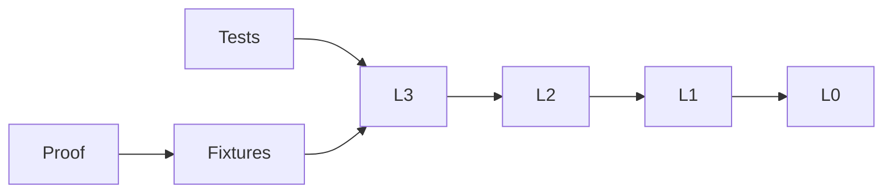

# Independent L3 Verification

## Purpose and Scope
Validate actual L3 sources and their public lower dependencies, without upper CAD targets.
Parent: [L3](../../Sources/CADGeometry/RationalBivariateAlgebra/ExactRealCell/DESIGN.md). No children.

## Responsibilities and Boundaries
Own behavioral fixtures and target-specific evidence. Production algorithms stay in L3.

## Related Designs
Depends on the public L0/L1/L2 contracts indexed by the L3 parent. Source links compile actual directories.

## Architecture

## Contracts and Invariants
Source inventories must match production directories. Tests exercise success, typed failure and retained ownership.

## Runtime Flows
Pinned compiler compiles source targets, then Native tests or synchronous WASI fixtures execute.

## State, Ownership, and Lifecycle
Each fixture owns its ledger. Concurrent readers use separate ledgers and immutable receipts.

## Failure, Concurrency, and Constraints
External timeout bounds every run. Ordinary and Embedded SDKs are separate verification scopes.

## Verification and Change Impact
`Tests/CellTests.swift` owns projection and source tests. Public fixtures will own lifting/query regressions.
Unchanged lower evidence is reused; lower sources are not modified.
