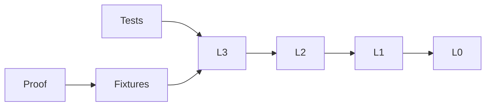

# Independent L3 Verification

## Purpose and Scope
Validate actual L3 sources and their public lower dependencies, without upper CAD targets.
Parent: [L3](../../Sources/CADGeometry/RationalBivariateAlgebra/ExactRealCell/DESIGN.md). No children.

## Responsibilities and Boundaries
Own behavioral fixtures and target-specific evidence. Production algorithms stay in L3.

## Related Designs
Depends on the public L0/L1/L2 contracts indexed by the L3 parent. Source links compile actual directories.

## Architecture

## Contracts and Invariants
Source inventories must match production directories. Tests exercise success, typed failure and retained ownership.

## Runtime Flows
Pinned compiler compiles source targets, then Native tests or synchronous WASI fixtures execute.

## State, Ownership, and Lifecycle
Each fixture owns its ledger. Concurrent readers use separate ledgers and immutable receipts.

## Failure, Concurrency, and Constraints
External timeout bounds every run. Ordinary and Embedded SDKs are separate verification scopes.

## Verification and Change Impact
`Tests/CellTests.swift` owns projection and source tests. Public fixtures own lifting/query, ownership and resource regressions; [VERIFICATION.md](VERIFICATION.md) records actual target evidence.
The optimization snapshot changes one arithmetic/comparison path in each lower layer. Existing lower fixtures and test modules are linked into this package, compiling the same production modules once. The combined proof executes lower and upper synchronous fixtures on both WASM SDKs. Native-only OptimizationBenchmark records identical-input measurements before and after source changes.

The complete twenty-requirement L2/L3 snapshot is recorded separately in
[ConvergenceEvidence](ConvergenceEvidence/VERIFICATION.md); earlier optimization
and inspection reports retain their original narrower source-bound scope.

## Measured Convergence Optimization

The existing OptimizationBenchmark adds explicit relation/profile modes that
call the unchanged public weighted and multistage field fixtures. Each weighted
query includes original-equation construction, proven reduction, complete box
decomposition, selection and exact result checks under its original ledger.
Three fresh-process samples time three complete queries, without sampling during
measurement. A separate eight-query process is sampled to locate the dominant
call path. Root owns only measured causal source changes, with unchanged exact
semantics and caps. Native/ASAN and both pinned WASI SDKs verify final affected
contracts. Earlier ConvergenceEvidence remains tied to its earlier source hashes.
