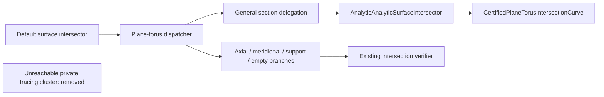

# Plane-Torus Legacy Tracing Cleanup

## Scope and retirement decision

Remove 316 unreachable private lines from PlaneTorusSurfaceIntersector: the
TrigonometricPolynomial, Configuration and ValidMinorAngleInterval nested types;
configuration, boundaryAngles, validIntervals, refinedAngle, uniformBreaks,
normalizedAngle, angularDistance and singularSection. These definitions form a
closed unused cluster. No public contract is deprecated or removed.

The complete dispatcher call path was read, including its default intersector
caller, original pair canonicalization, verifier and general delegation. Its
retained verifier, intersections, generalSection and axialSection are exactly the
original bytes at baseline a87b7853. The import/conditional prefix is also retained.
Nested types have no instance fields in the dispatcher and no global initializer.
The helper methods are private value-type methods with no protocol conformance,
Objective-C selector, reflection-based invocation or external reference path.
The old configuration point evaluator is used only by its retired configuration;
no live body refers to any removed type or method. Current general sections use
AnalyticAnalyticSurfaceIntersector and certified plane-torus curves.

## Actual behavioral proof

Verify.py copies the baseline and cleaned production files into distinct Native
modules, prefixes only a testable cached-module import, and executes both actual
dispatchers through the identical source-validating wrapper. It rejects any edit
outside the two frozen deletion ranges. Source/test/runner hashes and copied
immutable dependency hashes are captured before execution and checked afterward.
The runner uses Swift6.4.0 RELEASE, arm64 macOS, and a90-second limit per compile,
link and runtime command. The actual commands and artifact hash are in receipt.json.

| Behavior | Normal operand order | Reversed operand order |
|---|---|---|
| Two axial circles, with radii2 and4 | PASS | PASS |
| Axial tangent circle | PASS | PASS |
| Axial empty result | PASS | PASS |
| Two meridional circles | PASS | PASS |
| Outer support point, with original XYZ | PASS | PASS |
| Radial empty result | PASS | PASS |
| General certified offset section, with residual bound | PASS | PASS |
| Delegated invalid iteration limit: identical resourceLimitExceeded error | PASS | PASS |

All14 successful comparisons require exact equality of the full before/after
result arrays, not just matching result counts. Independent expected counts and
specific geometry/certificate checks prevent equal empty placeholders from passing.
Both failure comparisons require complete KernelError equality and the expected
failure code; an unexpected success fails the proof. runtime.log retains the run.

The checked dependency snapshot is a read-only copy of existing Native CADGeometry,
CADCore and Collections module/object products from the DI worktree. The foreign
worktree is not edited, rebuilt or assumed stable after copying. Its current
uncommitted source is not claimed to be the compiled artifact's source. Both
compared implementations use exactly the same checked copied products. This
proves actual dispatcher behavior in that dependency environment plus unchanged
live source in main; it does not prove a fresh build of every current main source.
No full Core/Geometry/Kernel or L2-L6 target is rebuilt. Cached objects/binaries
remain local build products and are not committed.

## Scoped review and retained paths

One aggregate review of the frozen deletion, direct caller, actual dependencies,
runner and behavioral checks has no open finding. There is no new state, pointer,
allocation, synchronization, Sendable change or target-specific semantic branch.
The only remaining instance property is the unchanged immutable verifier. Platform
imports match the baseline exactly. Portable correctness is not generalized from
this Native run; no new portable construct or altered live body is introduced.

| Inspected adjacent path | Decision |
|---|---|
| Public CS Native point / original polynomial / affine / Coons producers | Retain: the caller explicitly uses these applicability paths |
| Public SSI Native single-span / multi-chart producers | Retain: rich and admitted result entries still invoke them |
| L0 selected-root and coordinate transport foundations | Retain: current transfer and scalar publication depend on their evidence |
| Other isolated unused-helper candidates | Outside this frozen sprint; no automatic deletion |

The ownership/design decision is recorded in the CADGeometry parent design. This
cleanup does not complete migration of any public CS/SSI family or all seven
requirements. Integration must compare the exact verified source inputs and
retain the same live-body deletion proof against latest main.

Cleanup commit9f21f604 was fast-forwarded into the independent integration worktree
and main froma87b7853. All four verified source/proof/runner inputs match main; the
actual copied dependency products and runtime artifact retain their recorded hashes.
The live-body deletion proof and unchanged caller/delegate/verifier were checked
again on the integrated tree. No integration source adjustment is needed; Native
behavioral evidence is reused. Foreign worktrees and retained drafts remain untouched.
