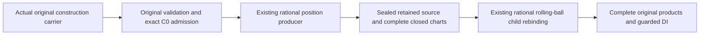

# Original normalized construction curves in rolling-ball source graphs

## Scope and original route

Actual Curve3D.originalEndpointConnector and affine originalConstructionChart
values now reach retained source, complete closed curve charts, rolling-ball child
products and guarded DI. One additive entry in the existing original rational
traversal producer consumes the retained construction, endpoint correction basis,
exact fractions and original directed traversal. It prepares no second RootSpan,
jet, position formula, inverse or solver.

The [original producer contract](../../Sources/CADGeometry/OriginalCoons/DESIGN.md#normalized-construction-curve-position-supply)
and [source contract](../../Sources/CADGeometry/OriginalSourceIssuance/DESIGN.md#retained-construction-curves-in-rolling-ball-children)
own these responsibilities. Position supply does not prove join identity, higher
continuity, embedding or final ordinary CS/SSI publication. Non-affine, angular,
algebraic and remaining general M4-M8 acceptance stay open. Whole-seven completion
remains 1/7 (requirement 5); full87 remains incomplete.

## Receipt-bound independent assembly

The verifier admits inherited derivative-host source, compiler inputs, immutable
modules/archives/products and accepted runtime logs before and after reuse. The
current original producer differs from its inherited numerical premise by exactly
one additive entry: stripping that entry must reproduce the inherited SHA256.
Its prior storage and every old producer algorithm remain byte-identical.

The entire changed producer file is freshly compiled into ConstructionPayloadAccess,
with ordinary access control. The fresh construction source snapshots import that
exact producer; existing derivative/guide consumers retain the admitted unchanged
producer. The changed child enums, actual rolling-ball constructor/evaluator,
source providers and child preparer are freshly compiled. This also verifies their
actual current metadata sizes, retaining the previous Native/Coons/correction,
derivative and guide child regressions.

An initial extension-only diagnostic could compile but could not link unchanged
private generic producer symbols. The accepted assembly compiles the complete exact
producer file and does not disable access control. Inherited derivative-host evidence
separately records its three additive surface helpers against unchanged private
storage; that inherited exception is not generalized to new code.

No broad CADCore/CADGeometry/Kernel or L2-L6 rebuild is performed. ASAN instruments
the fresh producer/caller/source/fixture and inherited changed-source assembly;
unchanged numerical dependencies are not newly instrumented. This is changed-source
ASAN, not whole-production ASAN.

## Behavioral acceptance

The fixture constructs actual weighted/unweighted Native originals with two spans,
affine construction charts using exact 1/3 and 2/3 fractions in both directions,
and actual RootSpan traversal charts with forward and reverse retained endpoints.
Independent rational expectations verify original XYZ/T and both closed knot sides.
Actual numerical point evaluation is checked separately from exact graph equality.

Original endpoint connectors retain nonzero endpoint differences. Every linear,
cubic-Hermite and quintic-Hermite basis and every start/end endpoint selector pair
is verified against an independent exact basis expression, including endpoints,
nonbinary interior samples and both knot sides. Weighted direct and mixed
construction/Native/derivative rolling-ball products retain all eight intersecting
closed chart triples; their common knot has eight incidents. Independent expected
XYZ, original UV and positive radial/half-angle witnesses remain exact.

Full, strict, singleton, disconnected and complete empty requests, negative-root
exclusion, foreign bindings/fields, source and chart caps, original tolerance and
proof-depth readmission are exercised. Preparation and query work/storage succeed
at measured exact ceilings and fail one unit short. Entry, ledger and final callback
cancellation prevent successful publication. Detached input COW changes cannot
modify the retained source; families remain queryable after local construction ends.

Numeric-source refusals preserve the existing ExactScalarNumericAccess failure
normalization as scalar.admissionRejected with its original GeometryConversionError.
The raw discontinuous Native fixture is rejected by original knot validation at its
constructor with GeometryError.invalidDistance(2), before source issuance. The new
entry also explicitly requires the existing whole-selected C0 theorem; the negative
fixture does not claim to bypass the original constructor and exercise that later
guard. Preliminary fixture failure expectations and extension-link diagnostics are
retained separately and are not accepted success evidence.

## Ownership, review and targets

| State | Native | Normal WASM | Embedded WASM |
|---|---|---|---|
| Provider configuration | Immutable | Same | Same |
| Original carrier, pieces, exact fields and law backing | Immutable Sendable | Same | Same |
| Preparation/query scratch | Invocation-local | Same | Same |
| Admission/cancellation | Exclusive caller inout | Same | Same |
| Release | Last retained owner | Same | Same |

No shared mutable state, unchecked certificate, unsafe operation or conditional
synchronization/Sendable weakening is added. The new source entry and five changed
child consumers retain original owners, guards, depths and the same caller ledger.
Independent later queries use explicit fresh admissions.

One stable scoped review inspected the original constructors, exact C0 and polynomial
producer, all eight production source files, five changed child enum/provider/preparer
contracts, actual numerical callers, independent fixture expectations and final lane
logs. No unresolved production finding remains. Initial fixture failure normalization
and invalid-knot assumptions were corrected before this stable review. All original
producer code outside the additive entry matches the inherited premise.

| Lane | Producer compile | Caller compile | Link | Runtime | Bound inputs |
|---|---:|---:|---:|---:|---:|
| native | 0.427 s | 1.816 s | 2.877 s | 14.422 s | 2645 |
| asan | 1.414 s | 4.374 s | 8.737 s | 19.979 s | 2645 |
| wasm | 0.671 s | 1.899 s | 2.802 s | 19.389 s | 4479 |
| embedded | 11.017 s | 34.342 s | 39.397 s | 9.642 s | 4478 |

 Every command has a 120-second
timeout and uses fixed Swift 6.4.0 and its matching SDK. The verifier rejects warnings,
errors, actor/race/null-call and function-signature diagnostics. Independent latest-main
delivery must match all source/product/log premises before and after fresh Native
and Embedded runtime, while preserving foreign drafts and the publisher patch.
