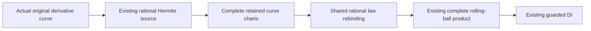

# Direct original derivative curves in rolling-ball children

## Scope and actual route

The actual rolling-ball child provider now consumes Curve3D.originalPlaneDerivative
through the existing OriginalPlaneDerivativeCurveSnapshotProvider. An additive
sealed capability, law evidence and complete-family coverage retain the actual
original curve, traversal, constraints, chart laws and proof owners. The existing
complete retained-curve preparer supplies every normalized T cell. Native and
retained rational laws share the previous Native rebinding algorithm, with the
same operation/storage/depth/guard order and immutable law backing.

The [source contract](../../Sources/CADGeometry/OriginalSourceIssuance/DESIGN.md#direct-retained-derivative-curves-in-rolling-ball-children)
owns this additive connection. No position/projection/Hermite formula, source
producer, root equation, inverse, solver or differential-continuity claim is added.
The numerical rolling-ball owner retains radius, minor-arc and feasibility policy;
this unit is not a whole-solid incidence, regularity or embedding certificate.

## Receipt-bound assembly and target scope

Verify.py validates all inherited source/compiler-input/module/archive/product/log
premises before reuse. It freshly compiles the five changed child source files,
unchanged original derivative curve snapshot/provider, actual rolling-ball
snapshot/provider and numerical constructor/evaluator. The original numeric curve,
Hermite producer and remaining source/DI/lower products are reused only after hash
admission. The earlier Coons/correction and Native caller fixtures are freshly
linked against the changed child cases and current metadata strides. The preceding
derivative-lift child fixture also runs against this newly compiled adapter.
Its heavy complete-product proof is reused on unchanged lift/product/DI premises.

The inherited host assembly records three additive surface helpers separately
against unchanged numerical payload storage. New caller compilation uses ordinary
access control and selective numerical imports, with no access-control disabling,
source reconstruction, production configuration change or broad CAD rebuild.
See the [host assembly evidence](../OriginalDerivativeLiftHostVerification/VERIFICATION.md).
ASAN instruments the new caller/snapshot/provider/fixture and inherited changed
source assembly; unchanged numerical dependency objects are not newly instrumented.
This is not a whole-production ASAN or broad CADCore/CADGeometry/Kernel/L2-L6 build.

All final lanes use Swift 6.4.0 and matching SDKs. Every compile/link/runtime command
has a 120-second timeout; the strict WASI runner propagates the exit status. Final
compile/link logs are warning/error-free, and runtime has no actor/race/null-call
or signature-mismatch diagnostics. Node's WASI experimental notice is informational.

| Lane | Caller compile | Link | Runtime | Bound inputs |
|---|---:|---:|---:|---:|
| Native | 1.494 s | 2.847 s | 13.854 s | 2630 |
| Changed-source ASAN | 3.710 s | 5.969 s | 19.060 s | 2630 |
| Normal WASM | 1.667 s | 2.128 s | 18.686 s | 4464 |
| Embedded WASM | 34.796 s | 39.615 s | 9.494 s | 4463 |

## Behavioral acceptance

The fixture constructs actual weighted/unweighted, projected/unprojected and
forward/reversed original derivative curves, for all eight combinations. Independent
rational quintic endpoint-Hermite expectations check exact XYZ/T at endpoints,
nonbinary thirds and both knot sides. Numerical curve/evaluator accuracy is checked
separately. Typed coverage and public source/chart ownership confirm the original
child family, with no private proof inspection or unchecked receipt injection.

Three actual weighted/projected derivative curves construct forward and reversed
rolling-ball products. A mixed product combines a direct derivative curve, Native
curve and Coons-host lift. The actual source/provider/preparer/product/DI path
preserves all eight direct or 32 mixed chart triples, eight/sixteen knot incidents,
exact XYZ/T/UV, dynamic auxiliary layout and physical positive radial-root guards.
The original numerical rolling-ball evaluator is compared separately at the same
stations. No same-XYZ coordinate or branch is merged.

The path verifies full, strict nonbinary, singleton, disconnected and complete empty
selections; negative-root exclusion; exact query work/storage and one-unit-short
refusal; complete preparation work/storage boundaries; exact source-depth reuse and
one-less refusal; entry and final-storage-callback cancellation; foreign child
binding; and retained graph queries after local input construction ends. Existing
Native, Coons/correction lift and derivative-lift child regressions run in all four
final products. Each preparation keeps the same caller ledger through source,
children, complete product and publication. Later independent prepared queries use
explicit independent admissions. No production limit, tolerance or depth is raised.

## Stable scoped review and ownership

One stable scoped review covers the five additive/refactored files, unchanged
original curve source/preparer, complete product/DI and numerical callers, current
fixture/verifier and final four-lane behavior. No unresolved finding remains.
The shared rational-law helper preserves the previous Native rebinding operations
and both denominator guards. Full support and all closed incidents come from the
existing checked family issuer. Original source, coefficient and proof-depth owners
are retained; new metadata allocation uses actual generic strides before reserve.
No cache, unchecked initializer, callback, fallback, unsafe path or shared mutation
is introduced. Existing incomplete-family markers remain present.

| State | Native | Normal WASM | Embedded WASM |
|---|---|---|---|
| Provider configuration | Immutable | Same | Same |
| Original source, laws and coverage | Immutable Sendable | Same | Same |
| Preparation/query scratch | Invocation-local | Same | Same |
| Admission/cancellation | Exclusive caller inout ledger | Same | Same |
| Release | Last retained immutable owner | Same | Same |

Verification-only import collisions, missing polynomial import and fixture compile
diagnostics are retained separately in Evidence/diagnostics.json. None is accepted
as behavior evidence. Final source/fixture paths and products are bound only by the
four successful lane receipts above.

## Delivery and remaining acceptance

Independent latest-main delivery compares source/product/log premises before and
after fresh Native/Embedded actual direct-curve/product/DI and retained-caller
processes. The accompanying integration receipt records exact premises and protects
foreign source/consumer drafts, indexes and the pending publisher patch.

General angular/algebraic derivative sources, remaining rail families, priority
images, nonlinear/singular correspondence and general M5/M6/M7/M8 remain incomplete.
Whole-seven completion remains 1/7 (requirement 5); full-87 acceptance is unchanged.
