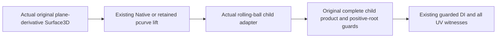

# Plane-derivative lift rails in original rolling-ball graphs

## Scope and actual route

The actual rolling-ball curve snapshot provider now selects the existing rational
plane-derivative retained-host provider for Native B-spline and retained
affine/constant-U/constant-V pcurves. Two additive sealed capability, evidence and
coverage cases retain the complete original lift bindings. The actual child graph
preparer delegates to the existing Native/retained-pcurve lift preparation, then
retains the complete graphs through the existing generic minor-arc product and DI.
No original position, Hermite/projection formula, root equation or solver is added.

See the [source contract](../../Sources/CADGeometry/OriginalSourceIssuance/DESIGN.md#retained-lift-hosts-in-rolling-ball-children).
The numerical rolling-ball owner retains radius, minor-arc and feasibility policy.
This unit does not certify whole-solid fillet incidence, regularity or embedding.

## Receipt-bound compilation and targets

Verify.py first validates every inherited derivative-host source, compiler input,
module/archive, product and log hash. It freshly compiles the five changed child
source files, actual rolling-ball snapshot/provider, original numerical
constructor/evaluator and their required adapters. It links current fixture bodies
against those adapters and admitted unchanged source/DI/numerical/lower products.
The earlier Coons/correction rolling-ball fixture is freshly linked against the
new cases and metadata strides; its old whole receipt is not reused after these
source changes.

The inherited derivative-host receipt proves that the numerical payload differs
from current source only by three additive source-identical helpers, separately
compiled against unchanged original private storage. This unit uses that admitted
assembly with ordinary access control for the source/DI and new caller adapters.
There is no production access-control flag or source reconstruction. See the
[host evidence](../OriginalDerivativeLiftHostVerification/VERIFICATION.md).

All final lanes use Swift 6.4.0 and matching SDKs. Each compile/link/runtime command
has its original 120-second timeout; the strict WASI runner preserves exit status.
All final compile/link logs are warning/error-free, and runtime has no actor/race,
null-call or signature-mismatch diagnostics. Node's WASI experimental notice is
informational. ASAN covers the freshly instrumented caller/fixture and inherited
changed-source assembly; unchanged numerical dependency objects are not newly
instrumented. No broad CADCore/CADGeometry/Kernel or L2-L6 rebuild was performed.

| Lane | Caller compile | Link | Runtime | Bound inputs |
|---|---:|---:|---:|---:|
| Native | 1.307 s | 2.122 s | 82.347 s | 2624 |
| Changed-source ASAN | 3.514 s | 6.125 s | 105.231 s | 2624 |
| Normal WASM | 1.478 s | 2.280 s | 103.312 s | 4458 |
| Embedded WASM | 34.789 s | 39.709 s | 57.538 s | 4457 |

## Behavioral acceptance

The fixture constructs actual weighted/projected derivative surfaces and actual
SurfaceLiftCurve3D values, invokes the changed provider/preparer and checks exact
homogeneous XYZ against independent rational/Hermite expectations. Native and
retained pcurves keep all host/span incidents and exact authored/auxiliary roles.
Actual projected/reversed rails then construct the numerical rolling-ball and
complete source/product/DI: all 128 child chart triples and sixteen knot incidents
survive. Exact XYZ/UV and positive radial-root conditions are checked separately
from numerical evaluator accuracy.

The actual path verifies full, nonbinary strict, singleton, disconnected and empty
requests; same-XYZ wrong UV and negative-root exclusion; exact query work/storage
and one-unit-short failures; preparation work/storage boundaries; exact source
depth and one-less refusal; entry and final-storage-callback cancellation; foreign
child binding; and query use after local source construction has ended. Unchanged
Native, Coons and correction child caller fixtures execute in the same final
products. The admitted host evidence retains its COW, foreign coefficient/owner
and complete derivative-host boundary cases on unchanged premises.

Each complete preparation uses one caller ledger through original source,
children, graph product and publication. Prepared results support later independent
queries with explicit independent admissions. The initial fixture wrongly charged
multiple independent preparations and subsequent queries to one aggregate ledger;
projected preparation succeeded but the aggregate exhausted work. Final tests keep
the same shapes, 300-million-work/1-GiB preparation and query ceilings and existing
100-million-work/400-million-byte single-query probes, while assigning independent
operations their own admissions. No production budget, tolerance or depth was
increased, and exact one-less failures remain required. Rejected diagnostic logs
and input manifests are bound by Evidence/diagnostics.json and are not acceptance.

## Scoped review and ownership

One stable scoped review covers the five additive edits, original host/lift
providers, complete graph/product/DI consumers, actual numerical caller, fixture
and final four-lane receipts. No unresolved finding remains. Both new branches use
existing source authority and preserve all source owners, auxiliary layouts,
guards, proof depths and failure causes. Metadata allocation is admitted using the
actual generic stride before reserve; law/condition arrays retain immutable
backing. There is no new unchecked certificate, callback, cache, shared mutation,
unsafe path or fallback. Existing incomplete-family markers remain in place.

| State | Native | Normal WASM | Embedded WASM |
|---|---|---|---|
| Provider configuration | Immutable | Same | Same |
| Source, graph and coverage owners | Immutable Sendable | Same | Same |
| Preparation/query scratch | Invocation-local | Same | Same |
| Admission/cancellation | Exclusive caller inout ledger | Same | Same |
| Release | Last retained immutable owner | Same | Same |

## Delivery and remaining acceptance

Independent latest-main delivery must compare all source/product/log premises
before and after fresh Native/Embedded actual caller processes and preserve the
foreign source/consumer drafts, indexes and publisher patch. The accompanying
main-integration receipt owns that delivery evidence.

General periodic/nonrational rails, other hosts/pcurves, priority images, nonlinear
or singular correspondence and general M5/M6/M7/M8 remain incomplete. Whole-seven
completion remains 1/7 (requirement 5), and full-87 acceptance is unchanged.
