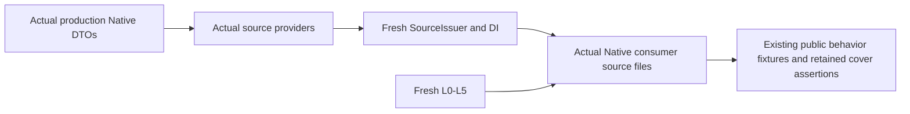

# Original Domain Consumer Verification

## Purpose and Scope
Parent: [system](../../DESIGN.md). Verification-only composition of production
Native source providers and CS/SSI parameter consumers with fresh L0-L5/DI.

## Responsibilities and Boundaries
Build the exact consumer closure independently for preparation checks. The M2
behavioral proof builds actual CADCore/CADGeometry because the Native surface DTO
signature depends on its production span/jet owner. It does not build other CAD
targets. Historical cached-DTO consumer receipts retain only their recorded
premises; the current M2 route uses fresh production compilation.

## Related Designs
| Design | Relationship | Contract Used | Summary | Cautions |
|---|---|---|---|---|
| [Consumer](../../Sources/CADGeometry/NativeExactRelations/DESIGN.md) | verifies | public parameter relation | domain receipt composition | XYZ legacy routes unchanged |
| [DI](../../Sources/CADGeometry/OriginalDomainIdentity/DESIGN.md) | depends on | source-bound cover | prepared proof consumption | no success generalization |

## Architecture

## Contracts and Invariants
The compiler builds linked production sources directly. Source snapshots, actual
compiler inputs, module products and runtime artifact hashes are recorded. Every public solve uses
the same original admission, result topology and independent original ceilings.

## Verification and Change Impact
Execute original weighted/contact/multiple-UV/endpoints/empty/overlap/folded-SSI
fixtures plus limits, cancellation and original domain owner assertions.
Record current compiled inputs independently from prior foundation evidence.
Independent adapter compilation does not establish Native behavior. The full
production family proof establishes the additive parameter consumer and M3 source
providers; it does not establish unrelated CAD targets or general XYZ integration.

## M2 Native finite family verification

`NativeFamilyAdapter` compiles the additive collection consumer with the current
L0-L5/DI closure, excluding unrelated coordinate-transfer L2 adapters. This check
is preparation evidence only. `Sources/FamilyFixtures` and `Sources/FamilyProof`
are also linked by the full production
[Native verification package](../NativeExactRelationVerification/Package.swift).
That route builds CADCore/CADGeometry and executes actual Native source providers,
complete multi-span CS/SSI, exact selected boundaries, periodic lifts, lifetime
and independent failure/cancellation fixtures. It records the source snapshot and
actual compiler inputs and product hashes; concurrent source changes invalidate
publication evidence. Cached geometry compilation is not assumed by this route.

## M3 scaled-normal regression

The actual production M3 fixture compares the same z=1 raw/analytic plane with
a z=0 degree-one Native patch in both operand orders. Unit N must return empty;
nonunit N must propagate the numerical consumer's unsupportedCapability before
any coincidence success. Point/UV source acceptance remains independent.
