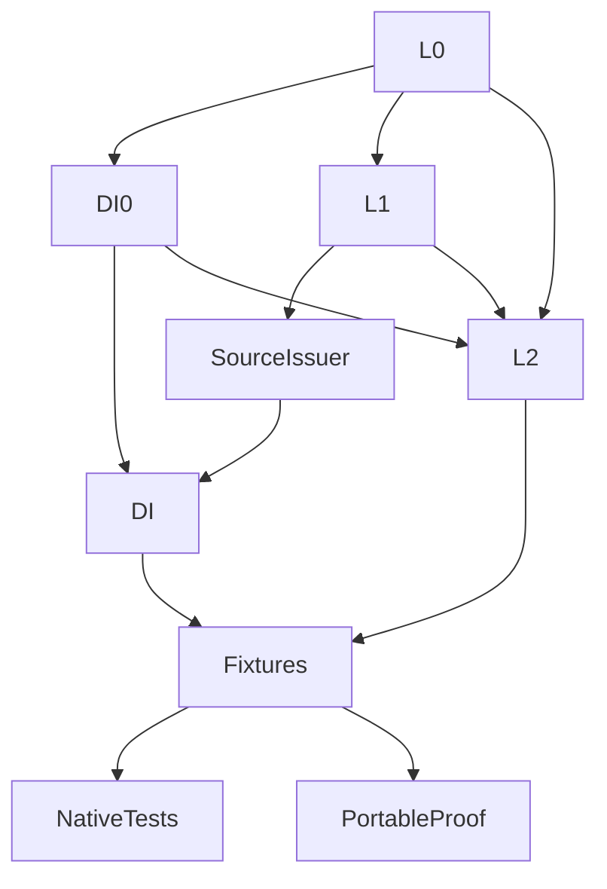

# Original Domain Identity Verification

## Purpose and Scope

Independent verification package for the [DI component](../../Sources/CADGeometry/OriginalDomainIdentity/DESIGN.md).
Compiles linked production sources rather than copies. Owns transport, parameter
coverage, scoped identity and source/domain handoff behavior. No children.

## Responsibilities and Boundaries

The fixture package supplies validated immutable primitive readers through the
original source protocols. It does not assert that every existing geometry adapter
or public intersector has migrated. Its selected-root plane fixture tests a genuine
algebraic coefficient owner; L2 is a fixture dependency, not a DI production dependency.

## Related Designs

| Design | Relationship | Contract Used | Summary | Cautions |
|---|---|---|---|---|
| [DI](../../Sources/CADGeometry/OriginalDomainIdentity/DESIGN.md) | test owner | Transport/coverage/identity contracts | Owns independent behavioral evidence | Consumer completion remains separate |
| [Source](../../Sources/CADGeometry/OriginalSourceIssuance/DESIGN.md) | depends on | Validated source binding/local/period/pole/basis laws | Literal primitive providers | Does not replace actual geometry validation |
| [L2](../../Sources/CADGeometry/RationalBivariateAlgebra/ExactRealRoot/DESIGN.md) | fixture-only dependency | Selected positive sqrt(2) and coefficient depth | Exact normalized plane basis | No additional solver implementation |

## Architecture

## Contracts and Invariants

Independent tests verify full endpoint sectors, disconnected/unbounded sets,
exact affine reversal/permutation/inverse/composition, huge and negative cycles,
complete Native spans and tensor seams, missing coverage, collapsed subsets,
whole paired boundary laws, intrinsic poles and selected request restriction.
No sample/residual certifies identity, no failed admission becomes empty success,
and every original tuple/lift remains represented. Terminal cancellation, source
mutation/lifetime, foreign owners and independent resource limits are exercised.
All new source owners are immutable; all mutable counters are exclusively borrowed
per query. No target-specific synchronization or Sendable contract is weakened.

## Verification and Change Impact

Native and ASAN use the 16 focused Swift Testing functions; a deterministic proof
calls the same synchronous fixtures on Native, normal WASM and Embedded WASM.
Every command has an external timeout. Each target has a separate build path.
Toolchain is Swift 6.4.0 release with matching WASM SDKs and Node 24.19.0 WASI Preview 1.
The dependency probe/compiler source inventory must exclude full CADGeometry,
CADCore and L3-L6. Reused lower source evidence is valid only while its input hashes
match. Current completion evidence is separate from the historical DI0 evidence.
Changed source contracts also run their owning independent SourceIssuer suite.
Actual public consumer changes require their own trace and behavioral evidence.

## Protocol Composition Acceptance

This design-only update reuses retained behavioral evidence for unchanged code.
The following tests are requirements for the subsequent implementation; they have
not been added or executed by this documentation task.

| Owning boundary | Refuting behavior | Required successful behavior |
|---|---|---|
| Specialized source-domain issuer | A forged/narrowed frame, missing span or missing source-period theorem cannot certify full source coverage | Complete source-derived support and all incident chart sides |
| Generic dependency composition | Foreign source/field/receipt owners, wrong capability or stricter caller depth refuse before publication | Same exact receipts and failure causes as the default route, one exclusive admission |
| Finite cover versus family query | Infinite family cannot masquerade as finite charts; missing template/cycle fails | Generic member/incident calls preserve huge negative cycles, both seam sides and independent tensor periods |
| Source law/domain handoff | Image-only law, dropped denominator guard or foreign chart cannot supply full correspondence | One binding owns the law/cover; selected local domain is exact; no repeated solving |
| Identity consumption | Self-crossing equal XYZ and unknown structural relation do not exclude contact pairs | Only scoped proved relations are excluded; original tuples and one-sided germs survive |
| Failure/lifetime | Budget/cancel/owner release never produces partial or unproved empty success | COW source mutation does not change retained proofs; later queries inherit depths |

Run independent Native/ASAN and ordinary/Embedded proof lanes for changed DI or
source-law contracts. Actual public relation, boundary, self-contact and XYZ
composition tests are owned by those consumers, using the applicable
[family obligations](../../Sources/CADGeometry/OriginalDomainIdentity/OriginalDomainCoverage/DESIGN.md#required-source-family-obligations)
and [consumer matrix](../../Sources/CADGeometry/OriginalDomainIdentity/DESIGN.md#di4-consumer-acceptance-and-migration-boundary).
Reuse prior evidence only while its source/target premises remain unchanged.
Document review and valid links do not establish those planned runtime guarantees.

## Stored-N Plane Regression

PlaneFixtures.scaledNormalsAndUV verifies the actual source binding and public
plane issuer for positive/negative axial scales, subnormal and maximal finite
components, and rational oblique normals. It checks the shared reference-axis
contract, exact basis coefficients and position/UV round trips. The original
selected-root fixture continues checking rounded candidate refusal, off-plane
refusal and independent depth/storage/cancellation failures. PlaneRepairEvidence
binds the repaired Native/ASAN/normal-WASM/Embedded snapshot separately from the
historical CompletionEvidence checkpoint; upper CAD modules are not built.

## Shared-Divisor Plane Optimization

The same independent graph verifies L0 direct shared-divisor arithmetic, L2
selected-root specialization and the public plane issuer together. Scalar
reference division must match every returned component exactly, including zero
numerators and a selected-root local inverse from a reducible defining law.
Rational generation/work must not increase. Existing plane cases continue proving
candidate refusal, exact round trips, off-plane refusal and immutable lifetime.
New focused tests cover work/storage and independent depth refusal, zero divisor,
foreign owner and terminal cancellation with no partial published array.
The four target proofs call the same fixtures; Native ASAN checks the unchanged
scoped invocation bridge. Performance compares identical prepared source/field,
issuer checks and exact results with bounded alternating execution; setup and
root generation are excluded and Debug/Release evidence is distinguished.

## M1 family-query verification

FamilyQueryFixtures calls member/incident through OriginalChartFamilyQuerying's
witness requirements, as well as the concrete receipts. Native and sphere tests
retain exact arbitrary-size negative cycles, all seam sides and the two-coordinate
pole domain. Nonperiodic nonzero cycles, malformed vectors, missing templates,
work exhaustion, foreign injected period owners and final cancellation fail
explicitly. Rejected injected period/chart issuers prove that source errors are
not replaced by default construction. The same portable fixture body runs in
DomainProof on ordinary/Embedded WASM; Native and ASAN use DomainTests.

## Revolution period identity verification

RevolutionIdentityFixtures consumes the sealed complete generator family through
OriginalRevolutionParameterIdentityIssuing. It checks exact finite clipping and
empty overlap, both cycle signs, unchanged original V, near-period refusal,
foreign owners, independent source/family/chart/identity/transport/work/storage
limits, and entry/final cancellation. Existing analytic period fixtures validate
the shared finite-period clipping helper. The production revolution proof checks
the concrete original source/provider/domain/identity handoff separately.

Component tests and runtimes remain externally bounded at120 seconds. Ordinary
component builds use120 seconds; an Embedded WMO build may continue for300 seconds
after a measured incomplete120-second batch, retaining that attempt and scratch path.
The actual CADGeometry incremental compile may use300 seconds with jobs1 after
an observed120-second unfinished compiler batch; its runtime remains120 seconds.
This operational compile window changes no solver, admission, depth, accuracy or
fixture limit. Retain failed attempts and reuse the same scratch directory.
Temporary diagnostic output is removed before the final source-bound proof.
