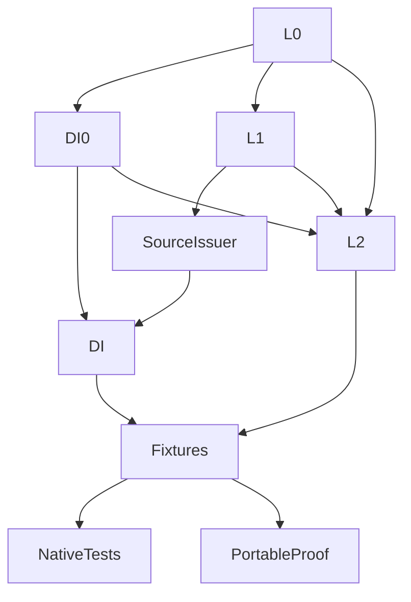

# Original Domain Identity Verification

## Purpose and Scope

Independent verification package for the [DI component](../../Sources/CADGeometry/OriginalDomainIdentity/DESIGN.md).
Compiles linked production sources rather than copies. Owns transport, parameter
coverage, scoped identity and source/domain handoff behavior. No children.

## Responsibilities and Boundaries

The fixture package supplies validated immutable primitive readers through the
original source protocols. It does not assert that every existing geometry adapter
or public intersector has migrated. Its selected-root plane fixture tests a genuine
algebraic coefficient owner; L2 is a fixture dependency, not a DI production dependency.

## Related Designs

| Design | Relationship | Contract Used | Summary | Cautions |
|---|---|---|---|---|
| [DI](../../Sources/CADGeometry/OriginalDomainIdentity/DESIGN.md) | test owner | Transport/coverage/identity contracts | Owns independent behavioral evidence | Consumer completion remains separate |
| [Source](../../Sources/CADGeometry/OriginalSourceIssuance/DESIGN.md) | depends on | Validated source binding/local/period/pole/basis laws | Literal primitive providers | Does not replace actual geometry validation |
| [L2](../../Sources/CADGeometry/RationalBivariateAlgebra/ExactRealRoot/DESIGN.md) | fixture-only dependency | Selected positive sqrt(2) and coefficient depth | Exact normalized plane basis | No additional solver implementation |

## Architecture

## Contracts and Invariants

Independent tests verify full endpoint sectors, disconnected/unbounded sets,
exact affine reversal/permutation/inverse/composition, huge and negative cycles,
complete Native spans and tensor seams, missing coverage, collapsed subsets,
whole paired boundary laws, intrinsic poles and selected request restriction.
No sample/residual certifies identity, no failed admission becomes empty success,
and every original tuple/lift remains represented. Terminal cancellation, source
mutation/lifetime, foreign owners and independent resource limits are exercised.
All new source owners are immutable; all mutable counters are exclusively borrowed
per query. No target-specific synchronization or Sendable contract is weakened.

## Verification and Change Impact

Native and ASAN use the 15 focused Swift Testing functions; a deterministic proof
calls the same synchronous fixtures on Native, normal WASM and Embedded WASM.
Every command has an external timeout. Each target has a separate build path.
Toolchain is Swift 6.4.0 release with matching WASM SDKs and Node 24.19.0 WASI Preview 1.
The dependency probe/compiler source inventory must exclude full CADGeometry,
CADCore and L3-L6. Reused lower source evidence is valid only while its input hashes
match. Current completion evidence is separate from the historical DI0 evidence.
Changed source contracts also run their owning independent SourceIssuer suite.
Actual public consumer changes require their own trace and behavioral evidence.
