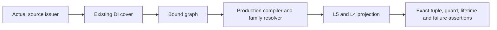

# Original Graph Relation Verification

## Purpose and Scope

Test owner for the B3 source/DI/L5 consumer contract. Parent:
[NativeExactRelations](../../Sources/CADGeometry/NativeExactRelations/DESIGN.md).
No production module is added. This independent SwiftPM package compiles actual
source issuance, DI and L0-L5 implementations and only the graph consuming bodies.

## Responsibilities and Boundaries

Verify actual issued Native rational and guarded offset laws through complete DI
covers, graph preparation and L5/L4 projection. Synthetic certified source receipts
are limited to explicit correspondence counterexamples; they do not certify a new
production shape producer. No numerical geometric publisher is substituted.

## Related Designs

| Design | Relationship | Contract Used | Summary | Cautions |
|---|---|---|---|---|
| NativeExactRelations | parent | B3 graph consumer ports | Foundation under test | Public geometry publication is separate |
| [DI coverage](../../Sources/CADGeometry/OriginalDomainIdentity/OriginalDomainCoverage/DESIGN.md) | depends on | Complete existing covers and local graph binding | Whole request versus local graph | Guarded enclosure is not material |
| [Source issuance](../../Sources/CADGeometry/OriginalSourceIssuance/DESIGN.md) | depends on | Sealed graphs and forward correspondence | Original source authority | No synthetic receipt counts as a producer |
| [L5](../../Sources/CADGeometry/RationalBivariateAlgebra/ExactParametricRelation/DESIGN.md) | depends on | Complete graph pair and projected topology | Reuse fixed L0-L5 contracts | No lower redesign |

## Architecture

## Contracts and Invariants

One caller ledger covers all stages. Preserve exact authored coefficients,
request boundaries, branch/denominator conditions, every lifted witness and
projected dimensions. Empty success retains complete coverage. No partial result
escapes limits/cancel. Static capability failures reject physical-angle coefficient
and implicit-image-only inputs instead of treating them as supported.

## Verification and Change Impact

Run focused Swift Testing on Native; the same fixture functions run as a bounded
proof executable on Native/ASAN/normal WASM/Embedded with fixed Swift6.4.0 and
matching SDKs. Source hashes and artifacts bind actual compiler inputs. Only changed
source/DI/consumer interactions are verified; B0-B2 lower fixtures remain valid on
unchanged sources. Main integration compares these exact inputs and executes the
composed Native proof from an independent worktree.

## Issued geometry and public composition

The package now also compiles actual L6 and source-bound geometric composition.
Groups 6-13 verify original rational/offset exact points, source parameter transports,
positive SSI images/fibers, finite and free auxiliary witnesses, affine whole-cell
image dimensions, complete station fibers/lift membership, limits and cancellation.
The actual CADCore/CADGeometry package at ../NativeExactRelationVerification consumes
the same fixtures through `ISSUED_GRAPH_PUBLIC_VERIFICATION`; group14 adds extracted
public SSI point/source lifetime and terminal publication cancellation. No substitute
result, intersector or geometry implementation is used. Prepared exact publication
is explicit; legacy numerical publication is regression-tested separately.

`GeneralGraphProof` separately forces the nonlinear XYZ-prefix pullback (no finite-fiber
or affine theorem) and checks a complete exact station fiber on all four lanes.
It is an additive verification-only target; the earlier fourteen-case package
premise is retained in GeometricEvidence/retained-original-package.swift.
GeometricEvidence/VERIFICATION.md owns the final commands, configuration distinctions,
review disposition and latest-main composition record.

## Issued graph refinement verification

Group 15 exercises the production issued-graph refinement port using real sealed
rational and positive-normal-offset source/DI families. It verifies a continuous
CS component split at exact thirds, all raw lifted-cell labels, auxiliary branch
retention/exclusion, complete empty predicates, retained source lifetime, COW
result copies, invalid pair/arity, exact independent work/storage limits,
source-depth refusal and entry/final-publication cancellation. The membership
regression uses the exact descendant-field point `t = sqrt(1/3)` and checks
foreign-field rejection against the same retained refinement. Cached reuse
requires successful generation receipts binding all reused module/object bytes,
unchanged source/compiler inputs and generation logs before compilation or
execution; missing/mismatched receipts are refusal cases. The repair driver
generates an isolated package from the existing target contracts, omits L6 and
geometric publication fixtures, and compiles the complete required source set into
a new owned directory. A generation receipt is admitted before runtime. The
refinement-only dispatcher does not reference unrelated geometry fixture bodies.
Native/ASAN and
matching ordinary/Embedded WASM use the same immutable production source files.
This independent proof owns the adapter contract, not untested face/identity
compilers or full production-module integration.

M6.G performance comparison uses `GraphRefinementEvidence/benchmark.py` with
separate baseline/candidate generation receipts and serial alternating processes.
Admission hashes stay outside elapsed/CPU timing. Baseline inputs that changed
must match their committed generation snapshot; all compiler, generated artifact
and log bytes must still match. Candidate inputs must match current bytes.
`run.py --output` retains previous lane evidence while generating a fresh owned
lane. The first-power optimization belongs to [L3](../../Sources/CADGeometry/RationalBivariateAlgebra/ExactRealCell/DESIGN.md);
no quota, equality, coverage or target ownership contract is relaxed.
