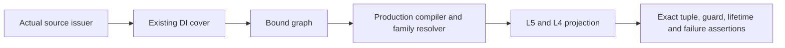

# Original Graph Relation Verification

## Purpose and Scope

Test owner for the B3 source/DI/L5 consumer contract. Parent:
[NativeExactRelations](../../Sources/CADGeometry/NativeExactRelations/DESIGN.md).
No production module is added. This independent SwiftPM package compiles actual
source issuance, DI and L0-L5 implementations and only the graph consuming bodies.

## Responsibilities and Boundaries

Verify actual issued Native rational and guarded offset laws through complete DI
covers, graph preparation and L5/L4 projection. Synthetic certified source receipts
are limited to explicit correspondence counterexamples; they do not certify a new
production shape producer. No numerical geometric publisher is substituted.

## Related Designs

| Design | Relationship | Contract Used | Summary | Cautions |
|---|---|---|---|---|
| NativeExactRelations | parent | B3 graph consumer ports | Foundation under test | Public geometry publication is separate |
| [DI coverage](../../Sources/CADGeometry/OriginalDomainIdentity/OriginalDomainCoverage/DESIGN.md) | depends on | Complete existing covers and local graph binding | Whole request versus local graph | Guarded enclosure is not material |
| [Source issuance](../../Sources/CADGeometry/OriginalSourceIssuance/DESIGN.md) | depends on | Sealed graphs and forward correspondence | Original source authority | No synthetic receipt counts as a producer |
| [L5](../../Sources/CADGeometry/RationalBivariateAlgebra/ExactParametricRelation/DESIGN.md) | depends on | Complete graph pair and projected topology | Reuse fixed L0-L5 contracts | No lower redesign |

## Architecture

## Contracts and Invariants

One caller ledger covers all stages. Preserve exact authored coefficients,
request boundaries, branch/denominator conditions, every lifted witness and
projected dimensions. Empty success retains complete coverage. No partial result
escapes limits/cancel. Static capability failures reject physical-angle coefficient
and implicit-image-only inputs instead of treating them as supported.

## Verification and Change Impact

Run focused Swift Testing on Native; the same fixture functions run as a bounded
proof executable on Native/ASAN/normal WASM/Embedded with fixed Swift6.4.0 and
matching SDKs. Source hashes and artifacts bind actual compiler inputs. Only changed
source/DI/consumer interactions are verified; B0-B2 lower fixtures remain valid on
unchanged sources. Main integration compares these exact inputs and executes the
composed Native proof from an independent worktree.
