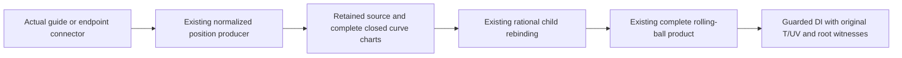

# Retained normalized guide curves in original rolling-ball graphs

## Scope and original route

Actual Curve3D.originalGuideTraversalChain and originalGuideEndpointConnector
values now supply sealed retained rational curve snapshots. The existing
OriginalSplineTraversalPolynomialPiece normalized producer owns the exact
station/traversal and endpoint correction expressions. The source provider only
transfers the resulting rational coefficients into the original field and retains
the original carrier, pieces, full closed-cell support and proof owners. Existing
complete retained-curve preparation and rational rolling-ball rebinding supply
all child graphs; the original minor-arc product and guarded DI are unchanged.

The [source contract](../../Sources/CADGeometry/OriginalSourceIssuance/DESIGN.md#retained-normalized-guide-curves-in-rolling-ball-children)
owns this additive connection. No guide formula, endpoint basis, root equation,
inverse, fitting or solver is added. Original XYZ equality is checked separately
from numerical evaluator accuracy. Position supply does not issue join identity,
higher-order continuity, embedding or whole-solid fillet certification.

## Receipt-bound assembly and targets

The verifier validates inherited derivative-host source, compiler-input, module,
archive, product and runtime-log hashes before and after reuse. It freshly compiles
the seven changed/new guide and child source files, current derivative snapshot
and provider, actual rolling-ball snapshot/provider and numerical constructor/
evaluator. Unchanged actual guide constructors and their original normalized
producer are reused only after source/product receipt admission. Current fixture
bodies are linked to the new caller adapters with ordinary access control and
selective numerical imports. Existing Native, Coons/correction and derivative
child regressions run against the changed enum cases and actual metadata strides.

The inherited host assembly records exactly three additive surface helpers
separately compiled against unchanged numerical payload storage; this changes no
production access control or source expression. See the
[host evidence](../OriginalDerivativeLiftHostVerification/VERIFICATION.md).
ASAN instruments the fresh caller/source/fixture and inherited changed-source
assembly. Unchanged numerical dependency objects are not newly instrumented;
this is not whole-production ASAN. No broad CADCore/CADGeometry/Kernel or L2-L6
rebuilding is performed.

All final lanes use fixed Swift 6.4.0 and matching SDKs. Every compile, link and
runtime command has a 120-second timeout; the strict WASI runner preserves exit
status. Final logs are warning/error-free, with no actor/race/null-call/signature
mismatch diagnostic. Node's WASI experimental notice is informational.

| Lane | Caller compile | Link | Runtime | Bound inputs |
|---|---:|---:|---:|---:|
| Native | 1.784 s | 3.064 s | 15.439 s | 2636 |
| Changed-source ASAN | 3.864 s | 6.781 s | 21.204 s | 2636 |
| Normal WASM | 1.681 s | 2.286 s | 20.753 s | 4470 |
| Embedded WASM | 34.424 s | 39.023 s | 10.217 s | 4469 |

## Behavioral acceptance

The fixture constructs actual two-segment guides with exact 1/3 or 2/3 stations,
weighted/unweighted Native children and actual forward/reversed RootSpan endpoints.
It constructs original guide endpoint connectors with nonzero start/end differences
and the original quintic correction basis. All eight weighted/corrected/reversed
combinations are checked against independent rational piecewise/Hermite-basis XYZ
at endpoints, nonbinary joins and every child knot. Four original closed cells and
both sides at every incident remain present. Numerical evaluator accuracy is
checked separately using an independent arithmetic expectation.

Actual direct and mixed rolling-ball construction, source, child preparation,
complete product and DI are exercised. Four aligned guide cells have 22 intersecting
closed chart triples: four interior combinations and six additional mixed-side
combinations at each of three joins. A guide/Native/derivative product has seven
intersecting triples, preserving two guide sides at nonbinary joins and four
Native/derivative sides at their shared knot. Disjoint child intervals are not
published as extra products; no matching incident is omitted. Exact original XYZ/T,
positive radial-root witnesses and every position/transport denominator are retained.

Full, strict, singleton, disconnected and complete empty requests are verified.
Negative roots, foreign source binding/field/carrier, changed source tolerance,
source-depth and chart limits fail explicitly. Preparation and query work/storage
succeed at the measured exact limits and fail one unit short; entry, cancelled
ledger and final-storage-callback cancellation prevent publication. COW mutation
of a detached traversal array leaves the retained original carrier unchanged, and
a complete mixed family remains queryable after local input construction ends.
Each preparation uses one caller admission through extraction, coefficient transfer,
children, product and publication. Later independent queries use their own explicit
admissions. No work/storage/depth ceiling or tolerance is increased.

## Scoped review and finding confirmation

One stable scoped review inspects original guide/connector constructors, normalized
producer branches, source/complete-chart contracts, all seven production edits,
actual rolling-ball and DI callers, fixture and accepted target logs. The finding
was a fixture gap: reversed control-point order did not directly exercise reversed
RootSpan traversal endpoints. The fixture now uses start=1/end=0 and an independent
weighted reversed-parameter expectation. Finding-only confirmation passes on all
four targets with unchanged production source. No unresolved finding remains.

Initial fixture compilation and chart-count expectation diagnostics, preliminary
source checks and pre-finding target runs remain bound by Evidence/diagnostics.json;
they are not final acceptance. Only the final four lane receipts above are accepted.
The original coefficient transfer is necessary at the numerical-rational to exact
field representation boundary; graph and later consumer stages retain the same
immutable law backing rather than repeating that transfer or solving intersections.

| State | Native | Normal WASM | Embedded WASM |
|---|---|---|---|
| Source provider configuration | Immutable | Same | Same |
| Original carrier, pieces, fields and law owners | Immutable Sendable | Same | Same |
| Preparation/query scratch | Invocation-local | Same | Same |
| Admission and cancellation | Exclusive caller inout | Same | Same |
| Release | Last retained immutable owner | Same | Same |

No new shared state, cache, unchecked certificate, unsafe operation or platform
synchronization/conformance branch is introduced. Existing incomplete-family
markers remain present; the new source marker preserves the explicit incomplete
nonrational/algebraic branch.

## Delivery and remaining acceptance

Independent latest-main delivery must match all current source/product/log premises
before and after fresh Native/Embedded actual caller processes and preserve foreign
source/consumer drafts, indexes and the protected publisher patch. Its accompanying
main-integration receipt owns delivery evidence.

Nonrational/angular/algebraic guide supply, other direct or periodic rail families,
priority images, nonlinear/singular correspondence and general M5/M6/M7/M8 remain
open. Whole-seven completion stays 1/7 (requirement 5); full-87 remains incomplete.
