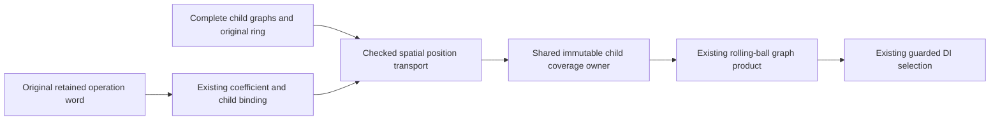

# Original spatial words over complete curve graphs

## Scope and actual route

Actual Curve3D.originalAffineWord values now consume every currently supported
finite rolling-ball child capability, including original UV auxiliaries, through
the existing exact word coefficient/source provider. The source contract is
[OriginalSourceIssuance](../../Sources/CADGeometry/OriginalSourceIssuance/DESIGN.md#spatial-operation-words-over-complete-curve-graphs).
This delivers spatial graph transport and its rolling-ball/DI consumer, not general
image/traversal/nonlinear adapters, remaining source families, M5/M6 migration or
M7/M8 completion. Whole-seven remains 1/7 (requirement 5); full87 is incomplete.

The graph issuer retains the child's field and polynomial ring. Only XYZ/D change;
support, boundary inclusion, layout, parameter transport and all guards retain their
original backing. Field selection occurs during child preparation. A separate field
argument would permit an incompatible ring authority while retaining old guards.
The new graph port therefore has no independent field argument. Every retained
support/transport/guard coefficient is validated before position composition.

The graph and existing rational-chart issuers share the exact original homogeneous
spatial composition. A whitespace-normalized comparison against main 53676553
confirms identical composition statements after passing the bound original directly
and renaming its generic field. Existing child preparation statements are likewise
unchanged after extracting same-ledger recursion and removing the new word branch.
The rational-chart issuer additionally retains the attained proof depth, including
word coefficients, rather than only its child's depth.

## Behavioral evidence

Seventeen actual original inputs cover Native, derivative curves, guide chains and
connectors, construction charts and endpoint connectors, plus Native, Coons,
boundary-correction and plane-derivative lift hosts with Native or retained pcurves.
Nonmonotone and constant pcurves are included. Direct and inverse-nested words retain
all original child ordinals, owners, T/UV, auxiliary roles, conditions and incidents.
Independent original-child XYZ plus exact translation verifies position equality;
actual numerical evaluation is checked separately.

A normalized original word retains its exact sqrt(1/2) coefficients. A Native curve
produces nonrational XY, and a lifted Coons curve retains four UV incidents while
producing nonrational XYZ. Matching fields succeed; rational and independently
constructed same-valued foreign fields fail. An adversarial internal sealed-input
fixture puts the foreign coefficient only in a guard and verifies refusal. It is
not a public unchecked certificate API.

Actual transformed rolling-ball construction uses complete eight-chart Native and
sixteen-chart mixed lifted products, with eight incidents at their common knot.
Independent XYZ, positive radial/root witnesses, wrong UV and negative-root exclusion,
strict, singleton, disconnected and complete empty requests exercise the existing DI
consumer. Existing actual Native/Coons/correction rolling-ball regression executes
128 products and sixteen incidents under unchanged limits.

Source-owner mismatch, source/chart limits and proof-depth readmission are checked.
Preparation and query work/storage succeed at exact measured ceilings and fail one
unit short. Entry, intermediate and final storage-callback cancellation prevent
publication. Input COW mutation preserves retained evidence, and returned families
remain queryable after local construction ends. Normalized graph and existing
rational-chart results fail readmission one coefficient-depth unit short. Old chart
position/support and exact work/storage/cancel behavior are exercised explicitly
through the freshly compiled CallerAdapters issuer.

## Independent assembly and limitations

The runner verifies inherited derivative-host source/compiler/product/log receipts
before and after reuse. The inherited spatial-chart source hash must match exact
main 53676553. Its current replacement and shared helper are freshly compiled;
new graph and old-chart fixtures explicitly call those fresh implementations.
Unchanged cached numerical and lower products are dependencies, not fresh evidence
for changed source. The inherited numerical traversal producer differs only by its
previously verified additive construction entry; the full exact producer is freshly
compiled with ordinary access control, as in the retained construction verification.

A preliminary Native run exposed incompatible polynomial ring ownership when only
XYZ moved to a fresh ring. Retaining the child ring fixes that production defect.
Other preliminary diagnostics corrected fixture expectations: old-chart expected
polynomials must be imported into its output ring; sixteen mixed template products
have eight applicable incidents at the selected UV knot; rational-chart proof depth
is optional and must be unwrapped. These diagnostic runs are not acceptance evidence.

No broad CADCore/CADGeometry/Kernel or L2-L6 rebuild occurs. ASAN instruments the
fresh changed-source/caller/fixture assembly, not every unchanged numerical dependency.
The fixed Swift 6.4.0 compiler and matching normal/Embedded SDK commands, immutable
artifacts, source inputs and accepted logs are bound by each lane's receipt.
Every process has a 120-second timeout. Final compile/link logs contain no warnings/errors. Runtime logs contain no
actor-isolation/race/null-call or function-signature diagnostics; Node's existing
WASI ExperimentalWarning is retained.

| Lane | Producer compile | Caller compile | Link | Runtime | Bound inputs |
|---|---:|---:|---:|---:|---:|
| Native | 0.426 s | 2.408 s | 3.194 s | 13.493 s | 2661 |
| Changed-source ASAN | 1.803 s | 5.262 s | 10.831 s | 18.340 s | 2661 |
| Normal WASM | 0.684 s | 2.430 s | 3.254 s | 17.557 s | 4495 |
| Embedded WASM | 10.934 s | 34.582 s | 40.323 s | 9.392 s | 4494 |

## Ownership and stable scoped review

| State | Native | Normal WASM | Embedded WASM |
|---|---|---|---|
| Source, word, child coverage and evidence | Immutable Sendable owners | Same | Same |
| Guard/transport/layout backing and ring | Retained child authority | Same | Same |
| Position/output arrays and scratch | Invocation-local | Same | Same |
| Admission and cancellation | Exclusive caller inout | Same | Same |
| Release | Last retained owner; acyclic child graph | Same | Same |

No shared mutable state, conditional Sendable/isolation weakening, unchecked proof
initializer, unsafe access or independent solver is introduced. New class header,
payload, graph records and position scratch are charged before allocation. Nested
preparation reuses the same concrete admission borrow. The immutable coverage owner
retains complete child backing once; every parent graph retains that owner/ordinal.

One stable scoped review inspected the original word preparation/evaluator/provider,
shared position composition, all eleven changed/new production files, child recursion,
old-chart proof depth, actual rolling-ball/DI callers, independent fixture expectations,
all four accepted logs and source/product consistency. No unresolved finding remains.
Existing source/consumer drafts and the protected publisher patch retain their
original HEAD/status/index/content hashes. Latest-main delivery is recorded below.

## Latest-main delivery

Implementation f8f6a243 is normally fast-forwarded into main from 53676553 after
independent comparison of 10,736 source/product/log/documentation premises before
and after fresh Native (12.750 s) and Embedded (9.109 s) actual caller processes.
Every runtime input and protected foreign snapshot matches without rebuilding or
source adjustment. Evidence/main-integration/integration.json owns the comparison,
commands and accepted logs. Its documentationSnapshot binds the reviewed document
at immutable implementation f8f6a243; this delivery section is post-runtime metadata.
The accompanying record commit closes the limited unit, with general M4-M8 and
whole-seven/full87 acceptance still open. Unrelated unpushed main history is retained
without automatic push.
